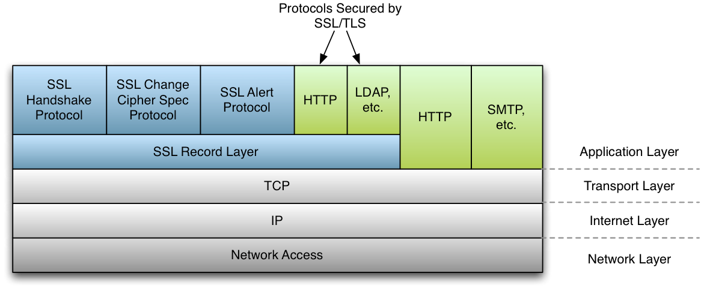
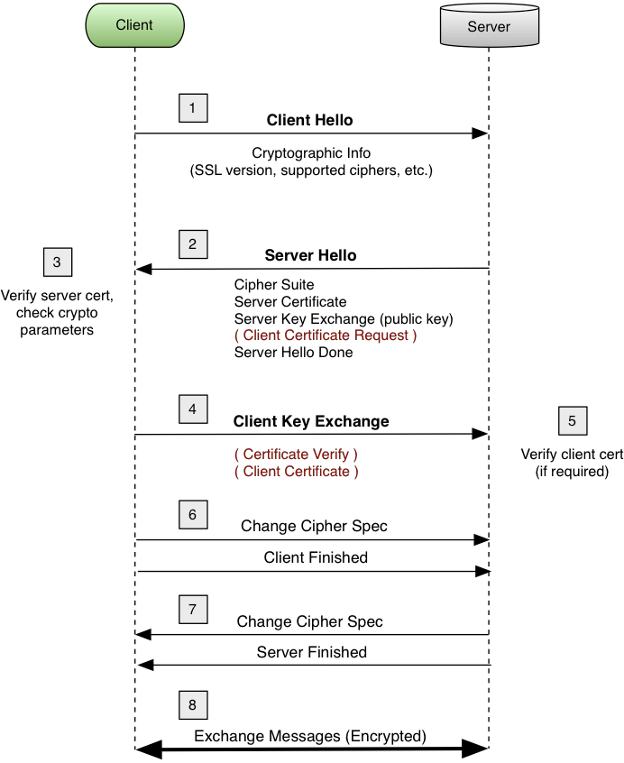

# SSL/TLSの概要

## アーキテクチャ

組み込み向けSSL/TLSライブラリであるwolfSSL(旧称：CyaSSL)は、SSL 3.0、TLS 1.0、TLS 1.1、TLS 1.2、TLS 1.3プロトコルに加えて、DTLS 1.0、DTLS 1.2、DTLS 1.3を実装しています。
TLS 1.3は、標準化されている最も安全な最新バージョンです。
SSL 3.0（RFC 7568）、TLS 1.0およびTLS 1.1（RFC 8996）は非推奨となっているため、wolfSSLはデフォルトではこれらをビルドに含めません。
これらは`--enable-sslv3`、`--enable-tlsv10`、`--enable-oldtls`で明示的に有効にした場合にのみコンパイルされます。
SSL 2.0は長年にわたり安全でないとされていることから、サポートしていません。

wolfSSLは、TLS 1.2を[RFC 5246](https://tex2e.github.io/rfc-translater/html/rfc5246)、TLS 1.3を[RFC 8446](https://tex2e.github.io/rfc-translater/html/rfc8446)で定義されている通りに実装しています。
DTLS 1.2は[RFC 6347](https://tools.ietf.org/html/rfc6347)に、DTLS 1.3は[RFC 9147](https://tools.ietf.org/html/rfc9147)に準拠しています。
TLSは階層化されたプロトコルです。
下位層はレコードプロトコルで、上位層のプロトコルのデータを断片化し、保護（暗号化と認証）して送信します。
上位層のプロトコルには、ハンドシェイクプロトコル、アラートプロトコル、ChangeCipherSpecプロトコル（TLS 1.2以前のみ）、およびアプリケーションデータがあります。
ハンドシェイクメッセージは、共通の暗号スイートのネゴシエーション、シークレットの作成、および安全な接続の有効化に使用されます。
アラートメッセージは、エラーや接続の終了を通知します。

SSLプロトコルが既存のプロトコルにどのように適合するかを、**図1**に示します。
SSLは、OSIモデルのトランスポート層とアプリケーション層の間に位置し、多くのプロトコル (TCP/IP、Bluetoothなど) がトランスポートメディアとして機能します。
HTTP、FTP、SMTPなどのアプリケーションプロトコルは、SSLの上に階層化されています。



## SSLハンドシェイク

SSLハンドシェイクプロセスの簡略を以下の**図2**に示します。
なお、SSLクライアントとサーバーの構成オプションによってはいくつかのステップは実行されません。



**図2**は、TLS 1.2以前のバージョンにおけるフルハンドシェイクを示しています。
実際のメッセージ順序では、証明書を要求されたクライアントは、ClientKeyExchangeメッセージの前にCertificateメッセージを送信し、ClientKeyExchangeメッセージの後にCertificateVerifyメッセージを送信します。

### TLS 1.3ハンドシェイク

TLS 1.3では、これとは異なる、より短いハンドシェイクを使用します。
鍵交換はHelloメッセージ（`key_share`拡張）の中で行われるため、フルハンドシェイクでは、クライアントがアプリケーションデータを送信できるようになるまでに1往復（1ラウンドトリップ）しか必要としません。
ServerKeyExchange、ServerHelloDone、ClientKeyExchangeメッセージは存在せず、ChangeCipherSpecはミドルボックス互換モードでダミーメッセージとして送信されるのみです。
また、サーバーがServerHelloの後に送信するメッセージはすべて暗号化されます。

```text
Client                                      Server

ClientHello (key_share, supported_versions)
                          -------->
                                ServerHello (key_share)
                                  {EncryptedExtensions}
                                 {CertificateRequest} *
                                          {Certificate}
                                    {CertificateVerify}
                                             {Finished}
                          <--------
{Certificate} *
{CertificateVerify} *
{Finished}
                          -------->
[Application Data]        <------->  [Application Data]

*  sent only when the server requests client authentication
{} encrypted with the handshake traffic keys
[] encrypted with the application traffic keys
```

## SSL/TLSにおける、バージョンごとの違い

SSL (Secure Sockets Layer) と TLS (Transport Layer Security) はどちらも、ネットワーク上で安全な通信を提供する暗号化プロトコルです。
これら2つのプロトコルは、今日、WebブラウジングからEメール、インスタントメッセージング、VoIPに至るまで、さまざまなアプリケーションで広く使用されています。
SSLとTLS、そしてそれぞれに含まれる各バージョン間にはいくつかの違いがあります。

以下に、SSL および TLS プロトコルの各バージョンについての解説と主な相違点を示します。
各プロトコルの具体的な詳細については、記載されているRFC仕様を参照してください。

### SSL 3.0

このプロトコルはNetscapeによって開発されたSSL 1.0から始まり、1996年にリリースされました。
バージョン1.0はリリースされておらず、バージョン2.0には多くのセキュリティ上の欠陥があり、SSL 3.0のリリースにつながりました。
SSL 2.0 に対する SSL 3.0 のいくつかの主要な改善点は次のとおりです。

* データ転送をメッセージレイヤーから分離
* Export Cipherを使用している場合でも、128ビットのキーイングマテリアルを使用
* クライアントとサーバーが証明書のチェーンを送信し、組織は2つ以上の証明書の証明書階層を使用可能に
* 一般化された鍵交換プロトコルを実装し、Diffie-HellmanとFortezzaの鍵交換と非RSA証明書を許可
* レコードの圧縮と解凍を可能に
* 2.0 クライアントが検出されたときに SSL 2.0 にフォールバック

### TLS 1.0

このプロトコルは1999年1月に[RFC 2246](https://tex2e.github.io/rfc-translater/html/rfc2246)で最初に定義されました。
これは SSL 3.0 からのアップグレードであり劇的な違いはありませんが、SSL 3.0 と TLS 1.0 は相互運用できない程度の変更を含んでいます。
SSL 3.0とTLS 1.0の間の大きな違いとして、以下が挙げられます。

* 鍵導出関数の変更
* MACの変更 - SSL 3.0は初期HMACの変更を使用し、TLS 1.0はHMACを使用します。
* 完了(Finished)メッセージの変更
* アラートの増加
* DSS/DHサポートの要求

### TLS 1.1

このプロトコルは、2006年4月にTLS 1.0の後継として[RFC 4346](https://tex2e.github.io/rfc-translater/html/rfc4346)で定義されました。
主な変更点は次のとおりです。

* 暗黙の初期化ベクトル(IV)は、暗号ブロック連鎖(CBC)攻撃から保護するために明示的なIVに置き換えられました。
* パディングエラーの取り扱いは、CBC攻撃から保護するために`decryption_failed`アラートではなく`bad_record_mac`アラートを使用するよう変更されました。
* IANAレジストリは、プロトコルパラメーター用に定義されました。
* 早期終了によってセッションが再開できなくなることがなくなりました。

### TLS 1.2

このプロトコルは、2008年8月に[RFC 5246](https://tex2e.github.io/rfc-translater/html/rfc5246)で定義されました。
TLS 1.1 をベースとして、いくつかの改善が行われました。
主な相違点は次のとおりです。

* 擬似ランダム関数(PRF)のMD5/SHA-1の組み合わせを、暗号スイート指定PRFに置き換えました。
* デジタル署名要素のMD5/SHA-1の組み合わせは、単一のハッシュに置き換えられました。署名された要素には、使用されるハッシュアルゴリズムを明示的に指定するフィールドが含まれます。
* クライアントとサーバーが受け入れるハッシュおよび署名アルゴリズムの組み合わせが整理されました。
* 追加のデータモードを使用した、認証された暗号化のためのサポートが追加されました。
* TLS拡張機能の定義とAES暗号スイートがマージされました。
* EncryptedPreMasterSecretバージョン番号が厳しくチェックされるようになりました。
* 多くの要件が厳しくなりました。
* `Verify_data`の長さは暗号スイートに依存します。
* Bleichenbacher/Klima 攻撃防御の説明が簡潔になりました。

### TLS 1.3

このプロトコルは、2018年8月に[RFC 8446](https://tex2e.github.io/rfc-translater/html/rfc8446)で定義されました。
主に、セキュリティ性能とスピードが向上しています。
主な違いは次のとおりです。

* サポートされている対称アルゴリズムのリストから、従来のアルゴリズムがすべて削除されました。残りのアルゴリズムはすべて、認証タグ付き暗号(AEAD) アルゴリズムを使用します。
* ゼロRTT (0-RTT) モードが追加され、一部のセキュリティ属性を犠牲にすることで、一部のアプリケーションデータのための接続時のラウンドトリップが削減されました。
* `ServerHello`の後のすべてのハンドシェイクメッセージが暗号化されるようになりました。
* HMACベースの抽出および拡張鍵導出機能(HKDF)がプリミティブとして使用されているため、鍵導出機能が再設計されました。
* ハンドシェイクステートマシンが再構築され、一貫性が向上し、余分なメッセージが削除されました。
* ECCは基本仕様になり、新しい署名アルゴリズムが含まれるようになりました。各曲線の単一のポイント形式を支持して、ポイント形式のネゴシエーションを削除しました。
* 圧縮、カスタムDHEグループ、およびDSAが削除されました。RSA署名はPSSパディングを使用するようになりました。
* 静的RSAおよび静的Diffie-Hellmanの暗号スイートが削除され、公開鍵ベースの鍵交換メカニズムはすべて前方秘匿性を提供するようになりました。
* TLS 1.2 バージョンネゴシエーション検証メカニズムは廃止され、拡張機能のバージョンリストが採用されました。
* サーバー側の状態の有無にかかわらず、セッションの再開と、TLSの以前のバージョンのPSKベースの暗号スイートは、単一の新しいPSK交換に置き換えられました。

### DTLS

DTLS（Datagram Transport Layer Security）は、TLSをUDPなどのデータグラムトランスポートに適応させたプロトコルです。
DTLSでは、明示的なレコードシーケンス番号とエポック、失われたハンドシェイクメッセージの再送信、およびサーバーをサービス拒否攻撃から保護するクッキー交換が追加されています。
DTLS 1.0（RFC 4347）はTLS 1.1を、DTLS 1.2（RFC 6347）はTLS 1.2を、DTLS 1.3（RFC 9147）はTLS 1.3をベースにしており、DTLS 1.1は存在しません。
wolfSSLでは、DTLSはデフォルトで無効です。
DTLS 1.2には`--enable-dtls`を、DTLS 1.3には`--enable-dtls13`を使用してください。
DTLS 1.0には`--enable-oldtls`も必要です。
