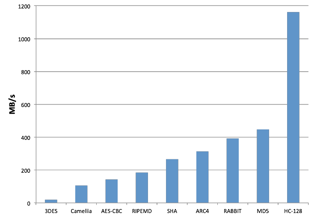

# 入門

## 概要

wolfSSL（旧称CyaSSL）は、[第2章](chapter02.md)に示したコンパイルオプションを使用した場合、OpenSSLの最大20分の1のサイズになります。
ユーザーによるベンチマークとフィードバックからも、標準的なSSL操作のほとんどにおいて、wolfSSLはOpenSSLと比較して劇的に優れたパフォーマンスを示していると報告されています。

ビルドプロセスの手順については、[第2章](chapter02.md)をご覧ください。

## テストスイート

テストスイートプログラムは、wolfSSLとその暗号化ライブラリであるwolfCryptが、システム上で正常に実行できるかをテストします。

サンプルプログラムとテストを実行する際は、wolfSSLのホームディレクトリからコマンドを投入する必要があります。
これは`./certs`から証明書と鍵を見つけるためです。
テストスイートを実行するには、次のコマンドを実行してください。

```sh
./testsuite/testsuite.test
```

autoconfを使用して、次のように実行することもできます。

```sh
make test
```

`make test`は`make check`のエイリアスです。
テストスイート、ユニットテスト（`tests/unit.test`）、およびテストスクリプトをautomakeのテストハーネス上で実行するため、コンソールには各テストのPASS/FAIL行のみが表示されます。
各テストの出力は、そのテストと同じ場所にあるログファイル（例えば`testsuite/testsuite.log`）に書き込まれます。
`testsuite.test`プログラム単体では、ユニットテストは実行されません。

\*nixまたはWindows環境においては、サンプルプログラムやテストスイートは現在のディレクトリがソースディレクトリかどうかを確認し、そうであれば、wolfSSLホームディレクトリに変更しようとします。
これはほとんどのセットアップケースで動作するはずです。
もしうまく実行できない場合には、上記の最初の方法を使用してフルパスを指定してください。

`./testsuite/testsuite.test`が正常に実行されると、次のような出力が表示されるはずです（wolfSSL 5.9.4、macOS/arm64上でデフォルトの`./configure`によりビルドした場合）。
表示されるテストの一覧は、ビルドで有効になっているアルゴリズムによって異なります。

```text
------------------------------------------------------------------------------
 wolfSSL version 5.9.4
------------------------------------------------------------------------------
macro    test passed!
error    test passed!
WCFLAGS  test passed!
MEMORY   test passed!
octets   test passed!
base64   test passed!
asn      test passed!
SHA      test passed!
SHA-224  test passed!
SHA-256  test passed!
SHA-384  test passed!
SHA-512  test passed!
SHA-512/224  test passed!
SHA-512/256  test passed!
SHA-3    test passed!
RANDOM   test passed!
RNGTHRD  test passed!
RNGSVC   test passed!
RNGEPOCH test passed!
RNGLIFE  test passed!
SHAKE128 test passed!
SHAKE256 test passed!
Hash     test passed!
HMAC-SHA test passed!
HMAC-SHA224 test passed!
HMAC-SHA256 test passed!
HMAC-SHA384 test passed!
HMAC-SHA512 test passed!
HMAC-SHA3   test passed!
HMAC-KDF    test passed!
PRF         test passed!
TLSv1.3 KDF test passed!
GMAC     test passed!
Chacha   test passed!
POLY1305 test passed!
ChaCha20-Poly1305 AEAD test passed!
AES      test passed!
AES192   test passed!
AES256   test passed!
AES-CBC  test passed!
AES-GCM  test passed!
RSA      test passed!
DH       test passed!
PWDBASED test passed!
ECC      test passed!
MLKEM    test passed!
logging  test passed!
time     test passed!
mutex    test passed!
memcb    test passed!
Test complete

Running simple test
listening on port 53227
connecting to 127.0.0.1:53227
SSL version is TLSv1.2
SSL cipher suite is TLS_ECDHE_RSA_WITH_AES_256_GCM_SHA384
SSL curve name is SECP256R1
SSL version is TLSv1.2
SSL cipher suite is TLS_ECDHE_RSA_WITH_AES_256_GCM_SHA384
SSL curve name is SECP256R1
Client message: hello wolfssl!
I hear you fa shizzle!
listening on port 53229

Running TLS test
connecting to 127.0.0.1:53229
connecting to 127.0.0.1:53229
sending server shutdown command: quit!
client sent quit command: shutting down!
ciphers = TLS13-AES128-GCM-SHA256:TLS13-AES256-GCM-SHA384:TLS13-CHACHA20-POLY1305-SHA256:DHE-RSA-AES128-SHA:DHE-RSA-AES256-SHA:ECDHE-RSA-AES128-SHA:ECDHE-RSA-AES256-SHA:ECDHE-ECDSA-AES128-SHA:ECDHE-ECDSA-AES256-SHA:DHE-RSA-AES128-SHA256:DHE-RSA-AES256-SHA256:DHE-RSA-AES128-GCM-SHA256:DHE-RSA-AES256-GCM-SHA384:ECDHE-RSA-AES128-GCM-SHA256:ECDHE-RSA-AES256-GCM-SHA384:ECDHE-ECDSA-AES128-GCM-SHA256:ECDHE-ECDSA-AES256-GCM-SHA384:ECDHE-RSA-AES128-SHA256:ECDHE-ECDSA-AES128-SHA256:ECDHE-RSA-AES256-SHA384:ECDHE-ECDSA-AES256-SHA384:ECDHE-RSA-CHACHA20-POLY1305:ECDHE-ECDSA-CHACHA20-POLY1305:DHE-RSA-CHACHA20-POLY1305:ECDHE-RSA-CHACHA20-POLY1305-OLD:ECDHE-ECDSA-CHACHA20-POLY1305-OLD:DHE-RSA-CHACHA20-POLY1305-OLD
33bc1a4570f4f1abccd5c48aace529b01a42ab51293954a297796e90d20970f0  input
33bc1a4570f4f1abccd5c48aace529b01a42ab51293954a297796e90d20970f0  /tmp/testsuite-output-4m4wH7

All tests passed!
```

これは、すべてが正しく構成およびビルドされていることを示しています。
いずれかのテストに失敗した場合は、ビルドシステムが正しく設定されていることをご確認ください。
エンディアンが間違っていたり、64ビットタイプが適切に設定されていなかったりする可能性があります。
デフォルトの構成からオプションを変更している場合は、それらを削除してwolfSSLを再ビルドし、改めてテストを実行してください。

## クライアントサンプルプログラム

`examples/client`にあるクライアントのサンプルプログラムを使用して、任意のSSL/TLSサーバーに対してwolfSSLをテストできます。
利用可能なコマンドラインオプションのリストを表示するには、`--help`を付けてクライアントを実行します。

```sh
./examples/client/client --help
```

出力例

```text
wolfSSL client 5.9.4 NOTE: All files relative to wolfSSL home dir
Max RSA key size in bits for build is set at : INFINITE
-? <num>    Help, print this usage
            0: English, 1: Japanese
--help      Help, in English
-h <host>   Host to connect to, default 127.0.0.1
-p <num>    Port to connect on, not 0, default 11111
-v <num>    SSL version [0-4], SSLv3(0) - TLS1.3(4)), default 3
-V          Prints valid ssl version numbers, SSLv3(0) - TLS1.3(4)
-l <str>    Cipher suite list (: delimited)
-c <file>   Certificate file,           default ./certs/client-cert.pem
-k <file>   Key file,                   default ./certs/client-key.pem
-A <file>   Certificate Authority file, default ./certs/ca-cert.pem
-Z <num>    Minimum DH key bits,        default 1024
-b <num>    Benchmark <num> connections and print stats
-B <num>    Benchmark throughput using <num> bytes and print stats
-d          Disable peer checks
-D          Override Date Errors example
-e          List Every cipher suite available,
-g          Send server HTTP GET
-m          Match domain name in cert
-N          Use Non-blocking sockets
-r          Resume session
-w          Wait for bidirectional shutdown
-M <prot>   Use STARTTLS, using <prot> protocol (smtp)
-f          Fewer packets/group messages
-x          Disable client cert/key loading
-X          Driven by eXternal test case
-j          Use verify callback override
-S <str>    Use Host Name Indication
-n          Disable Extended Master Secret
-H <arg>    Internal tests [defCipherList, exitWithRet, verifyFail, useSupCurve,
                            loadSSL, disallowETM]
-J          Use HelloRetryRequest to choose group for KE
-K          Key Exchange for PSK not using (EC)DHE
-I          Update keys and IVs before sending data
-y          Key Share with FFDHE named groups only
-Y          Key Share with ECC named groups only
-1 <num>    Display a result by specified language.
            0: English, 1: Japanese
-2          Disable DH Prime check
-6          Simulate WANT_WRITE errors on every other IO send
-7          Set minimum downgrade protocol version [0-4]  SSLv3(0) - TLS1.3(4)
--pqc <alg> Key Share with specified post-quantum algorithm only:
            ML_KEM_512, ML_KEM_768, ML_KEM_1024,
            SecP256r1MLKEM512,
            SecP384r1MLKEM768,
            SecP521r1MLKEM1024,
            SecP256r1MLKEM768,
            SecP521r1MLKEM1024,
            SecP384r1MLKEM1024,
            X25519MLKEM512,
            X25519MLKEM768,
            X448MLKEM768
--sys-ca-certs Load system CA certs for server cert verification
--onlyPskDheKe Must use DHE key exchange with PSK
--files-are-der Specified files are in DER, not PEM format

For simpler wolfSSL TLS client examples, visit
https://github.com/wolfSSL/wolfssl-examples/tree/master/tls
```

表示されるオプションはビルドによって異なります。
例えば、`-u`（DTLS）は、wolfSSLをDTLSサポート付きでビルドした場合にのみ表示されます。

www.google.com:443に対してテストするには、次のようにします。

```sh
./examples/client/client -h www.google.com -p 443 -d -g -S www.google.com
```

出力例（wolfSSL 5.9.4、デフォルトビルド、HTTPレスポンスは途中で省略）

```text
connecting to www.google.com:443
SSL version is TLSv1.2
SSL cipher suite is TLS_ECDHE_ECDSA_WITH_AES_128_GCM_SHA256
SSL curve name is SECP256R1
SSL connect ok, sending GET...
HTTP/1.0 200 OK
Content-Type: text/html; charset=ISO-8859-1
Date: Fri, 06 Nov 2026 09:09:56 GMT
Expires: -1
Cache-Control: private, max-age=0
...
```

これにより、クライアントはwww.google.com(`-h`)のHTTPSポート443(`-p`)に接続し、一般的なGETリクエスト(`-g`)を送信するように指示します。
(`-d`)オプションにより、クライアントにサーバー証明書の検証をスキップするよう指示しています。
また、(`-S`)オプションにより、サーバー名表示（SNI）拡張でホスト名を送信します。
ほとんどの公開サーバーではSNIが必要です。
残りは読み取りバッファに収められたサーバーからの初期出力です。
wolfSSLを`--enable-opensslextra`付きでビルドした場合、クライアントはサーバー証明書の発行者、サブジェクト、サブジェクト代替名などの詳細も出力します。

コマンドライン引数が指定されていない場合、クライアントはlocalhost上のwolfSSLデフォルトポート11111に接続を試みます。
また、サーバーがクライアント認証を実行したい場合を想定しクライアント証明書も読み込みます。

クライアントは引数`-b <num>`を使用して接続のベンチマークを実行できます。
このオプションを使用すると、クライアントは指定されたサーバー/ポートへの接続を引数として渡された回数だけ試行し、`SSL_connect()`の実行にかかった平均時間をミリ秒単位で表示します。
例えば、以下のように実行します。

```sh
./examples/client/client -b 100 -h www.google.com -p 443 -d -S www.google.com
```

出力例

```text
connecting to www.google.com:443
wolfSSL_connect avg took:   41.054 milliseconds
```

`wolfssl/test.h`を編集することで、デフォルトのホストやポートをlocalhost・11111から任意の値に変更できます。
変数wolfSSLIP / wolfSSLPortを編集してください。
なお、これらの設定を変更した場合は、testsuiteを含むすべてのサンプルプログラムを再ビルドする必要があります。
そうしないと、テストプログラムは互いに接続できません。

デフォルトでは、クライアントサンプルプログラムはTLS 1.2を使用して指定されたサーバーに接続しようとします。
ユーザーは`-v`コマンドラインオプションを使用して、クライアントが使用するSSL/TLSバージョンを変更できます。
このオプションでは、以下の値を指定できます。

* `-v 0` - SSL 3.0（デフォルトでは無効、`--enable-sslv3`が必要）
* `-v 1` - TLS 1.0（デフォルトでは無効、`--enable-tlsv10`が必要）
* `-v 2` - TLS 1.1（デフォルトでは無効、`--enable-oldtls`が必要）
* `-v 3` - TLS 1.2（デフォルトで選択）
* `-v 4` - TLS 1.3

クライアントサンプルプログラムを実行する際によく見られるエラーとして、次のような`-188`エラーがあります。

```text
wolfSSL_connect error -188, ASN no signer error to confirm failure
wolfSSL error, examples/client/client.c L 4422: wolfSSL_connect failed
```

これは通常、wolfSSLクライアントが接続先のサーバー証明書を検証できないことが原因です。
デフォルトでは、wolfSSLクライアントはwolfSSLのテスト用CA証明書（`./certs/ca-cert.pem`）を信頼されたルート証明書として読み込みます。
これはテスト用のCA証明書であり、別のCAによって署名された外部のサーバー証明書を検証することはできません。
そのため、この問題を解決するには、ユーザーは`-d`オプションを使用してサーバーの検証をオフにするか、

```sh
./examples/client/client -h myhost.com -p 443 -d -S myhost.com
```

`-A`コマンドラインオプションを使用して、正しいCA証明書をwolfSSLクライアントに読み込ませる必要があります。

```sh
./examples/client/client -h myhost.com -p 443 -A serverCA.pem -S myhost.com
```

または、`--sys-ca-certs`オプションを使用して、オペレーティングシステムのトラストストアにあるCA証明書を読み込むこともできます。

## サーバーサンプルプログラム

サーバーサンプルプログラムは、クライアント認証も実行可能なシンプルなSSL/TLSサーバーです。
1つのクライアント接続のみが受け入れられ、その後サーバーは終了します。
デフォルトでは、サーバーはクライアント証明書を要求し、クライアントは`./certs/client-cert.pem`を読み込みます。
そのため、他のコマンドライン引数の有無にかかわらず、クライアントサンプルプログラムはサーバーサンプルプログラムに対して接続できます。
クライアントを`-x`付きで実行した場合（PSKをサポートするビルドでPSKを使用する`-s`付きで実行した場合も同様）、クライアント証明書が送信されないため、[`wolfSSL_connect()`](group__IO.md#function-wolfssl_connect)が失敗し、サーバーは「-345, peer did not return a certificate」というエラーを出力します。
このような接続を許可するには、`-d`オプションを付けてサーバーを起動し、クライアント証明書チェックを無効にしてください。
サンプルプログラムのクライアントと同様に、サーバーもいくつかのコマンドライン引数で使用できます。

```sh
./examples/server/server --help
```

出力例

```text
server 5.9.4 NOTE: All files relative to wolfSSL home dir
-? <num>    Help, print this usage
            0: English, 1: Japanese
--help      Help, in English
-p <num>    Port to listen on, not 0, default 11111
-v <num>    SSL version [0-4], SSLv3(0) - TLS1.3(4)), default 3
-l <str>    Cipher suite list (: delimited)
-c <file>   Certificate file,           default ./certs/server-cert.pem
-k <file>   Key file,                   default ./certs/server-key.pem
-A <file>   Certificate Authority file, default ./certs/client-cert.pem
-R <file>   Create Ready file for external monitor default none
-D <file>   Diffie-Hellman Params file, default ./certs/dh2048.pem
-Z <num>    Minimum DH key bits,        default 1024
-d          Disable client cert check
-b          Bind to any interface instead of localhost only
-s          Use pre Shared keys
-u          Use UDP DTLS, add -v 2 for DTLSv1, -v 3 for DTLSv1.2 (default)
-f          Fewer packets/group messages
-r          Allow one client Resumption
-N          Use Non-blocking sockets
-S <str>    Use Host Name Indication
-w          Wait for bidirectional shutdown
-x          Print server errors but do not close connection
-i          Loop indefinitely (allow repeated connections)
-e          Echo data mode (return raw bytes received)
-B <num>    Benchmark throughput using <num> bytes and print stats
-g          Return basic HTML web page
-C <num>    The number of connections to accept, default: 1
-H <arg>    Internal tests [defCipherList, exitWithRet, verifyFail, useSupCurve,
                            loadSSL, disallowETM]
-U          Update keys and IVs before sending
-K          Key Exchange for PSK not using (EC)DHE
-y          Pre-generate Key Share using FFDHE_2048 only
-Y          Pre-generate Key Share using P-256 only
-F          Send alert if no mutual authentication
-2          Disable DH Prime check
-1 <num>    Display a result by specified language.
            0: English, 1: Japanese
-6          Simulate WANT_WRITE errors on every other IO send
-7          Set minimum downgrade protocol version [0-4]  SSLv3(0) - TLS1.3(4)
--pqc <alg> Key Share with specified post-quantum algorithm only:
            ML_KEM_512, ML_KEM_768, ML_KEM_1024,
            SecP256r1MLKEM512,
            SecP384r1MLKEM768,
            SecP521r1MLKEM1024,
            SecP256r1MLKEM768,
            SecP521r1MLKEM1024,
            SecP384r1MLKEM1024,
            X25519MLKEM512,
            X25519MLKEM768,
            X448MLKEM768
--force-curve [<curve>] Pre-generate a Key Share using <curve>.
                        Leave <curve> blank to list all curves.
                        Note: requires TLS1.3
--onlyPskDheKe Must use DHE key exchange with PSK

For simpler wolfSSL TLS server examples, visit
https://github.com/wolfSSL/wolfssl-examples/tree/master/tls
```

## エコーサーバーのサンプルプログラム

エコーサーバーのサンプルプログラムは、無限ループで無制限のクライアント接続を待ち続けます。
そしてクライアントが送信したものをすべてエコーバックします。
クライアント認証は実行されません。
したがって、クライアントサンプルプログラムは3つのモードすべてでエコーサーバーに接続できます。
なお、以下に示す4つの特別なコマンドはエコーバックされず、エコーサーバーに異なる処理を実行するよう指示します。

1. `quit` - エコーサーバーが文字列「quit」を受信すると、シャットダウンします。
2. `break` - エコーサーバーが文字列「break」を受信すると、現在のセッションを停止しますが、リクエストの処理は継続します。これはDTLSテストに特に役立ちます。
3. `printstats` - エコーサーバーが文字列「printstats」を受信すると、セッションキャッシュの統計情報を出力します。このコマンドは、wolfSSLを`PRINT_SESSION_STATS`付きでビルドした場合にのみ使用できます。
4. `GET` - エコーサーバーが文字列「GET」を受信すると、HTTPのGETとして処理し、「greetings from wolfSSL」というメッセージを含む簡単なページを送り返します。これにより、Safari、IE、Firefox、GnuTLSといったさまざまなTLS/SSLクライアントのテストが可能になります。

`NO_MAIN_DRIVER`が定義されていない限り、エコーサーバーの出力は標準出力にエコーされます。
シェルを通して、または1番目のコマンドライン引数を使用して出力をリダイレクトすることもできます。
エコーサーバーからの出力を`output.txt`という名前のファイルに保存したい場合には、次のように実行します。

```sh
./examples/echoserver/echoserver output.txt
```

## エコークライアントのサンプルプログラム

エコークライアントのサンプルプログラムは、インタラクティブモードまたはファイルによるバッチモードで実行できます。
インタラクティブモードで実行し、3つの文字列「hello」、「wolfssl」、および「quit」を書き込むと、結果は以下のようになります。

```text
./examples/echoclient/echoclient
hello
hello
wolfssl
wolfssl
quit
sending server shutdown command: quit!
```

ファイル入力を使用するには、コマンドライン上で最初の引数としてファイル名を指定します。
ファイル`input.txt`の内容をエコーするには、以下のように実行します。

```sh
./examples/echoclient/echoclient input.txt
```

結果をファイルに書き出したい場合は、追加のコマンドライン引数として出力ファイル名を指定できます。
ファイル`input.txt`の内容をエコーし、サーバーからの結果を`output.txt`に書き込むには、次のように実行します。

```sh
./examples/echoclient/echoclient input.txt output.txt
```

テストスイートプログラムではこの動作を行いますが、クライアントとサーバーが期待される結果を正しく送信/受信できていることを確認するため、入力・出力ファイルをハッシュ化しています。

## ベンチマーク

組み込み向けSSL/TLSライブラリwolfSSLが、使用を検討しているハードウェアデバイスや特定の環境で、果たしてどれほどのパフォーマンスを発揮できるのかは非常に気になるものです。
しかし、今日の組み込み / エンタープライズ / クラウド環境では、非常に多数のプラットフォーム・コンパイラが使用されています。
これらの全てに対応できる、一般的なパフォーマンス指標の算出式を提供することは非常に困難です。

そこで、ユーザーがwolfSSL / wolfCryptのパフォーマンスを容易に判断できるように、ベンチマークアプリケーションをバンドルしています。
wolfSSLは、デフォルトですべての暗号操作にwolfCrypt暗号ライブラリを使用します。
基盤となる暗号処理はSSL/TLSのパフォーマンスを大きく左右するため、ベンチマークアプリケーションはwolfCryptのアルゴリズムのパフォーマンステストを実行します。

wolfcrypt/benchmark（`./wolfcrypt/benchmark/benchmark`）にあるベンチマークユーティリティを使用して、wolfCryptの暗号処理のベンチマークを実行できます。
典型的な出力は以下のようになります（wolfSSL 5.9.4、macOS 27.2が動作するApple M5上でデフォルトの`./configure`によりビルドした場合）。
表示されるアルゴリズムはビルドオプションによって異なります。

```sh
./wolfcrypt/benchmark/benchmark
```

```text
------------------------------------------------------------------------------
 wolfSSL version 5.9.4
------------------------------------------------------------------------------
Clock frequency: 1000000000 Hz
Math:   Multi-Precision: Wolf(SP) no-dyn-stack word-size=64 bits=4096 sp_int.c
wolfCrypt Benchmark (block bytes 1048576, min 1.0 sec each)
RNG SHA-256 DRBG           185 MiB took 1.003 seconds,  184.426 MiB/s Cycles per byte =   5.17
RNG SHA-512 DRBG           365 MiB took 1.011 seconds,  360.988 MiB/s Cycles per byte =   2.64
AES-128-CBC-enc            410 MiB took 1.002 seconds,  409.322 MiB/s Cycles per byte =   2.33
AES-128-CBC-dec            555 MiB took 1.002 seconds,  553.772 MiB/s Cycles per byte =   1.72
AES-192-CBC-enc            350 MiB took 1.009 seconds,  346.999 MiB/s Cycles per byte =   2.75
AES-192-CBC-dec            445 MiB took 1.000 seconds,  444.947 MiB/s Cycles per byte =   2.14
AES-256-CBC-enc            305 MiB took 1.012 seconds,  301.402 MiB/s Cycles per byte =   3.16
AES-256-CBC-dec            375 MiB took 1.009 seconds,  371.520 MiB/s Cycles per byte =   2.57
AES-128-GCM-enc            250 MiB took 1.017 seconds,  245.809 MiB/s Cycles per byte =   3.88
AES-128-GCM-dec            165 MiB took 1.022 seconds,  161.425 MiB/s Cycles per byte =   5.91
AES-192-GCM-enc            225 MiB took 1.022 seconds,  220.209 MiB/s Cycles per byte =   4.33
AES-192-GCM-dec            155 MiB took 1.030 seconds,  150.413 MiB/s Cycles per byte =   6.34
AES-256-GCM-enc            205 MiB took 1.010 seconds,  203.043 MiB/s Cycles per byte =   4.70
AES-256-GCM-dec            140 MiB took 1.006 seconds,  139.127 MiB/s Cycles per byte =   6.85
GMAC Table 4-bit           650 MiB took 1.004 seconds,  647.435 MiB/s Cycles per byte =   1.47
CHACHA                     920 MiB took 1.002 seconds,  918.530 MiB/s Cycles per byte =   1.04
CHA-POLY-enc               715 MiB took 1.005 seconds,  711.090 MiB/s Cycles per byte =   1.34
CHA-POLY-dec               715 MiB took 1.001 seconds,  714.528 MiB/s Cycles per byte =   1.33
CHA-POLY-ex-enc            715 MiB took 1.006 seconds,  710.450 MiB/s Cycles per byte =   1.34
CHA-POLY-ex-dec            715 MiB took 1.004 seconds,  711.842 MiB/s Cycles per byte =   1.34
CHA-POLY-stream            710 MiB took 1.004 seconds,  707.218 MiB/s Cycles per byte =   1.35
POLY1305                  3140 MiB took 1.001 seconds, 3136.763 MiB/s Cycles per byte =   0.30
SHA                       1020 MiB took 1.000 seconds, 1019.620 MiB/s Cycles per byte =   0.94
SHA-224                    420 MiB took 1.011 seconds,  415.574 MiB/s Cycles per byte =   2.29
SHA-256                    425 MiB took 1.001 seconds,  424.512 MiB/s Cycles per byte =   2.25
SHA-384                    815 MiB took 1.004 seconds,  811.742 MiB/s Cycles per byte =   1.17
SHA-512                    810 MiB took 1.001 seconds,  809.112 MiB/s Cycles per byte =   1.18
SHA-512/224                810 MiB took 1.001 seconds,  808.822 MiB/s Cycles per byte =   1.18
SHA-512/256                820 MiB took 1.002 seconds,  818.167 MiB/s Cycles per byte =   1.17
SHA3-224                   800 MiB took 1.006 seconds,  795.431 MiB/s Cycles per byte =   1.20
SHA3-256                   740 MiB took 1.006 seconds,  735.729 MiB/s Cycles per byte =   1.30
SHA3-384                   545 MiB took 1.000 seconds,  544.920 MiB/s Cycles per byte =   1.75
SHA3-512                   400 MiB took 1.007 seconds,  397.202 MiB/s Cycles per byte =   2.40
SHAKE128                   920 MiB took 1.002 seconds,  918.619 MiB/s Cycles per byte =   1.04
SHAKE256                   725 MiB took 1.004 seconds,  722.403 MiB/s Cycles per byte =   1.32
HMAC-SHA                  1005 MiB took 1.004 seconds, 1000.948 MiB/s Cycles per byte =   0.95
HMAC-SHA224                445 MiB took 1.005 seconds,  442.654 MiB/s Cycles per byte =   2.15
HMAC-SHA256                435 MiB took 1.000 seconds,  434.933 MiB/s Cycles per byte =   2.19
HMAC-SHA384                805 MiB took 1.002 seconds,  803.179 MiB/s Cycles per byte =   1.19
HMAC-SHA512                835 MiB took 1.005 seconds,  831.031 MiB/s Cycles per byte =   1.15
HMAC-SHA3-256              745 MiB took 1.005 seconds,  741.425 MiB/s Cycles per byte =   1.29
HMAC-SHA3-384              565 MiB took 1.007 seconds,  561.258 MiB/s Cycles per byte =   1.70
HMAC-SHA3-512              400 MiB took 1.003 seconds,  398.649 MiB/s Cycles per byte =   2.39
PBKDF2                      52 KiB took 1.000 seconds,   52.168 KiB/s Cycles per byte = 18719.41
RSA     2048   public     45000 ops took 1.002 sec, avg 0.022 ms, 44918.330 ops/sec, 1001813204 cycles    22262.5 Cycles/op
RSA     2048  private       900 ops took 1.104 sec, avg 1.226 ms,   815.405 ops/sec, 1103740290 cycles  1226378.1 Cycles/op
DH      2048  key gen      4029 ops took 1.000 sec, avg 0.248 ms,  4028.818 ops/sec, 1000040018 cycles   248210.5 Cycles/op
DH      2048    agree      2000 ops took 1.044 sec, avg 0.522 ms,  1915.270 ops/sec, 1044233571 cycles   522116.8 Cycles/op
ML-KEM 512    128  key gen    194800 ops took 1.000 sec, avg 0.005 ms, 194760.624 ops/sec, 1000196207 cycles     5134.5 Cycles/op
ML-KEM 512    128    encap    171800 ops took 1.000 sec, avg 0.006 ms, 171751.394 ops/sec, 1000278450 cycles     5822.3 Cycles/op
ML-KEM 512    128    decap    128500 ops took 1.001 sec, avg 0.008 ms, 128431.043 ops/sec, 1000531132 cycles     7786.2 Cycles/op
ML-KEM 768    192  key gen    116100 ops took 1.000 sec, avg 0.009 ms, 116053.350 ops/sec, 1000397186 cycles     8616.7 Cycles/op
ML-KEM 768    192    encap    103000 ops took 1.000 sec, avg 0.010 ms, 102998.330 ops/sec, 1000011518 cycles     9708.8 Cycles/op
ML-KEM 768    192    decap     79800 ops took 1.001 sec, avg 0.013 ms, 79713.906 ops/sec, 1001074199 cycles    12544.8 Cycles/op
ML-KEM 1024   256  key gen     69600 ops took 1.001 sec, avg 0.014 ms, 69559.733 ops/sec, 1000573649 cycles    14376.1 Cycles/op
ML-KEM 1024   256    encap     62800 ops took 1.000 sec, avg 0.016 ms, 62785.555 ops/sec, 1000225082 cycles    15927.2 Cycles/op
ML-KEM 1024   256    decap     51000 ops took 1.001 sec, avg 0.020 ms, 50931.186 ops/sec, 1001346399 cycles    19634.2 Cycles/op
ECC   [      SECP256R1]   256  key gen      4900 ops took 1.018 sec, avg 0.208 ms,  4813.075 ops/sec, 1018054865 cycles   207766.3 Cycles/op
ECDHE [      SECP256R1]   256    agree      4900 ops took 1.019 sec, avg 0.208 ms,  4807.188 ops/sec, 1019301669 cycles   208020.7 Cycles/op
ECDSA [      SECP256R1]   256     sign      4700 ops took 1.006 sec, avg 0.214 ms,  4671.788 ops/sec, 1006034629 cycles   214049.9 Cycles/op
ECDSA [      SECP256R1]   256   verify      7100 ops took 1.003 sec, avg 0.141 ms,  7077.105 ops/sec, 1003229363 cycles   141299.9 Cycles/op
RNG      256 SHA256 Init/Free  68425 ops took 1.000 sec, avg 0.015 ms, 68424.527 ops/sec, 1000002084 cycles    14614.6 Cycles/op
RNG      512 SHA512 Init/Free  86827 ops took 1.000 sec, avg 0.012 ms, 86826.752 ops/sec, 999998750 cycles    11517.1 Cycles/op
Benchmark complete
```

これは、数学ライブラリを変更する前後で公開鍵演算の速度を比較するのに特に役立ちます。
「Math:」行には、ビルドで使用されている数学ライブラリが表示されます。
デフォルトのSP数学ライブラリ（`./configure`、`sp_int.c`を使用）、一般的な鍵サイズと曲線向けに最適化されたSPコード（`./configure --enable-sp --enable-sp-asm`）、そして必要に応じてレガシーのfastmathライブラリ（`./configure --enable-fastmath`）の結果を比較できます。

詳細とベンチマーク結果については、wolfSSLベンチマークページ（<https://www.wolfssl.com/docs/benchmarks>）を参照してください。

### 相対パフォーマンス

個々の暗号やアルゴリズムのパフォーマンスはホストプラットフォームによって異なりますが、wolfCryptの暗号間の相対的なパフォーマンスを以下のグラフに示します。
これは初期のwolfSSLリリースにおいて、2.2 GHz Intel Core i7を搭載したMacbook Pro（OS X 10.6.8）で測定した過去のグラフであり、SHA-3やML-KEMなどの新しいアルゴリズムは含まれていません。
最新の結果については、wolfSSLベンチマークページ（<https://www.wolfssl.com/docs/benchmarks>）を参照してください。



暗号のサブセットのみを使用したい場合は、SSL/TLS接続を行う際にwolfSSLが使用する特定の暗号スイートやCipherをカスタマイズできます。
例えばTLS 1.2で128ビットAESを強制するには、[`wolfSSL_CTX_new(SSL_CTX_new)`](group__Setup.md#function-wolfssl_ctx_new)の呼び出しの後に、次の行を追加します。

```c
wolfSSL_CTX_set_cipher_list(ctx, "ECDHE-RSA-AES128-GCM-SHA256");
```

TLS 1.3の場合は、代わりにTLS 1.3の暗号スイート名（例えば`"TLS13-AES128-GCM-SHA256"`）を使用してください。
`AES128-SHA`などの静的RSA鍵交換を使用する暗号スイートは、wolfSSLを`WOLFSSL_STATIC_RSA`付きでビルドした場合にのみ使用できます。

### ベンチマークに関する補足

1. プロセッサのネイティブレジスタサイズ（32ビット対64ビット）は、1000ビット以上の公開鍵操作を行う際、大きな違いをもたらす可能性があります。
2. **keygen**（`--enable-keygen`）により、ベンチマークユーティリティを実行する際、RSA鍵生成速度もベンチマークすることができます。ECC、DH、ML-KEMの鍵生成は、このオプションなしでもベンチマークされます。
3. **fastmath**（`--enable-fastmath`）はレガシーの数学ライブラリであり、デフォルトのSP数学ライブラリの使用を推奨します。項目3から5は、fastmathを使用するビルドにのみ当てはまります。fastmathは動的メモリ使用量を削減し、公開鍵操作を高速化します。32ビットプラットフォームでfastmathを使用してビルドする際に問題がある場合は、PICがレジスタを占有しないように共有ライブラリを無効にしてください。このとき、READMEの注意事項も併せてご参照ください。

    ```sh
    ./configure --enable-fastmath --disable-shared
    make clean
    make
    ```

    **注意**：wolfSSLで構成オプションを切り替える際には、`make clean`を実行することを推奨しています。
4. デフォルトでは、fastmathは可能であればアセンブリ最適化を使用しようとします。アセンブリ最適化が機能しない場合でも、wolfSSLをビルドする際に`CFLAGS`に`TFM_NO_ASM`を追加することで、アセンブリ最適化なしでfastmathを使用できます。

    ```sh
    ./configure --enable-fastmath CFLAGS="-DTFM_NO_ASM"
    ```

5. fasthugemathを使用すると、組み込みプラットフォームで実行していないユーザー向けにfastmathをさらに強化できます。

    ```sh
    ./configure --enable-fasthugemath
    ```

6. デフォルトのwolfSSLビルドでは、メモリ使用量とパフォーマンスのバランスを取るよう努めています。どちらかをより重視する場合は、追加のwolfSSL構成オプションについて[第2章 wolfSSLのビルド](chapter02.md)の「ビルドオプション」節を参照してください。
7. **バルク転送**：デフォルトでは、メモリ使用量を抑えるため、wolfSSLのI/Oバッファの静的部分にはレコードヘッダーのみが格納され、より大きなレコード用のバッファは必要に応じて動的に確保されます。`LARGE_STATIC_BUFFERS`を定義すると、静的バッファが16 KBの完全なレコード（TLSの最大レコードサイズ）を格納できる大きさになるため、バルク転送が必要な場合に役立ちます。

### 組み込みシステムでのベンチマーク

組み込みシステム上で容易にベンチマークアプリケーションをビルドできるように、複数のビルドオプションがあります。
主なものは以下のとおりです。

#### BENCH_EMBEDDED

この定義を有効にすると、ベンチマークアプリケーションはメガバイト単位からキロバイト単位に切り替わり、メモリ使用量が削減されます。
この定義を使用した場合、デフォルトでは、暗号処理と各アルゴリズムは1 KiBのブロック25個（`NUM_BLOCKS`と`BENCH_SIZE`）でベンチマークを実行します。
また、一部の組み込みプロセッサでは公開鍵操作に非常に長い時間を要するため、公開鍵操作は`BENCH_NTIMES`回、鍵合意は`BENCH_AGREETIMES`回を1バッチとして実行され、どちらもデフォルトでは100回ではなく2回になります。
それでも、各アルゴリズムは最低1秒間（`BENCH_MIN_RUNTIME_SEC`）実行されます。
これらの値はビルド時に上書きできます（例えば`-DBENCH_NTIMES=1`）。
また、ブロックサイズとブロック数は、ベンチマークのコマンドラインオプション`<num>`と`-blocks <num>`で実行時にも設定できるため、`benchmark.c`を編集する必要はありません。

#### USE_CERT_BUFFERS_1024

この定義を有効にすると、ベンチマークアプリケーションはファイルシステムからテスト鍵と証明書を読み込む代わりに、`<wolfssl_root>/wolfssl/certs_test.h`にある1024ビットの鍵と証明書バッファを使用します。
これは組み込みプラットフォームにファイルシステムがなく（[`NO_FILESYSTEM`](chapter02.md#no_filesystem)と併用）、2048ビット公開鍵操作が現実的でないほど遅いプロセッサの場合に役立ちます。

#### USE_CERT_BUFFERS_2048

[`USE_CERT_BUFFERS_1024`](#use_cert_buffers_1024)と似ていますが、1024ビットの代わりに2048ビットの鍵と証明書バッファを使用します。
プロセッサが2048ビット公開鍵操作を行うのに十分な速度を持っているものの、ファイルシステムがなくファイルから鍵と証明書を読み込むことが難しいケースに役立ちます。

## クライアントアプリケーションでwolfSSLを使用する

この節では、wolfSSLネイティブAPIを使用して、クライアントアプリケーションにwolfSSLを追加するための基本的な手順について説明します。
サーバーの説明については、本章の「サーバーアプリケーションでwolfSSLを使用する」節をご参照ください。
より詳しい手順とサンプルコードは[第11章 SSL/TLSチュートリアル](chapter11.md)に掲載しています。
OpenSSL互換性レイヤーの詳細については、[第13章 OpenSSL互換性](chapter13.md)を参照してください。

1. wolfSSLヘッダーをインクルードします。アプリケーションとライブラリの間で構成（例えば構造体のレイアウト）を一致させるため、ビルド設定ヘッダーは他のどのwolfSSLヘッダーよりも前にインクルードする必要があります。`./configure`でビルドしたライブラリの場合は、`wolfssl/options.h`をインクルードします。

    ```c
    #include <wolfssl/options.h>
    #include <wolfssl/ssl.h>
    ```

    `user_settings.h`を使用するビルドの場合は、アプリケーション側でも`WOLFSSL_USER_SETTINGS`を定義してください。これにより、wolfSSLヘッダーが`user_settings.h`をインクルードします。あるいは、アプリケーションのコンパイル時に`WOLFSSL_USE_OPTIONS_H`を定義すると、`wolfssl/options.h`が自動的にインクルードされます。

2. wolfSSLと`WOLFSSL_CTX`を初期化します。最終的に作成する`WOLFSSL`オブジェクトの数に関係なく、1つの`WOLFSSL_CTX`を使用できます。基本的には、接続先のサーバーを検証するためにCA証明書を読み込むだけで済みます。`wolfTLS_client_method()`（または同等の[`wolfSSLv23_client_method()`](group__Setup.md#function-wolfsslv23_client_method)）は、双方がサポートする最も高いプロトコルバージョンをネゴシエートします。1つのバージョンのみを許可するには、`wolfTLSv1_3_client_method()`または`wolfTLSv1_2_client_method()`を使用してください。基本的な初期化手順は次のようになります。

    ```c
    wolfSSL_Init();
    WOLFSSL_CTX* ctx;
    if ((ctx = wolfSSL_CTX_new(wolfTLS_client_method())) == NULL)
    {
        fprintf(stderr, "wolfSSL_CTX_new error.\n");
        exit(EXIT_FAILURE);
    }
    if (wolfSSL_CTX_load_verify_locations(ctx,"./ca-cert.pem",0) != SSL_SUCCESS) {
        fprintf(stderr, "Error loading ./ca-cert.pem,"
                        " please check the file.\n");
        exit(EXIT_FAILURE);
    }
    ```

3. TCP接続ごとに`WOLFSSL`オブジェクトを作成し、ファイルディスクリプタをセッションに関連付けます。

    ```c
    /*after connecting to socket fd*/
    WOLFSSL* ssl;
    if ((ssl = wolfSSL_new(ctx)) == NULL) {
        fprintf(stderr, "wolfSSL_new error.\n");
        exit(EXIT_FAILURE);
    }
    wolfSSL_set_fd(ssl, fd);
    ```

4. すべての`read()`（または`recv()`）の呼び出しを[`wolfSSL_read()`](group__IO.md#function-wolfssl_read)に変更します。例えば以下の場合、

    ```c
    result = read(fd, buffer, bytes);
    ```

    次のように変更します。

    ```c
    result = wolfSSL_read(ssl, buffer, bytes);
    ```

5. すべての`write()`（または`send()`）の呼び出しを[`wolfSSL_write()`](group__IO.md#function-wolfssl_write)に変更します。例えば以下の場合、

    ```c
    result = write(fd, buffer, bytes);
    ```

    次のように変更します。

    ```c
    result = wolfSSL_write(ssl, buffer, bytes);
    ```

6. [`wolfSSL_connect()`](group__IO.md#function-wolfssl_connect)を手動で呼び出すこともできますが、必ずしも必要ではありません。最初の[`wolfSSL_read()`](group__IO.md#function-wolfssl_read)または[`wolfSSL_write()`](group__IO.md#function-wolfssl_write)の呼び出し時に、まだ実行されていなければ[`wolfSSL_connect()`](group__IO.md#function-wolfssl_connect)が開始されます。
7. エラーチェックは以下のように実装します。それぞれの[`wolfSSL_read()`](group__IO.md#function-wolfssl_read)と[`wolfSSL_write()`](group__IO.md#function-wolfssl_write)呼び出しは、成功時には読み取りまたは書き込みしたバイト数を返し、接続終了時には0を、エラー時には-1を返します。これは`read()`と`write()`と同様です。エラーが発生した場合、次の2つの関数を使用して詳しい情報を入手できます。

    ```c
    char errorString[WOLFSSL_MAX_ERROR_SZ];
    int err = wolfSSL_get_error(ssl, 0);
    wolfSSL_ERR_error_string(err, errorString);
    ```

    ノンブロッキングソケットを使用している場合は、errno `EAGAIN`/`EWOULDBLOCK`をテストするか、より正確には[`wolfSSL_get_error()`](group__Debug.md#function-wolfssl_get_error)が返す特定のエラーコードが`SSL_ERROR_WANT_READ`または`SSL_ERROR_WANT_WRITE`であるかをテストできます。
8. クリーンアップは次のように実装します。各`WOLFSSL`オブジェクトの使用が終了したら、[`wolfSSL_shutdown()`](group__TLS.md#function-wolfssl_shutdown)を呼び出してピアにclose_notifyアラートを送信し、その後、以下を呼び出してオブジェクトを解放してください。

    ```c
    wolfSSL_shutdown(ssl);
    wolfSSL_free(ssl);
    ```

    SSL/TLSの使用が完全に終了したら、以下を呼び出して`WOLFSSL_CTX`オブジェクトを解放してください。

    ```c
    wolfSSL_CTX_free(ctx);
    wolfSSL_Cleanup();
    ```

    wolfSSLを使用したクライアントアプリケーションのサンプルプログラムについては、`<wolfssl_root>/examples/client/client.c`をご参照ください。

## サーバーアプリケーションでwolfSSLを使用する

この節では、wolfSSLネイティブAPIを使用してサーバーアプリケーションにwolfSSLを追加するための基本的な手順について説明します。
クライアントの説明については、本章の「クライアントアプリケーションでwolfSSLを使用する」節を参照してください。
より詳しい手順とサンプルコードは[第11章 SSL/TLSチュートリアル](chapter11.md)に掲載しています。

1. 概ね上記のクライアントの手順と同様です。ただし、ステップ2のクライアントメソッド呼び出しをサーバーのものに変更します。例えば以下の行を、

    ```c
    wolfSSL_CTX_new(wolfTLS_client_method());
    ```

    次のように変更します。

    ```c
    wolfSSL_CTX_new(wolfTLS_server_method());
    ```

    または、同等の以下の呼び出しを使用します。

    ```c
    wolfSSL_CTX_new(wolfSSLv23_server_method());
    ```

    バージョンを限定しないサーバーメソッドは、TLS 1.3までのバージョンをネゴシエートします。デフォルトビルドではTLS 1.2とTLS 1.3のクライアントを受け入れ、それより古いプロトコルバージョンは、wolfSSLのビルド時に有効にした場合にのみ受け入れます。1つのバージョンのみを受け入れるには、`wolfTLSv1_3_server_method()`などのバージョン固有のメソッドを使用してください。
2. 上記のステップ2の初期化に、サーバーの証明書と鍵ファイルを追加します。

    ```c
    if (wolfSSL_CTX_use_certificate_file(ctx,"./server-cert.pem", SSL_FILETYPE_PEM) != SSL_SUCCESS) {
        fprintf(stderr, "Error loading ./server-cert.pem,"
                        " please check the file.\n");
        exit(EXIT_FAILURE);
    }
    if (wolfSSL_CTX_use_PrivateKey_file(ctx,"./server-key.pem", SSL_FILETYPE_PEM) != SSL_SUCCESS) {
        fprintf(stderr, "Error loading ./server-key.pem,"
                        " please check the file.\n");
        exit(EXIT_FAILURE);
    }
    ```

ファイルシステムが利用できない場合は、バッファから証明書と鍵を読み込むこともできます。
詳しい情報は[`wolfSSL_CTX_use_certificate_buffer()`](group__CertsKeys.md#function-wolfssl_ctx_use_certificate_buffer)と[`wolfSSL_CTX_use_PrivateKey_buffer()`](group__CertsKeys.md#function-wolfssl_ctx_use_privatekey_buffer)のAPIドキュメントをご参照ください。

wolfSSLを使用したサーバーアプリケーションのサンプルプログラムは、`<wolfssl_root>/examples/server/server.c`ファイルを参照してください。
