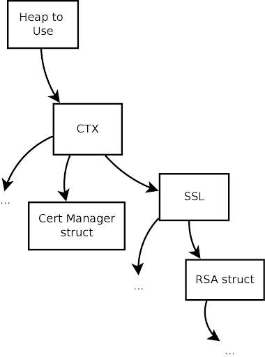
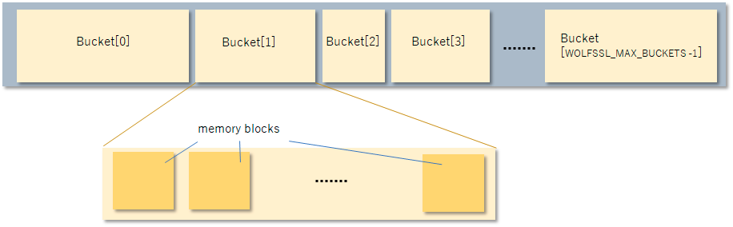

# 機能

wolfSSL（旧称CyaSSL）は主要なインターフェースとしてC言語をサポートしていますが、専用のラッパーを通じて他のいくつかのホスト言語もサポートしています。

* C#（wolfSSLソースツリーの`wrapper/CSharp`）
* Ada/SPARK（`wrapper/Ada`）
* Rust（`wrapper/rust`、wolfCrypt API用の`wolfssl-wolfcrypt`クレート）
* Python（別リポジトリ）：wolfSSL-py（[https://github.com/wolfSSL/wolfssl-py](https://github.com/wolfSSL/wolfssl-py)）およびwolfCrypt-py（[https://github.com/wolfSSL/wolfcrypt-py](https://github.com/wolfSSL/wolfcrypt-py)）
* Java（別リポジトリ）：wolfSSL JNI/JSSE（[https://github.com/wolfSSL/wolfssljni](https://github.com/wolfSSL/wolfssljni)）およびwolfCrypt JNI/JCE（[https://github.com/wolfSSL/wolfcrypt-jni](https://github.com/wolfSSL/wolfcrypt-jni)）

現在サポートされていない他のプログラミング言語でwolfSSLをホストすることに興味がある場合は、お問い合わせください。

本章では、ストリーム暗号、AES-NI、IPv6サポート、SSL検査（スニファー）サポートなど、wolfSSLの機能についてより詳しく説明します。

## 機能概要

wolfSSLの機能概要については、製品紹介ページをご覧ください。

<https://wolfssl.jp/products/wolfssl>

## プロトコルサポート

wolfSSLは**SSL 3.0**、**TLS**（**1.0**、**1.1**、**1.2、1.3**）、および**DTLS**（**1.0**、**1.2**、**1.3**）をサポートしています。
デフォルトビルドで有効になっているのはTLS 1.2とTLS 1.3のみです。
SSL 3.0、TLS 1.0、TLS 1.1を使用するには、それぞれ[`--enable-sslv3`](chapter02.md#--enable-sslv3)、[`--enable-tlsv10`](chapter02.md#--enable-tlsv10)、`--enable-oldtls`ビルドオプションが必要です。
DTLSには[`--enable-dtls`](chapter02.md#--enable-dtls)が必要で、DTLS 1.3にはさらに`--enable-dtls13`が必要です。
DTLS 1.0には旧バージョンのTLS（`--enable-oldtls`）も必要です。
以下の関数のいずれかを使用することで、使用するプロトコルを簡単に選択できます（クライアント用とサーバー用をそれぞれ示します）。
wolfSSLは、長年安全でないとされているSSL 2.0をサポートしていません。
OpenSSL互換性レイヤーを使用する場合、以下の関数はわずかに異なります。
OpenSSL互換関数については、[第13章 OpenSSL互換性](chapter13.md)をご参照ください。

### サーバー関数

* [`wolfDTLSv1_server_method()`](group__Setup.md#function-wolfdtlsv1_server_method) - DTLS 1.0
* [`wolfDTLSv1_2_server_method()`](ssl_8h.md#function-wolfdtlsv1_2_server_method) - DTLS 1.2
* [`wolfDTLSv1_3_server_method()`](group__Setup.md#function-wolfdtlsv1_3_server_method) - DTLS 1.3
* [`wolfDTLS_server_method()`](group__Setup.md#function-wolfdtls_server_method) - ビルドで有効になっている可能な限り新しいDTLSバージョンを使用
* [`wolfSSLv3_server_method()`](group__Setup.md#function-wolfsslv3_server_method) - SSL 3.0
* [`wolfTLSv1_server_method()`](group__Setup.md#function-wolftlsv1_server_method) - TLS 1.0
* [`wolfTLSv1_1_server_method()`](group__Setup.md#function-wolftlsv1_1_server_method) - TLS 1.1
* [`wolfTLSv1_2_server_method()`](group__Setup.md#function-wolftlsv1_2_server_method) - TLS 1.2
* [`wolfTLSv1_3_server_method()`](group__Setup.md#function-wolftlsv1_3_server_method) - TLS 1.3
* [`wolfSSLv23_server_method()`](group__Setup.md#function-wolfsslv23_server_method) - TLS 1.3までの可能な限り新しいバージョンを使用（ビルドで有効になっている最も古いバージョンまでダウングレード）
* `wolfTLS_server_method()` - `wolfSSLv23_server_method()`と同じ

SSL 3.0とTLS 1.0のメソッドは、wolfSSLを`WOLFSSL_ALLOW_SSLV3`および`WOLFSSL_ALLOW_TLSV10`を定義してビルドした場合にのみ使用できます。
TLS 1.1とDTLS 1.0のメソッドは、`NO_OLD_TLS`が定義されていない場合にのみ使用できます。
DTLS 1.3のメソッドには`WOLFSSL_DTLS13`が必要です。

wolfSSLは[`wolfSSLv23_server_method()`](group__Setup.md#function-wolfsslv23_server_method)関数による堅牢なサーバーダウングレードをサポートしています。
詳しくは、本章の「堅牢なクライアントとサーバーのダウングレード」節をご参照ください。

### クライアント関数

* [`wolfDTLSv1_client_method()`](group__Setup.md#function-wolfdtlsv1_client_method) - DTLS 1.0
* `wolfDTLSv1_2_client_method()` - DTLS 1.2
* [`wolfDTLSv1_3_client_method()`](group__Setup.md#function-wolfdtlsv1_3_client_method) - DTLS 1.3
* [`wolfDTLS_client_method()`](group__Setup.md#function-wolfdtls_client_method) - ビルドで有効になっている可能な限り新しいDTLSバージョンを使用
* [`wolfSSLv3_client_method()`](group__Setup.md#function-wolfsslv3_client_method) - SSL 3.0
* [`wolfTLSv1_client_method()`](group__Setup.md#function-wolftlsv1_client_method) - TLS 1.0
* [`wolfTLSv1_1_client_method()`](group__Setup.md#function-wolftlsv1_1_client_method) - TLS 1.1
* [`wolfTLSv1_2_client_method()`](group__Setup.md#function-wolftlsv1_2_client_method) - TLS 1.2
* [`wolfTLSv1_3_client_method()`](group__Setup.md#function-wolftlsv1_3_client_method) - TLS 1.3
* [`wolfSSLv23_client_method()`](group__Setup.md#function-wolfsslv23_client_method) - TLS 1.3までの可能な限り新しいバージョンを使用（ビルドで有効になっている最も古いバージョンまでダウングレード）
* `wolfTLS_client_method()` - `wolfSSLv23_client_method()`と同じ

各メソッドには、ヒープヒントを引数に取る`_ex`版もあります（例：[`wolfDTLSv1_2_client_method_ex()`](ssl_8h.md#function-wolfdtlsv1_2_client_method_ex)）。
ビルド条件はサーバー関数と同じです。

wolfSSLは[`wolfSSLv23_client_method()`](group__Setup.md#function-wolfsslv23_client_method)関数による堅牢なクライアントダウングレードをサポートしています。
詳しくは、本章の「堅牢なクライアントとサーバーのダウングレード」節をご参照ください。

これらの関数の使用方法の詳細については、[第3章 入門](chapter03.md)をご参照ください。
SSL、TLS、DTLSの比較については、[付録D SSL/TLSの概要](appendix04.md)をご参照ください。

### 堅牢なクライアントとサーバーのダウングレード

wolfSSLのクライアントとサーバーはどちらも堅牢なバージョンダウングレード機能を持っています。
どちらかの側で特定のプロトコルバージョンメソッドが使用されている場合、そのバージョンによりネゴシエーションされるか、エラーが返されます。
例えば、TLS 1.0を使用するクライアントがSSL 3.0のみのサーバーに接続しようとすると、接続は失敗します。
同様に、TLS 1.1への接続も失敗します。

この問題を解決するには、クライアント側で[`wolfSSLv23_client_method()`](group__Setup.md#function-wolfsslv23_client_method)関数を使用し、必要に応じてダウングレードすることでサーバーがサポートする最高のプロトコルバージョンをサポートします。
デフォルトビルドではTLS 1.0とTLS 1.1がコンパイル時に除外されているため、クライアントが接続できるのはTLS 1.2またはTLS 1.3を実行しているサーバーのみです。
wolfSSLのビルド時に古いプロトコルバージョンを有効にした場合、クライアントはそれらのバージョン（TLS 1.0とTLS 1.1、および有効にした場合はSSL 3.0）にもダウングレードできます。
長年安全でないとされているSSL 2.0には、クライアントは決して接続できません。

同様に、サーバー側で[`wolfSSLv23_server_method()`](group__Setup.md#function-wolfsslv23_server_method)関数を使用することで、デフォルトビルドではTLS 1.2とTLS 1.3をサポートするクライアントを処理できます。
それより古いバージョンは、ビルド時に有効にした場合にのみ処理できます。
wolfSSLサーバーはセキュリティ上の問題から、SSLv2からの接続を受け入れません。

クライアントまたはサーバーがダウングレードする最低バージョンを引き上げるには、[`wolfSSL_CTX_SetMinVersion()`](group__Setup.md#function-wolfssl_ctx_setminversion)（単一の`WOLFSSL`オブジェクトに対しては[`wolfSSL_SetMinVersion()`](group__TLS.md#function-wolfssl_setminversion)）を呼び出します。
例えば`WOLFSSL_TLSV1_3`を指定すると、TLS 1.3のみを許可します。

### IPv6サポート

wolfSSLはIPv6もサポートしています。

wolfSSLはIPニュートラルとして設計しており、IPv4とIPv6の両方で動作します。
ただしより広範なシステムに適用するために、現在のテストアプリケーションはデフォルトでIPv4を使用します。
テストアプリケーションでIPv6を使用するには、wolfSSLのビルド時に `--enable-ipv6` オプションをお使いください。

IPv6に関する一般的な情報はこちらで確認できます。

[https://en.wikipedia.org/wiki/IPv6](https://en.wikipedia.org/wiki/IPv6)

### DTLS

wolfSSLはクライアントとサーバーの両方でDTLS（「データグラム」TLS）をサポートしています。
現在サポートしているバージョンは、DTLS 1.0、1.2、1.3です。

TLSプロトコルは**信頼性のある**媒体（TCPなど）を介して安全なトランスポートチャネルを提供するように設計されました。
UDPトランスポートを使用するアプリケーション層プロトコル（SIPやゲームプロトコルなど）が開発され始めるにつれて、遅延に敏感なアプリケーションの通信セキュリティを提供する必要性が生じました。
この必要性がDTLSプロトコルの作成につながりました。

多くの人がTLSとDTLSの違いはTCPとUDPの違いと同じだと考えていますが、これは正しくありません。
UDPはハンドシェイクがなく、切断がなく、何かが失われた場合にTCPと比較して遅延が少ないという利点があります。
一方、DTLSは拡張されたSSLハンドシェイクと切断を持ち、ハンドシェイクにTCPのような動作を実装する必要があります。
本質的に、DTLSは安全な接続と引き換えにUDPが提供する利点を逆転させます。

DTLSはwolfSSLをビルドする際に[`--enable-dtls`](chapter02.md#--enable-dtls)ビルドオプションを使用することで有効にできます。
DTLS 1.3にはさらに`--enable-dtls13`が必要です。

### LwIP（軽量インターネットプロトコル）

wolfSSLは、軽量インターネットプロトコル実装をすぐ使えるようサポートしています。
このプロトコルを使用するには、`WOLFSSL_LWIP`を定義するか、`settings.h`ファイルを編集して次の行のコメントアウトを解除してください。

```c
/*#define WOLFSSL_LWIP*/
```

lwIPの焦点は、できるだけ小さなRAM使用量で完全なTCPスタックを提供することです。
そのためlwIPは組み込みシステムに適しており、これはwolfSSLが最も力を発揮するSSL/TLSの用途とも一致します。

### TLS拡張機能

wolfSSLがサポートするTLS拡張機能と、各拡張機能に対応するRFCの一覧です。

| RFC | 拡張機能 | wolfSSLタイプ |
| --- | --------- | ------------ |
| [6066](https://tex2e.github.io/rfc-translater/html/rfc6066) | サーバー名表示 | `TLSX_SERVER_NAME` |
| [6066](https://tex2e.github.io/rfc-translater/html/rfc6066) | 最大フラグメント長ネゴシエーション | `TLSX_MAX_FRAGMENT_LENGTH` |
| [6066](https://tex2e.github.io/rfc-translater/html/rfc6066) | 信頼されたCA鍵 | `TLSX_TRUSTED_CA_KEYS` |
| [6066](https://tex2e.github.io/rfc-translater/html/rfc6066) | 短縮HMAC | `TLSX_TRUNCATED_HMAC` |
| [6066](https://tex2e.github.io/rfc-translater/html/rfc6066) | ステータスリクエスト | `TLSX_STATUS_REQUEST` |
| [7919](https://tex2e.github.io/rfc-translater/html/rfc7919) | サポートされているグループ | `TLSX_SUPPORTED_GROUPS` |
| [8422](https://datatracker.ietf.org/doc/html/rfc8422) | EC点フォーマット | `TLSX_EC_POINT_FORMATS` |
| [5246](https://tex2e.github.io/rfc-translater/html/rfc5246) | 署名アルゴリズム | `TLSX_SIGNATURE_ALGORITHMS` |
| [5764](https://datatracker.ietf.org/doc/html/rfc5764) | SRTPの使用 | `TLSX_USE_SRTP` |
| [7301](https://tex2e.github.io/rfc-translater/html/rfc7301) | アプリケーション層プロトコルネゴシエーション | `TLSX_APPLICATION_LAYER_PROTOCOL` |
| [6961](https://tex2e.github.io/rfc-translater/html/rfc6961) | 複数証明書ステータスリクエスト | `TLSX_STATUS_REQUEST_V2` |
| [7250](https://datatracker.ietf.org/doc/html/rfc7250) | クライアント証明書タイプ（Raw Public Key） | `TLSX_CLIENT_CERTIFICATE_TYPE` |
| [7250](https://datatracker.ietf.org/doc/html/rfc7250) | サーバー証明書タイプ（Raw Public Key） | `TLSX_SERVER_CERTIFICATE_TYPE` |
| [7366](https://datatracker.ietf.org/doc/html/rfc7366) | Encrypt-then-MAC | `TLSX_ENCRYPT_THEN_MAC` |
| [7627](https://datatracker.ietf.org/doc/html/rfc7627) | 拡張マスターシークレット | `TLSX_EXTENDED_MASTER_SECRET` |
| [5077](https://tex2e.github.io/rfc-translater/html/rfc5077) | セッションチケット | `TLSX_SESSION_TICKET` |
| [5746](https://tex2e.github.io/rfc-translater/html/rfc5746) | 再ネゴシエーションの提示 | `TLSX_RENEGOTIATION_INFO` |
| [8446](https://tex2e.github.io/rfc-translater/html/rfc8446) | 鍵共有 | `TLSX_KEY_SHARE` |
| [8446](https://tex2e.github.io/rfc-translater/html/rfc8446) | 事前共有鍵 | `TLSX_PRE_SHARED_KEY` |
| [8446](https://tex2e.github.io/rfc-translater/html/rfc8446) | PSK鍵交換モード | `TLSX_PSK_KEY_EXCHANGE_MODES` |
| [8446](https://tex2e.github.io/rfc-translater/html/rfc8446) | 早期データ | `TLSX_EARLY_DATA` |
| [8446](https://tex2e.github.io/rfc-translater/html/rfc8446) | クッキー | `TLSX_COOKIE` |
| [8446](https://tex2e.github.io/rfc-translater/html/rfc8446) | サポートされているバージョン | `TLSX_SUPPORTED_VERSIONS` |
| [8446](https://tex2e.github.io/rfc-translater/html/rfc8446) | 認証局 | `TLSX_CERTIFICATE_AUTHORITIES` |
| [8446](https://tex2e.github.io/rfc-translater/html/rfc8446) | ポストハンドシェイク認証 | `TLSX_POST_HANDSHAKE_AUTH` |
| [8446](https://tex2e.github.io/rfc-translater/html/rfc8446) | 証明書用署名アルゴリズム | `TLSX_SIGNATURE_ALGORITHMS_CERT` |
| [8773](https://datatracker.ietf.org/doc/html/rfc8773) | 外部PSKを併用したTLS 1.3証明書認証 | `TLSX_CERT_WITH_EXTERN_PSK` |
| [9001](https://datatracker.ietf.org/doc/html/rfc9001) | QUICトランスポートパラメータ | `TLSX_KEY_QUIC_TP_PARAMS` |
| [9146](https://datatracker.ietf.org/doc/html/rfc9146) | DTLSコネクションID | `TLSX_CONNECTION_ID` |
| [9849](https://datatracker.ietf.org/doc/html/rfc9849) | Encrypted Client Hello | `TLSX_ECH` |

### セッション再開とセッションチケット

wolfSSLクライアントは、以前のセッションを再開することで完全なハンドシェイクを省略できます。
接続後に[`wolfSSL_get1_session()`](group__Setup.md#function-wolfssl_get1_session)（または[`wolfSSL_get_session()`](group__IO.md#function-wolfssl_get_session)）でセッションを保存し、接続する前に新しい`WOLFSSL`オブジェクトに対して[`wolfSSL_set_session()`](group__Setup.md#function-wolfssl_set_session)で渡してください。
サーバーはTLS 1.2のセッションID用にセッションキャッシュを保持します。
セッションチケット（RFC 5077、およびTLS 1.3のNewSessionTicketメッセージ）によるステートレスな再開は、[`--enable-session-ticket`](chapter02.md#--enable-session-ticket)で有効になります。
TLS 1.3のセッション再開は常にチケットを使用するため、このオプションが必要です。
クライアントは[`wolfSSL_UseSessionTicket()`](group__IO.md#function-wolfssl_usesessionticket)または[`wolfSSL_CTX_UseSessionTicket()`](group__Setup.md#function-wolfssl_ctx_usesessionticket)でチケットを要求します。
サーバーは、`WOLFSSL_NO_DEF_TICKET_ENC_CB`が定義されていない限り、組み込みのコールバックでチケットを暗号化します。
アプリケーションは[`wolfSSL_CTX_set_TicketEncCb()`](ssl_8h.md#function-wolfssl_ctx_set_ticketenccb)で独自のコールバックを設定することもできます。

### セキュアな再ネゴシエーション

TLS 1.2以前向けのセキュアな再ネゴシエーション（RFC 5746）は、[`--enable-secure-renegotiation`](chapter02.md#--enable-secure-renegotiation)で有効になります。
接続に対して[`wolfSSL_UseSecureRenegotiation()`](group__IO.md#function-wolfssl_usesecurerenegotiation)で有効にし、[`wolfSSL_Rehandshake()`](group__IO.md#function-wolfssl_rehandshake)で新しいハンドシェイクを開始します。
TLS 1.3は再ネゴシエーションをサポートしていません。
このオプションを使用しない場合でも、wolfSSLは初回ハンドシェイクでrenegotiation_info拡張をサポートしています（`HAVE_SERVER_RENEGOTIATION_INFO`、デフォルトで有効）。
また、wolfSSLを`--enable-legacy-server-connect`でビルドしない限り、TLS 1.2クライアントはこの拡張に応答しないサーバーへの接続を拒否します。

### TLS 1.3 早期データ（0-RTT）

TLS 1.3の早期データを使用すると、クライアントはセッションを再開する場合や事前共有鍵を使用する場合に、最初のフライトでアプリケーションデータを送信できます。
`--enable-earlydata`で有効にします。
このオプションには、セッションチケット（[`--enable-session-ticket`](chapter02.md#--enable-session-ticket)）とPSK（[`--enable-psk`](chapter02.md#--enable-psk)）のいずれか、または両方も必要です。
クライアントは[`wolfSSL_write_early_data()`](group__IO.md#function-wolfssl_write_early_data)でデータを送信します。
サーバーは、受け入れる早期データの最大量を[`wolfSSL_CTX_set_max_early_data()`](group__Setup.md#function-wolfssl_ctx_set_max_early_data)で設定し、[`wolfSSL_read_early_data()`](group__IO.md#function-wolfssl_read_early_data)で読み込みます。
早期データは攻撃者によってリプレイされる可能性があるため、繰り返し実行しても安全なリクエストにのみ使用してください。

### TLS 1.3 ポストハンドシェイク認証

ポストハンドシェイク認証を使用すると、TLS 1.3サーバーはハンドシェイクの完了後にクライアント証明書を要求できます。
`--enable-postauth`で有効にします。
クライアントは[`wolfSSL_allow_post_handshake_auth()`](group__Setup.md#function-wolfssl_allow_post_handshake_auth)（または[`wolfSSL_CTX_allow_post_handshake_auth()`](group__Setup.md#function-wolfssl_ctx_allow_post_handshake_auth)）でサポートを通知し、サーバーは[`wolfSSL_request_certificate()`](group__IO.md#function-wolfssl_request_certificate)で要求を送信します。

### DTLS 1.3とDTLSコネクションID

DTLS 1.3（RFC 9147）は`--enable-dtls13`で有効になり、DTLSとTLS 1.3も同時に有効になります。
[`wolfDTLSv1_3_client_method()`](group__Setup.md#function-wolfdtlsv1_3_client_method)と[`wolfDTLSv1_3_server_method()`](group__Setup.md#function-wolfdtlsv1_3_server_method)、またはバージョンを柔軟に選択できる[`wolfDTLS_client_method()`](group__Setup.md#function-wolfdtls_client_method)と[`wolfDTLS_server_method()`](group__Setup.md#function-wolfdtls_server_method)を使用してください。

DTLSコネクションID（DTLS 1.2はRFC 9146、DTLS 1.3はRFC 9147）を使用すると、ピアのIPアドレスやポートが変わっても接続を維持できます。
`--enable-dtlscid`で有効にします。
ハンドシェイクの前に[`wolfSSL_dtls_cid_use()`](ssl_8h.md#function-wolfssl_dtls_cid_use)を呼び出してください。
必要に応じて[`wolfSSL_dtls_cid_set()`](ssl_8h.md#function-wolfssl_dtls_cid_set)を呼び出し、ピアがこちらへ送信する際に使用するコネクションIDを指定することもできます。

### 生の公開鍵（Raw Public Key）

Raw Public Key（RFC 7250）を使用すると、クライアントとサーバーはX.509証明書の代わりに公開鍵そのものを使用して認証できます。
`--enable-rpk`で有効にします。
エンドポイントが受け入れる証明書タイプと提示する証明書タイプは、[`wolfSSL_CTX_set_client_cert_type()`](group__Setup.md#function-wolfssl_ctx_set_client_cert_type)および[`wolfSSL_CTX_set_server_cert_type()`](group__Setup.md#function-wolfssl_ctx_set_server_cert_type)（または`wolfSSL_set_*`版）で、`WOLFSSL_CERT_TYPE_RPK`と`WOLFSSL_CERT_TYPE_X509`を使用して設定します。

### Encrypted Client Hello

Encrypted Client Hello（ECH、RFC 9849）は、サーバーが公開している公開鍵を使用して、サーバー名などTLS 1.3 ClientHelloの機密性の高い部分を暗号化します。
`--enable-ech`で有効にします。
このオプションにより、HPKE、Curve25519、SNIも有効になります。
サーバーは`wolfSSL_CTX_GenerateEchConfig()`でECH設定を作成し、`wolfSSL_CTX_GetEchConfigs()`でエクスポートします。
クライアントは`wolfSSL_SetEchConfigs()`または`wolfSSL_SetEchConfigsBase64()`でサーバーの設定を読み込みます。

### QUIC

wolfSSLはQUIC実装（RFC 9001）向けにTLS 1.3ハンドシェイクを提供しますが、QUICプロトコル自体は実装していません。
`--enable-quic`で有効にします。
QUICスタックは`wolfSSL_CTX_set_quic_method()`または`wolfSSL_set_quic_method()`でコールバックを登録します。
これによりwolfSSLは、TLSレコードを書き込む代わりに、ハンドシェイクメッセージとトラフィックシークレットをQUICスタックに渡します。
QUICスタックのngtcp2はwolfSSLをサポートしています。
詳細については、wolfSSLソースツリーの`doc/QUIC.md`をご参照ください。

## 暗号サポート

### 暗号スイートの強度と適切な鍵サイズの選択

メソッド[`wolfSSL_get_ciphers()`](group__IO.md#function-wolfssl_get_ciphers)を呼び出すことで、利用可能な暗号スイートを確認できます。

`wolfSSL_get_ciphers(buf, len)`は、ライブラリにコンパイルされているすべての暗号スイートをコロン区切りのリストとして`buf`に書き込みます。
接続でネゴシエーションされた暗号スイートを確認するには、[`wolfSSL_get_cipher_name()`](group__IO.md#function-wolfssl_get_cipher_name)を使用します。

暗号スイートはさまざまな強度で提供されています。
それらはいくつかの異なるタイプのアルゴリズム（認証、暗号化、およびメッセージ認証コード（MAC））で構成されているため、各々の強度は選択された鍵サイズによって異なります。

暗号スイートの強度を評価する方法は多数あり、実際に使用される手法はプロジェクトや企業によって異なるようです。
これには、共通鍵および公開鍵アルゴリズムの鍵サイズ、アルゴリズムの種類、性能、既知の弱点などが含まれる場合があります。

**NIST**（米国国立標準技術研究所）は、各鍵サイズに対して比較可能なアルゴリズムの強度を提供することにより、受け入れ可能な暗号スイートを選択するための推奨事項を提供しています。
NIST Special Publication [SP800-57](https://csrc.nist.gov/publications/detail/sp/800-57-part-1/rev-5/final)では、どのようにして2つのアルゴリズムが同等の強度であると見なすのか述べられています。

> 2つのアルゴリズムは、与えられた鍵サイズ（XとY）に対して、「アルゴリズムを破る」または鍵を決定するために必要な作業量が、与えられたリソースを使用して概ね同じである場合、同等の強度を持つと見なされます。特定の鍵サイズに対するアルゴリズムのセキュリティ強度は、伝統的に、ショートカット攻撃（つまり、最も効率的な攻撃はすべての可能な鍵を試すこと）がない「X」の鍵サイズを持つ対称アルゴリズムに対してすべての鍵を試すのにかかる作業量の観点から説明されています。

以下の表は、[NIST SP800-57](https://csrc.nist.gov/publications/detail/sp/800-57-part-1/rev-5/final)の表2（56ページ）と表4（59ページ）の両方に基づいており、アルゴリズム間で同等のセキュリティ強度と、セキュリティビット数に基づいてNISTが推奨するアルゴリズムの使用可能期間を示しています。

**注意**：次の表では、「L」は有限体暗号（FFC）の公開鍵のサイズ、「N」はFFCの秘密鍵のサイズ、「k」は整数因数分解暗号（IFC）の鍵サイズ、「f」は楕円曲線暗号（ECC）の鍵サイズを示しています。

| セキュリティビット数 | 対称鍵アルゴリズム | **FFC** 鍵サイズ (DSA, DH, 等) | **IFC** 鍵サイズ (RSA, 等) | **ECC** 鍵サイズ (ECDSA, 等) | 説明 |
| ---------------- | ------------------------ | -------------------------------- | ---------------------------- | ------------------------------ | ----------- |
| 80 | 2TDEA, 等 | L = 1024, N = 160 | k = 1024 | f = 160-223 | 使用不可（レガシー用途のみ） |
| 112 | 3TDEA, 等 | L = 2048, N = 224 | k = 2048 | f = 224-255 | 2030年まで使用可 |
| 128 | AES-128, 等 | L = 3072, N = 256 | k = 3072 | f = 256-383 | 2030年以降も使用可 |
| 192 | AES-192, 等 | L = 7680, N = 384 | k = 7680 | f = 384-511 | 長期的に有効 |
| 256 | AES-256, 等 | L = 15360, N = 512 | k = 15360 | f = 512+ | 予見可能な将来にわたって有効 |

この表をガイドとして使用すると、暗号スイートは対称暗号化アルゴリズムの強度に基づいて分類できます。
これにより、セキュリティビット数に基づいて各暗号スイートを大まかに分類するための等級分類を考案できます（対称鍵サイズのみを考慮しています）。

* **低** - 128ビット未満のセキュリティビット
* **中** - 128ビットのセキュリティビット
* **高** - 128ビットを超えるセキュリティビット

暗号スイートの強度は、対称暗号化アルゴリズムの強度以外にも、鍵交換および認証アルゴリズムの鍵サイズに大きく依存します。
暗号スイートを構成する要素のうち、最も弱い要素の強度により評価されます。

上記の評価方法（対称暗号化アルゴリズムの強度のみに基づく）に従うと、以下に示す暗号スイートはそれぞれ低、中、高のいずれかに分類できます。
この強度分類は、他のアルゴリズムの選択された鍵サイズによって変わる可能性があります。
ハッシュ関数のセキュリティ強度に関する参考として、[NIST SP800-57](https://csrc.nist.gov/publications/detail/sp/800-57-part-1/rev-5/final)の表3（56ページ）をご参照ください。

媒体によっては、「**EXPORT**」暗号として示されていることがあります。
これは1992年まで、米国では強力な暗号処理を含むソフトウェアを輸出することが違法とされていたことに由来しています。
強力な暗号化は米国政府によって「弾薬」（核兵器、戦車、弾道ミサイルと同じカテゴリ）として分類されていました。
この制限のため、輸出されるソフトウェアには「弱められた」暗号（主に小さい鍵サイズ）が含まれていました。
現在ではこの制限は解除されており、EXPORT暗号はもはや必要とされなくなりました。

### サポートしている暗号スイート

以下の暗号スイートはwolfSSLでサポートしています。
暗号スイートとは、SSL/TLSハンドシェイク中にコネクションのセキュリティ設定をネゴシエーションするために使用される、認証、暗号化、メッセージ認証コード（MAC）アルゴリズムの組み合わせです。

TLS 1.2以前の各暗号スイートは、鍵交換アルゴリズム、バルク暗号化アルゴリズム、メッセージ認証コードアルゴリズム（MAC）を定義します。
**鍵交換アルゴリズム**（RSA、DHE、ECDH、ECDHE、PSK）と認証アルゴリズム（RSA、ECDSA、PSK）は、ハンドシェイクプロセス中にクライアントとサーバーがどのように認証するかを決定します。
**バルク暗号化アルゴリズム**（ブロック暗号とストリーム暗号。CBC、GCM、CCMモードのAES、ChaCha20-Poly1305、Camellia、ARIA、SM4、3DES、RC4）は、メッセージストリームの暗号化に使用されます。
**メッセージ認証コード（MAC）アルゴリズム**（MD5、SHA-1、SHA-256、SHA-384、SM3）は、メッセージダイジェストを作成するために使用されるハッシュ関数です。
TLS 1.3の暗号スイートは、AEADアルゴリズムとハッシュのみを指定します。
鍵交換（(EC)DHE、ML-KEM、またはそれらのハイブリッド。サポートされているグループ拡張と鍵共有拡張で選択します）と認証は、別途ネゴシエーションされます。

以下のリストは、`<wolfssl_root>/wolfssl/internal.h`の「actual cipher values, 2nd byte」列挙型にある暗号スイート（およびカテゴリ）に対応しています。
どの暗号スイートが利用可能かはビルドオプションによって異なります。
`./examples/client/client -e`を実行すると、ビルドに組み込まれている暗号スイートを一覧表示できます。
以下のリストにない暗号スイートをお探しの場合は、wolfSSLへの追加についてお問い合わせください。

TLS 1.3暗号スイート：

* `TLS_AES_128_GCM_SHA256`
* `TLS_AES_256_GCM_SHA384`
* `TLS_CHACHA20_POLY1305_SHA256`
* `TLS_AES_128_CCM_SHA256`
* `TLS_AES_128_CCM_8_SHA256`
* `TLS_SM4_GCM_SM3`
* `TLS_SM4_CCM_SM3`

TLS 1.3の完全性保護のみの暗号スイート（暗号化なし）：

* `TLS_SHA256_SHA256`
* `TLS_SHA384_SHA384`

RSA、DHE、PSK暗号スイート：

* `TLS_DHE_RSA_WITH_3DES_EDE_CBC_SHA`
* `TLS_DHE_RSA_WITH_AES_256_CBC_SHA`
* `TLS_DHE_RSA_WITH_AES_128_CBC_SHA`
* `TLS_DH_anon_WITH_AES_128_CBC_SHA`
* `TLS_RSA_WITH_AES_256_CBC_SHA`
* `TLS_RSA_WITH_AES_128_CBC_SHA`
* `TLS_RSA_WITH_NULL_MD5`
* `TLS_RSA_WITH_NULL_SHA`
* `TLS_PSK_WITH_AES_256_CBC_SHA`
* `TLS_PSK_WITH_AES_128_CBC_SHA256`
* `TLS_PSK_WITH_AES_256_CBC_SHA384`
* `TLS_PSK_WITH_AES_128_CBC_SHA`
* `TLS_PSK_WITH_NULL_SHA256`
* `TLS_PSK_WITH_NULL_SHA384`
* `TLS_PSK_WITH_NULL_SHA`
* `SSL_RSA_WITH_RC4_128_SHA`
* `SSL_RSA_WITH_RC4_128_MD5`
* `SSL_RSA_WITH_3DES_EDE_CBC_SHA`

ECC暗号スイート：

* `TLS_ECDHE_RSA_WITH_AES_256_CBC_SHA`
* `TLS_ECDHE_RSA_WITH_AES_128_CBC_SHA`
* `TLS_ECDHE_ECDSA_WITH_AES_256_CBC_SHA`
* `TLS_ECDHE_ECDSA_WITH_AES_128_CBC_SHA`
* `TLS_ECDHE_RSA_WITH_RC4_128_SHA`
* `TLS_ECDHE_ECDSA_WITH_RC4_128_SHA`
* `TLS_ECDHE_RSA_WITH_3DES_EDE_CBC_SHA`
* `TLS_ECDHE_ECDSA_WITH_3DES_EDE_CBC_SHA`
* `TLS_ECDHE_RSA_WITH_AES_128_CBC_SHA256`
* `TLS_ECDHE_ECDSA_WITH_AES_128_CBC_SHA256`
* `TLS_ECDHE_RSA_WITH_AES_256_CBC_SHA384`
* `TLS_ECDHE_ECDSA_WITH_AES_256_CBC_SHA384`
* `TLS_ECDHE_PSK_WITH_NULL_SHA256`
* `TLS_ECDHE_PSK_WITH_AES_128_CBC_SHA256`
* `TLS_ECDHE_PSK_WITH_AES_128_GCM_SHA256`
* `TLS_ECDHE_ECDSA_WITH_NULL_SHA`

静的ECC暗号スイート：

* `TLS_ECDH_RSA_WITH_AES_256_CBC_SHA`
* `TLS_ECDH_RSA_WITH_AES_128_CBC_SHA`
* `TLS_ECDH_ECDSA_WITH_AES_256_CBC_SHA`
* `TLS_ECDH_ECDSA_WITH_AES_128_CBC_SHA`
* `TLS_ECDH_RSA_WITH_RC4_128_SHA`
* `TLS_ECDH_ECDSA_WITH_RC4_128_SHA`
* `TLS_ECDH_RSA_WITH_3DES_EDE_CBC_SHA`
* `TLS_ECDH_ECDSA_WITH_3DES_EDE_CBC_SHA`
* `TLS_ECDH_RSA_WITH_AES_128_CBC_SHA256`
* `TLS_ECDH_ECDSA_WITH_AES_128_CBC_SHA256`
* `TLS_ECDH_RSA_WITH_AES_256_CBC_SHA384`
* `TLS_ECDH_ECDSA_WITH_AES_256_CBC_SHA384`

SHA-256暗号スイート：

* `TLS_DHE_RSA_WITH_AES_256_CBC_SHA256`
* `TLS_DHE_RSA_WITH_AES_128_CBC_SHA256`
* `TLS_RSA_WITH_AES_256_CBC_SHA256`
* `TLS_RSA_WITH_AES_128_CBC_SHA256`
* `TLS_RSA_WITH_NULL_SHA256`
* `TLS_DHE_PSK_WITH_AES_128_CBC_SHA256`
* `TLS_DHE_PSK_WITH_NULL_SHA256`

SHA-384暗号スイート：

* `TLS_DHE_PSK_WITH_AES_256_CBC_SHA384`
* `TLS_DHE_PSK_WITH_NULL_SHA384`

AES-GCM暗号スイート：

* `TLS_RSA_WITH_AES_128_GCM_SHA256`
* `TLS_RSA_WITH_AES_256_GCM_SHA384`
* `TLS_DHE_RSA_WITH_AES_128_GCM_SHA256`
* `TLS_DHE_RSA_WITH_AES_256_GCM_SHA384`
* `TLS_DH_anon_WITH_AES_256_GCM_SHA384`
* `TLS_PSK_WITH_AES_128_GCM_SHA256`
* `TLS_PSK_WITH_AES_256_GCM_SHA384`
* `TLS_DHE_PSK_WITH_AES_128_GCM_SHA256`
* `TLS_DHE_PSK_WITH_AES_256_GCM_SHA384`

ECC AES-GCM暗号スイート：

* `TLS_ECDHE_ECDSA_WITH_AES_128_GCM_SHA256`
* `TLS_ECDHE_ECDSA_WITH_AES_256_GCM_SHA384`
* `TLS_ECDH_ECDSA_WITH_AES_128_GCM_SHA256`
* `TLS_ECDH_ECDSA_WITH_AES_256_GCM_SHA384`
* `TLS_ECDHE_RSA_WITH_AES_128_GCM_SHA256`
* `TLS_ECDHE_RSA_WITH_AES_256_GCM_SHA384`
* `TLS_ECDH_RSA_WITH_AES_128_GCM_SHA256`
* `TLS_ECDH_RSA_WITH_AES_256_GCM_SHA384`

AES-CCM暗号スイート：

* `TLS_RSA_WITH_AES_128_CCM_8`
* `TLS_RSA_WITH_AES_256_CCM_8`
* `TLS_ECDHE_ECDSA_WITH_AES_128_CCM`
* `TLS_ECDHE_ECDSA_WITH_AES_128_CCM_8`
* `TLS_ECDHE_ECDSA_WITH_AES_256_CCM_8`
* `TLS_PSK_WITH_AES_128_CCM`
* `TLS_PSK_WITH_AES_256_CCM`
* `TLS_PSK_WITH_AES_128_CCM_8`
* `TLS_PSK_WITH_AES_256_CCM_8`
* `TLS_DHE_PSK_WITH_AES_128_CCM`
* `TLS_DHE_PSK_WITH_AES_256_CCM`

Camellia暗号スイート：

* `TLS_RSA_WITH_CAMELLIA_128_CBC_SHA`
* `TLS_RSA_WITH_CAMELLIA_256_CBC_SHA`
* `TLS_RSA_WITH_CAMELLIA_128_CBC_SHA256`
* `TLS_RSA_WITH_CAMELLIA_256_CBC_SHA256`
* `TLS_DHE_RSA_WITH_CAMELLIA_128_CBC_SHA`
* `TLS_DHE_RSA_WITH_CAMELLIA_256_CBC_SHA`
* `TLS_DHE_RSA_WITH_CAMELLIA_128_CBC_SHA256`
* `TLS_DHE_RSA_WITH_CAMELLIA_256_CBC_SHA256`

ChaCha暗号スイート：

* `TLS_ECDHE_RSA_WITH_CHACHA20_POLY1305_SHA256`
* `TLS_ECDHE_ECDSA_WITH_CHACHA20_POLY1305_SHA256`
* `TLS_DHE_RSA_WITH_CHACHA20_POLY1305_SHA256`
* `TLS_ECDHE_PSK_WITH_CHACHA20_POLY1305_SHA256`
* `TLS_PSK_WITH_CHACHA20_POLY1305_SHA256`
* `TLS_DHE_PSK_WITH_CHACHA20_POLY1305_SHA256`
* `TLS_ECDHE_RSA_WITH_CHACHA20_OLD_POLY1305_SHA256`
* `TLS_ECDHE_ECDSA_WITH_CHACHA20_OLD_POLY1305_SHA256`
* `TLS_DHE_RSA_WITH_CHACHA20_OLD_POLY1305_SHA256`

ARIA-GCM暗号スイート：

* `TLS_ECDHE_ECDSA_WITH_ARIA_128_GCM_SHA256`
* `TLS_ECDHE_ECDSA_WITH_ARIA_256_GCM_SHA384`

SM（ShangMi）TLS 1.2暗号スイート：

* `TLS_ECDHE_ECDSA_WITH_SM4_CBC_SM3`
* `TLS_ECDHE_ECDSA_WITH_SM4_GCM_SM3`
* `TLS_ECDHE_ECDSA_WITH_SM4_CCM_SM3`

再ネゴシエーション表示拡張特別スイート：

* `TLS_EMPTY_RENEGOTIATION_INFO_SCSV`

フォールバックシグナリング暗号スイート値（RFC 7507）：

* `TLS_FALLBACK_SCSV`

### AEADスイート

wolfSSLは、AES-GCM、AES-CCM、CHACHA-POLY1305などのAEADスイートをサポートしています。
wolfCryptはさらに、ノンスの誤用に耐性を持つAEADであるAES-GCM-SIV（RFC 8452）を、TLS以外でのアプリケーション用途向けに提供しています。
これは[`--enable-aesgcm-siv`](chapter02.md#--enable-aesgcm-siv)で有効になります。
これらのAEADスイートと他のスイートの大きな違いは、追加のクリアテキストデータを使用して暗号化されたデータを認証することです。
これは、データ改ざんを伴う中間者攻撃を軽減するのに役立ちます。
AEADスイートはブロック暗号（または最近ではストリーム暗号）アルゴリズムと、鍵付きハッシュアルゴリズムによって生成されるタグの組み合わせを使用します。
これら2つのアルゴリズムの組み合わせはwolfSSLの暗号化・復号プロセスによって処理されるため、ユーザーは容易に利用できます。
特定のAEADスイートを使用するために必要なのは、サポートされているスイートで使用されるアルゴリズムを有効にするだけです。

### ブロック暗号とストリーム暗号

wolfSSLは **AES**、**DES**、**3DES**、**Camellia**、**ARIA**、**SM4** ブロック暗号と、**RC4** および **CHACHA20** ストリーム暗号をサポートしています。
wolfCryptは軽量AEADである **Ascon** も提供しています。
AES（CBCモードとGCMモード）とChaCha20はデフォルトで有効です。
DES/3DES（`--enable-des3`）、RC4（[`--enable-arc4`](chapter02.md#--enable-arc4)）、AES-CCM（[`--enable-aesccm`](chapter02.md#--enable-aesccm)）、Camellia（[`--enable-camellia`](chapter02.md#--enable-camellia)）、ARIA（`--enable-aria`）、SM4（`--enable-sm4-ecb`、`--enable-sm4-cbc`、`--enable-sm4-ctr`、`--enable-sm4-gcm`、`--enable-sm4-ccm`）、Ascon（`--enable-ascon`）は明示的に有効にする必要があります。
使用方法についてはサンプルプログラムを、具体的な使用方法については[第10章 wolfCryptの使用法](chapter10.md)をご参照ください。

RC4はTLSでの使用が禁止されています（RFC 7465）。
RC4はデフォルトで無効であり（`--enable-arc4`で有効になります）、RC4暗号スイートが有効な場合はconfigureが警告を表示します。
ストリーム暗号のAEADとしては、ChaCha20-Poly1305を推奨します。

暗号性能の比較については、wolfSSLのベンチマークウェブページをご覧ください。

<https://www.wolfssl.com/docs/benchmarks>

#### 違いは何でしょうか

ブロック暗号は、暗号のブロックサイズのチャンク単位で暗号化する必要があります。
例えば、AESのブロックサイズは16バイトです。
したがって、2〜3バイトの小さなチャンクを暗号化する場合、データの80%以上が無駄なパディングとなります。
これにより暗号化/復号処理速度は低下し、ネットワーク帯域幅を無駄に消費します。
基本的に、ブロック暗号は大きなデータチャンク用に設計されており、パディングを必要とするブロックサイズを有し、固定の不変な変換を使用します。

ストリーム暗号は、大小さまざまなデータチャンクに適しています。
ブロックサイズが不要なため、小さいデータサイズにも適しています。
速度が重要な場合、ストリーム暗号が最適です。
これは、一般的にXOR処理された鍵ストリームを含むより単純な変換を使用するためです。
メディアをストリーミングしたり、小さなサイズを含むさまざまなデータサイズを暗号化したり、高速な暗号が必要な場合は、ストリーム暗号が最適な選択です。

### ハッシュ関数

wolfSSLはいくつかの異なるハッシュ関数をサポートしています。
これには、**MD2**、**MD4**、**MD5**、**SHA-1**、**SHA-2**（SHA-224、SHA-256、SHA-384、SHA-512、SHA-512/224、SHA-512/256）、**SHA-3**（拡張出力関数SHAKE128およびSHAKE256を含む）、**SM3**、**BLAKE2**、**RIPEMD-160** が含まれます。
MD2、MD4、MD5、SM3、BLAKE2、RIPEMD-160はデフォルトで無効です。
例えばMD5は`--enable-md5`で有効にできます。
これらの関数の詳細な使用方法は、[第10章 wolfCryptの使用法](chapter10.md)の「ハッシュ関数」節で確認できます。

SP 800-185で定義されたSHA-3派生関数である **cSHAKE** と **KMAC** は、[`--enable-cshake`](chapter02.md#--enable-cshake)および[`--enable-kmac`](chapter02.md#--enable-kmac)で利用できます。
パスワードハッシュ用として、wolfCryptはPBKDF2、scrypt、およびwolfSSL 5.9.4以降では **Argon2**（RFC 9106、Argon2d、Argon2i、Argon2idのすべて）を提供しています。
Argon2は[`--enable-argon2`](chapter02.md#--enable-argon2)で有効にできます。

### 公開鍵オプション

wolfSSLは **RSA**、**ECC**、**DSA/DSS**、**DH** の公開鍵オプションに加え、wolfSSLサーバー上での **EDH**（Ephemeral Diffie-Hellman）もサポートしています。
wolfCryptは **Curve25519**（X25519）、**Ed25519**、**Curve448**（X448）、**Ed448**、**SM2**、およびIDベースの **ECCSI** と **SAKKE** 方式もサポートしています。
RSA、ECC、DHはデフォルトで有効です。
DSA（[`--enable-dsa`](chapter02.md#--enable-dsa)）、Curve25519（[`--enable-curve25519`](chapter02.md#--enable-curve25519)）、Ed25519（[`--enable-ed25519`](chapter02.md#--enable-ed25519)）、Curve448（`--enable-curve448`）、Ed448（`--enable-ed448`）、SM2（`--enable-sm2`）、ECCSI（`--enable-eccsi`）、SAKKE（`--enable-sakke`）は明示的に有効にする必要があります。
これらの関数の詳細な使用方法は、[第10章 wolfCryptの使用法](chapter10.md)の「公開鍵暗号」節で確認できます。

#### ML-KEM, ML-DSA

ML-KEM (Module Lattice Key Encapsulation Mechanism) は、NISTが標準化した格子ベースの耐量子アルゴリズムです。
Kyberをベースとして標準化されました。
2者間で鍵カプセル化メカニズムを使用して、安全でないチャネル上で共有鍵を確立します。
これにより、従来型および量子コンピュータを用いた攻撃者の両方から保護できます。

ML-DSA (Module Lattice Digital Signature Algorithm) は、同じくNISTが標準化した格子ベースの耐量子デジタル署名方式です。
Dilithiumをベースとして標準化されました。
これにより、送信者はメッセージの送信元と完全性を証明する検証可能な署名を生成できます。

ML-KEMとML-DSAはどちらも、暗号の復号に特化した量子コンピュータに耐性を持つように設計された公開鍵アルゴリズムです。
これらはNISTの耐量子暗号標準(FIPS 203およびFIPS 204)の一部です。
量子コンピューティング時代に備えるために、多くの場合ハイブリッド形式で、すぐに導入できます。

ML-KEMはデフォルトで有効です（`--enable-mlkem`）。
ML-KEMとECDH鍵交換を組み合わせたTLS 1.3のPQ/Tハイブリッドグループ（`SecP256r1MLKEM768`や`SecP384r1MLKEM1024`など）も併せて有効になります（`X25519MLKEM768`にはCurve25519も必要です）。
ML-KEMを単独でTLSの鍵交換に使用する（`ML_KEM_512`、`ML_KEM_768`、`ML_KEM_1024`）には、`--enable-tls-mlkem-standalone`が必要です。
サンプルクライアントとサンプルサーバーでは、`--pqc <alg>`オプションでグループを選択します（例：`./examples/client/client -v 4 --pqc SecP256r1MLKEM768`）。
ML-DSAはデフォルトで無効であり、[`--enable-mldsa`](chapter02.md#--enable-mldsa)（エイリアス：`--enable-dilithium`）で有効にできます。

#### SLH-DSA, Falcon, FrodoKEM

SLH-DSA（Stateless Hash-based Digital Signature Algorithm、FIPS 205）は、SPHINCS+をNISTが標準化したものです。
その安全性は基盤となるハッシュ関数のみに依存しているため、格子ベースの方式と並ぶ保守的な選択肢となります。
wolfCryptは12種類のパラメータセットすべてを実装しています。
wolfSSL 5.9.4では、SLH-DSAを使用してTLS 1.3およびDTLS 1.3のハンドシェイクを認証する機能を追加しました（draft-reddy-tls-slhdsa）。
[`--enable-slhdsa`](chapter02.md#--enable-slhdsa)で有効にします。

Falconは、署名サイズが小さい格子ベースの署名方式です。
wolfSSL 5.9.4では、Falcon（レベル1および5）をwolfCryptネイティブの実装として導入し、暗号コールバックのサポートとARM DSP / AArch64 NEONによる高速化を加え、従来のliboqsへの依存をなくしました。
Falconはまだ標準化されていないため、`--enable-experimental`も必要です。
`--enable-experimental` [`--enable-falcon`](chapter02.md#--enable-falcon)で有効にしてください。

FrodoKEMは、保守的な非構造格子（LWE）ベースの鍵カプセル化メカニズムです。
wolfCryptの実装には、高速版、小型版、スモールスタック版のCコードと、x86_64、AArch64、AArch32、Thumb2向けのアセンブリに加え、ASN.1形式の鍵とX.509証明書のサポートが含まれます。
FrodoKEMは実験的な実装であるため、`--enable-experimental` [`--enable-frodokem`](chapter02.md#--enable-frodokem)で有効にしてください。

wolfSSL 5.9.4は、耐量子アルゴリズムのみを使用するTLS 1.3ビルドもサポートしています。
このビルドでは、鍵交換にML-KEM、認証にML-DSAまたはSLH-DSAを使用し、RSA、ECC、DHは使用しません。
詳しくは、[付録I 耐量子暗号の評価](appendix09.md)をご参照ください。

### ECC サポート

wolfSSLは楕円曲線暗号（ECC）をサポートしています。
これには、ECDH-ECDSA、ECDHE-ECDSA、ECDH-RSA、ECDHE-PSK、ECDHE-RSA などが含まれます。

wolfSSLのECC実装は、`<wolfssl_root>/wolfssl/wolfcrypt/ecc.h` ヘッダーファイルと `<wolfssl_root>/wolfcrypt/src/ecc.c` ソースファイルにあります。

サポートされている暗号スイートは、上記の「サポートしている暗号スイート」節に記載されています。
ECCはすべてのプラットフォームでデフォルトで有効です。
[`--disable-ecc`](chapter02.md#--disable-ecc)で無効にできます。
autoconfを使用しないビルドでは、`HAVE_ECC`を定義することで有効になります。
autoconfシステムを使用する場合は、次のようにします。

```sh
./configure --enable-ecc
make
make check
```

`make check`を実行すると、wolfSSLがチェックする多数の暗号スイートを出力します。
もし`make check`が暗号スイートのリストを生成しない場合は、`./testsuite/testsuite.test` を単独で実行してください。
これらの暗号スイートは、それぞれ個別にテストできます。
例えば、ECDHE-ECDSAとAES256-SHAを試すには、wolfSSLサーバーを次のように起動します。

```sh
./examples/server/server -d -l ECDHE-ECDSA-AES256-SHA -c ./certs/server-ecc.pem -k ./certs/ecc-key.pem
```

（`-d`）はクライアント証明書チェックを無効にし、（`-l`）は暗号スイートリストを指定します。
（`-c`）は使用する証明書、（`-k`）は対応する秘密鍵です。
クライアントを接続するには次のようにします。

```sh
./examples/client/client -A ./certs/ca-ecc-cert.pem
```

ここで`-A`には、サーバーの検証に使用するCA証明書を指定します。
`./certs/ca-ecc-cert.pem`は、`./certs/server-ecc.pem`を発行したECC CA証明書です。

### PKCS サポート

PKCS（Public Key Cryptography Standards）は、RSA Security, Inc. によって作成され公開された標準規格のグループを指します。
wolfSSLは **PKCS #1、PKCS #3、PKCS #5、PKCS #7、PKCS #8、PKCS #9、PKCS #10、PKCS #11、PKCS #12** をサポートしています。

さらに、wolfSSLは PKCS #1 の一部として標準化された RSA-Probabilistic Signature Scheme(PSS)もサポートしています。

#### PKCS #5, PBKDF1, PBKDF2, PKCS #12

PKCS #5 はパスワードベースの鍵導出方法です。
具体的には、パスワード、ソルト、反復回数を組み合わせてパスワードベースの鍵を生成します。
wolfSSLは鍵導出関数として、PBKDF1とPBKDF2の両方をサポートしています。
鍵導出関数は、基本鍵と他のパラメータ（上記で説明したソルトや反復回数など）から派生鍵を生成します。
PBKDF1はハッシュ関数（MD5、SHA1 など）を適用して鍵を導出し、派生鍵の長さはハッシュ関数の出力長によって制限されます。
PBKDF2では、疑似乱数関数（HMAC-SHA-1 など）を適用して鍵を導出します。
PBKDF2の場合、派生鍵の長さに制限はありません。

wolfSSLはPBKDF1とPBKDF2に加えて、PKCS #12からのPBKDF関数もサポートしています。
関数プロトタイプは次の通りです。

```c
int wc_PBKDF2(byte* output, const byte* passwd, int pLen,
           const byte* salt, int sLen, int iterations,
           int kLen, int hashType);

int wc_PKCS12_PBKDF(byte* output, const byte* passwd, int pLen,
                 const byte* salt, int sLen, int iterations,
                 int kLen, int hashType, int purpose);
```

`output` には派生鍵が含まれ、`passwd` は長さ `pLen` のユーザーパスワードを保持します。
`salt` は長さ `sLen` のソルト入力を保持します。
`iterations` は実行する反復回数、`kLen` は希望する派生鍵の長さ、`hashType` は使用するハッシュ（MD5、SHA1、または SHA2）です。

`./configure` を使用してwolfSSLをビルドする場合、[`--enable-pwdbased`](chapter02.md#--enable-pwdbased) オプションを使用することでこの機能を有効にできます。

完全な例は `<wolfSSL Root>/wolfcrypt/test/test.c` の `pbkdf2_test()` や `pkcs12_pbkdf_test()` などにあります。
PKCS #5、PBKDF1、PBKDF2 に関する詳細情報は、以下の仕様書から入手できます。

PKCS#5、PBKDF1、PBKDF2：[https://www.rfc-editor.org/rfc/rfc8018](https://www.rfc-editor.org/rfc/rfc8018)

#### PKCS #8

PKCS #8 は、秘密鍵情報構文の標準として設計されました。
公開鍵アルゴリズムの秘密鍵と属性セットを含む秘密鍵情報を保存するために使用されます。

PKCS #8 標準には2つのバージョンがあり、暗号化された秘密鍵と非暗号化鍵の両方を保存する構文について説明しています。
wolfSSLは暗号化と非暗号化の両方の PKCS #8 をサポートしています。
サポートしているフォーマットには、PKCS #5 バージョン 1 - バージョン 2、および PKCS#12 が含まれます。
暗号化の種類として、 DES、3DES、RC4、AES が利用可能です。

PKCS#8：[RFC 5208](https://tex2e.github.io/rfc-translater/html/rfc5208)

#### PKCS #7

PKCS #7 は、暗号化された証明書や暗号化されていないが署名されたデータ文字列などのデータバンドルを転送するように設計されています。
この機能は、ビルドオプション[`--enable-pkcs7`](chapter02.md#--enable-pkcs7)を使用するか、マクロ `HAVE_PKCS7` を定義することで有効にできます。
RFCに従って、デフォルトでは署名者の空セットを持つ縮退ケースが許可されています。
縮退ケースの許可/不許可を切り替えるには、関数 `wc_PKCS7_AllowDegenerate()` を使用します。

サポートされている機能は以下の通りです。

* 縮退バンドル
* KARI、KEKRI、PWRI、ORI、KTRI バンドル
* 分離署名
* 圧縮およびファームウェアパッケージバンドル
* カスタムコールバックサポート
* 限定的なストリーミング機能

##### PKCS #7 コールバック

PKCS7バンドルが解析された後、ユーザーが鍵を選択できるようにするためのコールバックとサポート関数を追加しました。
CEKをアンラップするには、`wc_PKCS7_SetWrapCEKCb()` を使用します。
このコールバックはKARIおよびKEKRIバンドルの場合に呼び出されます。
keyIDまたはSKIDは、KARIの場合、オリジネータ鍵と共にwolfSSLからユーザーに渡されます。
ユーザーがKEKでCEKをアンラップした後、使用する復号された鍵をwolfSSLに戻す必要があります。
この実装例は、[wolfssl-examples リポジトリ](https://github.com/wolfssl/wolfssl-examples)内の `signedData-EncryptionFirmwareCB.c` で公開しています。

PKCS7 バンドルの復号のためのコールバックも追加しました。
復号コールバック関数を設定するには、`wc_PKCS7_SetDecodeEncryptedCb()` を使用します。
ユーザー定義のコンテキストを設定するには、`wc_PKCS7_SetDecodeEncryptedCtx()` を使用する必要があります。
このコールバックは、`wc_PKCS7_DecodeEncryptedData()` の呼び出し時に実行されます。

##### PKCS #7 ストリーミング

PKCS7 デコーディングのためのストリーム指向APIは、すべてを一度に渡すのではなく、より小さなチャンクで入力するオプションを提供します。
デフォルトでは、PKCS7 のストリーミング機能はオンになっています。
PKCS7 APIのストリーミングサポートをオフにするには、マクロ `NO_PKCS7_STREAM` を定義してください。
autoconfで行う場合は、 `./configure --enable-pkcs7 CFLAGS=-DNO_PKCS7_STREAM` とします。

バンドルのデコード/検証のためのストリーミングでは、以下の関数がサポートされています。

1. `wc_PKCS7_DecodeEncryptedData()`
2. [`wc_PKCS7_VerifySignedData()`](group__PKCS7.md#function-wc_pkcs7_verifysigneddata)
3. [`wc_PKCS7_VerifySignedData_ex()`](group__PKCS7.md#function-wc_pkcs7_verifysigneddata_ex)
4. [`wc_PKCS7_DecodeEnvelopedData()`](group__PKCS7.md#function-wc_pkcs7_decodeenvelopeddata)
5. `wc_PKCS7_DecodeAuthEnvelopedData()`

**注意**：[`wc_PKCS7_VerifySignedData_ex`](group__PKCS7.md#function-wc_pkcs7_verifysigneddata_ex) を呼び出す場合、引数`pkiMsgFoot`は完全なバッファであることが想定されています。
内部構造は1つのバッファのストリーミングのみをサポートしており、この場合は`pkiMsgHead`になります。

##### PKCS #7による証明書の登録と耐量子暗号のサポート

wolfSSL 5.9.4では、証明書のみを含む縮退SignedDataと、eContentを持たない（署名属性のみの）SignedDataをエンコードできるようになりました。
これらは、ESTやSCEPによる証明書の登録で使用される形式です。
また、複数の証明書のデコードに関する修正も含まれています。
SignedDataのML-DSA（FIPS 204）による署名と検証は、RFC 9882に準拠しています。

#### PKCS #12

PKCS #12はPFXバンドル形式を定義しています。
PFXバンドルは、秘密鍵とその証明書（必要に応じてCAチェーンの残りの証明書も）を1つにまとめ、パスワードで保護したファイルです。
OpenSSL、Javaのkeytool、Windowsの証明書エクスポートなどでよく作成される`.p12`ファイルや`.pfx`ファイルは、この形式です。
wolfSSLは[RFC 7292](https://www.rfc-editor.org/rfc/rfc7292)に記述された形式を実装しています。

PKCS #12のサポートは、configureオプション`--enable-pkcs12`を使用するか、マクロ[`HAVE_PKCS12`](chapter02.md#have_pkcs12)を定義することで有効になります。
パスワードベースの鍵導出に依存しているため、[`--enable-pwdbased`](chapter02.md#--enable-pwdbased)も必要です。
どちらも通常のビルドでは有効になっており、[`--disable-pkcs12`](chapter02.md#--disable-pkcs12)で無効にできます。
古いバンドルはRC2やシングルDESで暗号化されていることが多いため、旧来のツールが生成したファイルを読み込むには`--enable-rc2`や`--enable-des3`が追加で必要になる場合があります。

wolfCryptのAPIは`<wolfssl/wolfcrypt/pkcs12.h>`で宣言されており、不透明な`WC_PKCS12`構造体を操作します。
各関数の詳細は[PKCS12 APIリファレンス](group__PKCS12.md)をご参照ください。

##### PKCS #12 バンドルの読み込み

バンドルの読み込みは3つの手順で行います。
`WC_PKCS12`構造体を割り当て、DERをその構造体にデコードし、MACを検証して内容を復号します。

```c
WC_PKCS12* pkcs12 = NULL;
byte* key  = NULL;
byte* cert = NULL;
WC_DerCertList* ca = NULL;
word32 keySz  = 0;
word32 certSz = 0;

/* *pkcs12がNULLの場合、wc_d2i_PKCS12_fpがWC_PKCS12を割り当てます */
if (wc_d2i_PKCS12_fp("./certs/test-servercert.p12", &pkcs12) != 0) {
    /* ファイルの読み込みまたはデコードのエラー */
}

if (wc_PKCS12_parse(pkcs12, "password", &key, &keySz, &cert, &certSz,
                    &ca) != 0) {
    /* バンドルの解析エラー。最も多い原因はパスワードの誤りです */
}

/* ここでDER形式の鍵、証明書、CAチェーンを使用します。
 * 例えばwolfSSL_CTX_use_certificate_buffer()や
 * wolfSSL_CTX_use_PrivateKey_buffer()に渡します */

XFREE(key, NULL, DYNAMIC_TYPE_PUBLIC_KEY);
XFREE(cert, NULL, DYNAMIC_TYPE_PKCS);
wc_FreeCertList(ca, NULL);
wc_PKCS12_free(pkcs12);
```

バンドルがファイルではなくメモリ上にある場合は、[`wc_PKCS12_new()`](group__PKCS12.md#function-wc_pkcs12_new)または[`wc_PKCS12_new_ex()`](group__PKCS12.md#function-wc_pkcs12_new_ex)で`WC_PKCS12`を割り当ててから、[`wc_d2i_PKCS12()`](group__PKCS12.md#function-wc_d2i_pkcs12)を使用します。
`_ex`版はヒープヒントを引数に取ります。
このヒントは構造体に保存され、その構造体に関するメモリ割り当てすべてに使用されます。

[`wc_PKCS12_parse()`](group__PKCS12.md#function-wc_pkcs12_parse)は秘密鍵と証明書を新たに割り当てたDERバッファで返します。
CAリストを含む3つの出力は、すべて呼び出し元で解放する必要があります。
鍵と証明書では解放時に指定する動的タイプが異なり、CAリストには専用の解放関数を使う点にご注意ください。

| 出力 | 解放方法 |
| ---- | -------- |
| `pkey` | `XFREE(pkey, heap, DYNAMIC_TYPE_PUBLIC_KEY)` |
| `cert` | `XFREE(cert, heap, DYNAMIC_TYPE_PKCS)` |
| `ca`   | [`wc_FreeCertList(ca, heap)`](group__PKCS12.md#function-wc_freecertlist) |

上記の`heap`には、`wc_PKCS12_new_ex()`に渡したヒープヒントを指定します。
`wc_PKCS12_new()`を使用した場合は`NULL`を指定します。
`ca`引数は省略可能で、追加の証明書が不要な場合は`NULL`を渡してください。

デフォルトでは、返される秘密鍵からPKCS #8ヘッダーが取り除かれます。
ヘッダーを残したい場合は、`keepKeyHeader`に0以外の値を指定して[`wc_PKCS12_parse_ex()`](group__PKCS12.md#function-wc_pkcs12_parse_ex)を呼び出してください。
それ以外の動作は`wc_PKCS12_parse()`と同じです。

##### PKCS #12 バンドルの作成

[`wc_PKCS12_create()`](group__PKCS12.md#function-wc_pkcs12_create)は、DER形式の秘密鍵、DER形式の証明書、および追加証明書を格納した`WC_DerCertList`（省略可能）からバンドルを構築します。
作成された構造体は[`wc_i2d_PKCS12()`](group__PKCS12.md#function-wc_i2d_pkcs12)でシリアライズします。

```c
WC_PKCS12* pkcs12 = NULL;
byte* der = NULL;
int derSz = 0;
char pass[] = "password";

pkcs12 = wc_PKCS12_create(pass, sizeof(pass) - 1, NULL,
                          key, keySz, cert, certSz, ca,
                          PBE_AES256_CBC,          /* 鍵の暗号化 */
                          PBE_AES256_CBC,          /* 証明書の暗号化 */
                          WC_PKCS12_ITT_DEFAULT,   /* 暗号化の反復回数 */
                          WC_PKCS12_ITT_DEFAULT,   /* MACの反復回数 */
                          0, NULL);
if (pkcs12 == NULL) {
    /* バンドルの作成エラー */
}

/* *derがNULLの場合、wc_i2d_PKCS12がバッファを割り当てます */
if ((derSz = wc_i2d_PKCS12(pkcs12, &der, NULL)) <= 0) {
    /* バンドルのエンコードエラー */
}

/* ここでder/derSzを.p12ファイルに書き出します */

XFREE(der, NULL, DYNAMIC_TYPE_PKCS);
wc_PKCS12_free(pkcs12);
```

`nidKey`引数と`nidCert`引数では、秘密鍵と証明書それぞれに適用するパスワードベース暗号化方式を指定します。
指定できる値は`PBE_SHA1_RC4_128`、`PBE_SHA1_DES`、`PBE_SHA1_DES3`、`PBE_AES128_CBC`、`PBE_AES256_CBC`です。
`-1`を渡すと、対応する鍵または証明書は暗号化せずに格納されます。
新規に作成するバンドルには`PBE_AES256_CBC`を推奨します。
SHA-1ベースのオプションは、古いソフトウェアとの相互運用が必要な場合にのみ使用してください。
`iter`が0以下の場合、反復回数には`WC_PKCS12_ITT_DEFAULT`（2048）が使用されます。

`name`（friendlyName）引数と`keyType`引数はAPIの互換性のために引数として受け取りますが、現在は使用していません。

`wc_i2d_PKCS12()`は、`der`引数と`derSz`引数の渡し方に応じて次の3つのモードで動作します。

* `der`に`NULL`を渡すと、必要なサイズの計算のみを行います。必要な長さが`*derSz`に格納され、`LENGTH_ONLY_E`が返されます
* `*der`が`NULL`の場合は、必要なサイズのバッファを割り当て、そのアドレスを`*der`に格納します。呼び出し元は`XFREE(*der, NULL, DYNAMIC_TYPE_PKCS)`で解放します
* `*der`が呼び出し元で用意したバッファを指している場合は、そのバッファに書き込みます。`derSz`で示されるサイズが足りない場合は`BUFFER_E`を返します。成功時には、通常の`i2d`の慣例どおり`*der`がDERの末尾の次のバイトまで進むため、元のポインタは別途保持しておいてください

##### OpenSSL互換レイヤー

互換レイヤーが有効な場合、`<wolfssl/openssl/pkcs12.h>`を通じてOpenSSLと同じ形式の関数名も使用できます。
`d2i_PKCS12_bio()`、`PKCS12_parse()`、`PKCS12_verify_mac()`、`PKCS12_create()`が該当します。
これらは[`wolfSSL_d2i_PKCS12_bio()`](group__openSSL.md)や`wolfSSL_PKCS12_parse()`などに対応しています。
これらのwolfSSL関数は上記のwolfCrypt関数をラップしており、DERバッファの代わりに`WOLFSSL_X509`オブジェクトや`WOLFSSL_EVP_PKEY`オブジェクトを返します。

#### タイムスタンププロトコル（RFC 3161）

wolfCryptにはRFC 3161のタイムスタンププロトコルの実装が含まれており、[`--enable-tsp`](chapter02.md#--enable-tsp)で有効にできます。
`wc_TspRequest_*`関数はTimeStampReq（ハッシュアルゴリズム、メッセージインプリント、および省略可能なナンスとポリシー）を構築します。
`wc_TspResponse_*`関数は、タイムスタンプ局（Time Stamping Authority、TSA）から返されたTimeStampRespをデコードして検証します。
`wc_TspResponse_Verify()`には信頼済みのTSA証明書が必要です。
また、メッセージインプリントを設定する関数は、ダイジェストの長さがハッシュアルゴリズムと一致するかを照合します。
OpenSSL互換レイヤー、テスト、証明書、サンプルも提供されています。

### 特定の暗号スイートの使用を強制する

デフォルトでは、wolfSSLは接続の両側がサポートしている暗号スイートのうち「最良」（最もセキュリティが高い）のものを選択します。
128ビットAESなどの特定の暗号を強制するには、次のような内容を追加します。

```c
wolfSSL_CTX_set_cipher_list(ctx, "ECDHE-RSA-AES128-GCM-SHA256");
```

[`wolfSSL_CTX_new()`](group__Setup.md#function-wolfssl_ctx_new) の呼び出しの後で、次のように実装してください。

```c
ctx = wolfSSL_CTX_new(method);
wolfSSL_CTX_set_cipher_list(ctx, "ECDHE-RSA-AES128-GCM-SHA256");
```

TLS 1.3の暗号スイートには`"TLS13-AES128-GCM-SHA256"`のような名前を使用します。
`"AES128-SHA"`のような静的RSA鍵交換の暗号スイートは、wolfSSLを`WOLFSSL_STATIC_RSA`付きでビルドした場合にのみ使用できます。

### 耐量子暗号

wolfSSLのすべての耐量子暗号アルゴリズム（ML-KEM、ML-DSA、SLH-DSA、Falcon、FrodoKEM、LMS/HSS、XMSS/XMSS^MT）は、現在ではwolfCryptのネイティブ実装となっています。
以前のOpen Quantum Safeのliboqsライブラリとの統合は削除されました。
詳細は、本ドキュメントの[付録I 耐量子暗号の評価](appendix09.md)をご覧ください。

## ハードウェアによる支援機構の活用

wolfSSLは、さまざまなプロセッサやチップに搭載されたハードウェアアクセラレーテッド機能をいくつか活用できます。
ここでは、wolfSSLが標準でサポートしているテクノロジーについて説明します。

### AES-NI

AESは世界中の政府によって使用される鍵暗号化標準であり、wolfSSLは当初からサポートしています。
2010年から提供されているIntelのAES-NI命令セットは、AESをより高速に処理する手段であり、wolfSSLは商用環境でこの命令セットをサポートしています。

基本的に、IntelとAMDはAESアルゴリズムの計算集約的な部分を実行するチップレベルのAES命令を追加し、パフォーマンスを向上させています。
AES-NIをサポートするIntelのチップのリストは、こちらで確認できます。

[https://ark.intel.com/search/advanced/?s=t&AESTech=true](https://ark.intel.com/search/advanced/?s=t&AESTech=true)

wolfSSLでは、ソフトウェアでアルゴリズムを実行する代わりにチップから直接命令を呼び出す機能を追加しました。
これにより、AES-NIをサポートするチップセットでwolfSSLを実行すると、AES暗号を5〜10倍高速に実行できるようになりました。

AES-NIをサポートするチップセットで実行している場合は、[ビルドオプション`--enable-aesni`](chapter02.md#--enable-aesni)を使用してAES-NIを有効にします。
[`--enable-intelasm`](chapter02.md#--enable-intelasm)オプションは、AES-NIに加えて、他のアルゴリズム向けのAVX1/AVX2による高速化コードも有効にします。
AES-NIを使用してwolfSSLをビルドする場合、アセンブリコードを使用するために GCC 4.4.3 以降が必要です。
wolfSSLは、同一のビルドオプションを使用してAMDプロセッサ上のASM命令もサポートしています。

AES-NIに関する参考文献を、一般的なものから具体的なものの順に以下に示します。
AES-NIによるパフォーマンス向上に関する情報については、3つ目のIntel Software Network ページをご参照ください。

* [AES（Wikipedia）](https://en.wikipedia.org/wiki/Advanced_Encryption_Standard)
* [AES-NI（Wikipedia）](https://en.wikipedia.org/wiki/AES_instruction_set)
* [AES-NI（Intel Software Network ）](https://software.intel.com/en-us/articles/intel-advanced-encryption-standard-instructions-aes-ni/)

AES-NIは、AES暗号モード AES-CBC、AES-GCM、AES-CCM-8、AES-CCM、AES-CTR、AES-XTS、AES-GCM-SIVを高速化します。
AES-GCMは、GHASH認証用にIntelチップに追加された128ビット乗算関数を使用することでさらに高速になります。

### ARMv8 暗号化拡張機能とNEON

ARMプロセッサでは、ビルドオプション[`--enable-armasm`](chapter02.md#--enable-armasm)により、ARMv8暗号化拡張機能（AES、AES-GCM、SHA-1、SHA-256用）とNEONを使用するアセンブリコードが有効になります。
あわせて、ChaCha20、Poly1305、SHA-512、SHA-3、Curve25519、ML-KEM、ML-DSAのアセンブリ実装も有効になります。
32ビットARMとThumb-2には、それぞれ専用の実装があります。
`--enable-armasm=sha512-crypto`や`--enable-armasm=sha3-crypto`などの追加オプションを指定すると、SHA-512命令やSHA-3命令を備えたAArch64 CPUでそれらの命令を使用します。

### 単精度（SP）演算のアセンブリ実装

[`--enable-sp-asm`](chapter02.md#--enable-sp-asm)オプション（`--enable-sp`も有効になります）は、x86_64、AArch64、32ビットARM、ARM Thumb、Cortex-M（Thumb-2）、64ビットRISC-V上で、RSA、DH、ECC演算のSP Math実装向けに手作業で最適化したアセンブリを有効にします。
詳細は、第2章の[`--enable-sp-math-all`](chapter02.md#--enable-sp-math-all)およびそれに続くオプションをご参照ください。

### 暗号コールバックとPKCS #11

その他のハードウェアは、暗号コールバックフレームワーク（[`--enable-cryptocb`](chapter02.md#--enable-cryptocb)）を通じて使用できます。
このフレームワークでは、アプリケーションやポートがデバイスIDごとに個々の暗号処理を引き受けることができ、ソフトウェア実装もフォールバックとして引き続き利用できます。
[第6章 コールバック](chapter06.md)の「暗号コールバック（cryptocb）」節をご参照ください。
PKCS #11インターフェースを備えたハードウェアセキュリティモジュール（HSM）やトークンは、[`--enable-pkcs11`](chapter02.md#--enable-pkcs11)で使用できます。

### その他のハードウェアポート

wolfSSLのソースツリーの`wolfcrypt/src/port/`には、他にも多くのハードウェアポートが含まれており、それぞれに独自のREADMEがあります。
主なものは次のとおりです。

* Intel QuickAssist（`--with-intelqa=PATH`、非同期暗号フレームワークを使用）
* NXP i.MX CAAM（`--enable-caam`）、EdgeLock Enclave（`--enable-ele`）、SE050（`--with-se050=PATH`）、ELS/PKC
* Renesas TSIP、FSP SM、RX64ハードウェア（`wolfcrypt/src/port/Renesas`）
* Microchip ATECC508A/608AとPIC32（`wolfcrypt/src/port/atmel`、`wolfcrypt/src/port/pic32`）、およびMicrochip MPFS Athenaアクセラレータ（`wolfcrypt/src/port/microchip`）
* STMicroelectronics STSAFE-Aセキュアエレメント（`--enable-stsafe`）
* Tropic Square TROPIC01（`--with-tropic01=PATH`）
* Analog Devices（Maxim）MAXQ10xx（`--with-maxq10xx=PART`）
* Arm Platform Security Architecture（PSA）暗号API（`--enable-psa`）

### STM32

wolfSSLは、F1、F2、F3、F4、F7、L4、L5、G0、G4、H5、H7、H7S、U0、U3、U5、WB、WBA、WL、MP13、N6、C5、V8を含む幅広いSTM32ファミリーで、STM32のハードウェアベースの暗号処理、ハッシュ、乱数生成器を使用できます。
このポートは、STM32CubeMX HAL（`WOLFSSL_STM32_CUBEMX`）、従来の標準周辺機器ライブラリ（Standard Peripheral Library）、またはHALを使用しない直接のレジスタアクセス（`WOLFSSL_STM32_BARE`）で動作します。

サポートを有効にするには、デバイスのファミリーに対応するマクロ（例えば`WOLFSSL_STM32F4`や`WOLFSSL_STM32H7`）を定義します。
全一覧は`settings.h`をご参照ください。
ファミリーのマクロを定義すると、デフォルトで`STM32_RNG`（ハードウェアRNG）、`STM32_CRYPTO`（ハードウェアAES）、`STM32_HASH`（ハードウェアハッシュ）、`STM32_HMAC`が有効になります。
これらは`NO_STM32_RNG`、`NO_STM32_CRYPTO`、`NO_STM32_HASH`、`NO_STM32_HMAC`でそれぞれ個別に無効にできます。

各ファミリーがサポートする機能を含む詳細は、wolfSSLリポジトリの`wolfcrypt/src/port/st`にあるREADME.mdをご覧ください。

### Cavium NITROX

wolfSSLはMarvell（旧称：Cavium）NITROX（<https://www.marvell.com/products/security-solutions.html>）をサポートしています。
NITROX Vは非同期暗号フレームワークを通じてサポートされています。
これを有効にするには、wolfSSLをビルドする際に次のconfigureオプションを使用します。

```sh
./configure --with-cavium-v=/home/user/CNN55XX-SDK --enable-asynccrypt
```

`--with-cavium-v=PATH`オプションには、ライセンスを受けたNITROX V SDKのディレクトリを指定します。
NITROX Vを使用すると、wolfSSLはRNG、AES-CBC、AES-GCM、3DES、RC4、HMAC（SHA-224およびSHA-3のバリエーションを含む）、RSA、ECDH、ECDSAをオフロードできます。
ビルド手順の詳細は、wolfSSLリポジトリの`README-async.md`および`wolfcrypt/src/port/cavium`にあるREADME.mdをご参照ください。

旧世代のNITROX IIIは、ライセンスされたcavium/softwareディレクトリを指定した[`--with-cavium=PATH`](chapter02.md#--with-cavium)オプションで有効にします。
Caviumはライブラリをビルドしないため、wolfSSLは `cavium_common.o` ファイルを取り込みます。
その結果、移植性に関するlibtoolの警告が表示されます。
`HAVE_CAVIUM` の定義をご参照ください。

### Espressif ESP32

wolfSSLは、ESP-IDFでビルドした場合、Espressif ESP32ファミリーのハードウェアベースの暗号化を使用できます。

ESP-IDFでのビルドでは`WOLFSSL_ESPIDF`が定義され、`WOLFSSL_ESP32`でESP32のハードウェアアクセラレーションサポートが選択されます（`WOLFSSL_ESPWROOM32`は`WOLFSSL_ESP32`の旧来の別名です）。
RNG、AES、SHA、RSA/多倍長整数演算のハードウェアアクセラレーションは、ESP32、ESP32-S2、ESP32-S3、ESP32-C2、ESP32-C3、ESP32-C6で利用できます。
高速化されるアルゴリズムの組み合わせはチップによって異なります。
ESP32-H2は、ソフトウェアによる暗号処理のみでサポートされています。
個々のハードウェア機能は、`NO_ESP32_CRYPT`や、より細かい`NO_WOLFSSL_ESP32_CRYPT_*`の定義で無効にできます。
TLSクライアントとサーバー（`wolfssl_client`、`wolfssl_server`）、wolfCryptテスト（`wolfssl_test`）、ベンチマーク（`wolfssl_benchmark`）を含むサンプルプロジェクトは、wolfSSLソースツリーの`IDE/Espressif/ESP-IDF/examples`ディレクトリにあります。

### ESP8266

ESP32とは異なり、ESP8266ではハードウェアベースの暗号化は利用できません。
ESP8266用にコンパイルするには、`user_settings.h` に `WOLFSSL_ESP8266` を定義します。
autoconfにより`./configure CFLAGS="-DWOLFSSL_ESP8266"` とすることも可能です。

### EFR32

wolfSSLはEFR32ファミリーのハードウェアベースの暗号化を使用できます。

このポートには、同時には使用できない2つのモードがあります。
ダイレクトモードは`user_settings.h`で`WOLFSSL_SILABS_SE_ACCEL`を定義することで有効になり、コンパイル時にソフトウェア実装を置き換えて、EFR32プラットフォーム上でRNG、AES-CBC、AES-GCM、AES-CCM、SHA-1、SHA-2、ECDHE、ECDSAを高速化します。
暗号コールバックモードは`WOLFSSL_SILABS_CRYPTOCB`で有効になり、処理を暗号コールバックフレームワーク経由で実行し、Secure Engineで処理できないものはソフトウェアにフォールバックします。
このモードでは、TRNG、SHA-1、SHA-224、SHA-256、AES ECB/CBC/CTR/GCM/CCM、AES-CMAC、およびECC鍵生成、ECDSA、ECDH（P-192およびP-256）をオフロードします。
Secure Vault High対応デバイスでは、さらにSHA-384、SHA-512、P-384、P-521、ChaCha20-Poly1305、HKDF、PBKDF2も高速化されます。

詳細とベンチマークは、wolfSSLリポジトリの`wolfcrypt/src/port/silabs/README.md`をご覧ください。

### MAX32665/MAX32666

wolfSSLは、Analog Devicesの [MAX32666](https://www.analog.com/ja/products/max32666.html)/[MAX32665](https://www.analog.com/ja/products/max32665.html) マイクロコントローラーのサポートモデルに搭載されている Trust Protection Unit（TPU）、Modular Arithmetic Accelerator（MAA）、TRNG の使用をサポートしています。

サポートを有効にするには、`WOLFSSL_MAX3266X` と `WOLFSSL_SP_MATH_ALL` を定義します。
wolfSSLは現在、RNG、AES-CBC、AES-GCM、AES-ECB、SHA-1、SHA-2、RSA 2048、および ECDSA のハードウェアアクセラレーションをサポートしています。

このハードウェアは、ハードウェアとソフトウェア実装の両方を使用できるようにするwolfSSLの暗号コールバック機能の使用もサポートしています。

サポートの詳細は、wolfSSLリポジトリの`wolfcrypt/src/port/maxim/README.md`をご覧ください。

## SSL検査（スニファー）

wolfSSL 1.5.0リリース以降、wolfSSLにはSSLスニファー（SSL検査）機能でビルドできるビルドオプションが含まれています。
これは、SSLトラフィックパケットを収集し、正しい鍵ファイルを使用して復号できることを意味します。
SSLトラフィックを「検査」する機能は、以下のような場面で役立ちます。

* ネットワーク問題の分析
* 内部および外部ユーザーによるネットワーク誤用の検出
* ネットワーク使用状況と転送中のデータの監視
* クライアント/サーバー通信のデバッグ

スニファーサポートを有効にするには、\*nix では[`--enable-sniffer`](chapter02.md#--enable-sniffer)オプション、Windows では **vcproj** ファイルを使用してwolfSSLをビルドします。
\*nix では **pcap** を、Windows では **WinPcap** をインストールする必要があります。
`sniffer.h`で見つけることができる主なスニファー関数を、各機能の簡単な説明と共に以下に示します。

* `ssl_SetPrivateKey` - 特定のサーバーとポートの秘密鍵を設定します。
* `ssl_SetNamedPrivateKey` - 特定のサーバー、ポート、ドメイン名の秘密鍵を設定します。
* `ssl_DecodePacket` - 復号のために TCP/IP パケットを渡します。
* `ssl_Trace` - トレースファイルへのデバッグトレースを有効/無効にします。
* `ssl_InitSniffer` - 全体的なスニファーを初期化します。
* `ssl_FreeSniffer` - 全体的なスニファーを解放します。
* `ssl_EnableRecovery` - パケット損失の場合にSSLトラフィックの復号を再開しようとするオプションを有効にします。
* `ssl_GetSessionStats` - スニファーセッションのメモリ使用量を取得します。

wolfSSLのスニファーサポートに関する完全なサンプルとして、wolfSSLの `sslSniffer/sslSnifferTest/snifftest`アプリをご参照ください。

暗号化鍵はSSLハンドシェイクで設定されるため、その後のアプリケーションデータを復号するためにはスニファーによってハンドシェイクを復号する必要があることにご注意ください。
例えば、wolfSSLのサンプルプログラム`echoserver`と`echoclient`で「snifftest」を使用している場合、サーバーとクライアント間のハンドシェイクが始まる前に snifftest アプリケーションを起動する必要があります。

スニファーは、AES-CBC、AES-GCM、AES-CCM、ChaCha20-Poly1305、ARIA-GCM、Camellia-CBC、DES3-CBC、ARC4、NULL暗号で暗号化されたストリームを復号できます（いずれもビルドで有効になっている場合に限ります）。
サーバーの秘密鍵をロードすると、スニファーはRSA鍵交換と静的ECDH鍵交換を復号できます。
TLS 1.3を含むエフェメラル(EC)DHE鍵交換は、サーバーが静的なエフェメラル鍵を使用し、その鍵を`ssl_SetEphemeralKey()`でスニファーにもロードしている場合に復号できます（`WOLFSSL_STATIC_EPHEMERAL`が必要で、これは`--enable-sniffer`で有効になります）。
または、`ssl_LoadSecretsFromKeyLogFile()`でNSSキーログファイルからセッションシークレットをロードすることでも復号できます（`WOLFSSL_SNIFFER_KEYLOGFILE`を定義してビルドします。TLS 1.2とTLS 1.3に対応）。
詳細は、wolfSSLソースツリーの`sslSniffer/README.md`をご参照ください。

wolfSSLスニファーでのウォッチコールバックは、`WOLFSSL_SNIFFER_WATCH` で有効にできます。
スニファーウォッチ機能がコンパイルされている場合、関数 `ssl_SetWatchKeyCallback()` を使用してカスタムコールバックを設定できます。
このコールバックは、証明書チェーン、エラー値、ピアから送信された証明書のダイジェストを検査するために使用されます。
コールバックからゼロ以外の値が返された場合、ピアの証明書を処理する際にエラー状態が設定されます。
ウォッチコールバックをサポートする追加関数は次のとおりです。

* `ssl_SetWatchKeyCtx`：ウォッチコールバックに渡されるカスタムユーザーコンテキストを設定します。
* `ssl_SetWatchKey_buffer`：新しいDER形式の鍵をサーバーセッションにロードします。
* `ssl_SetWatchKey_file`：`ssl_SetWatchKey_buffer` のファイルバージョンです。

スニファーでの統計収集を有効にするには、マクロ `WOLFSSL_SNIFFER_STATS` を定義します。
統計はSSLStats構造体に保持され、`ssl_ReadStatistics` を呼び出すことでアプリケーションのSSLStats構造体にコピーされます。
スニファー統計で使用する追加APIは `ssl_ResetStatistics`（統計収集をリセット）と `ssl_ReadResetStatistics`（現在の統計値を読み取り、内部状態をリセット）です。
現在保持される統計値は、以下の通りです。

* `sslStandardConns`
* `sslClientAuthConns`
* `sslResumedConns`
* `sslEphemeralMisses`
* `sslResumeMisses`
* `sslCiphersUnsupported`
* `sslKeysUnmatched`
* `sslKeyFails`
* `sslDecodeFails`
* `sslAlerts`
* `sslDecryptedBytes`
* `sslEncryptedBytes`
* `sslEncryptedPackets`
* `sslDecryptedPackets`
* `sslKeyMatches`
* `sslEncryptedConns`
* `sslResumptionInserts`

## 静的バッファ確保オプション

wolfSSLはデフォルトで、**動的**メモリ管理が提供されている環境を想定しています。
すなわち、`malloc`/`free`関数でバッファを確保/解放できることを前提としています。
しかし、wolfSSLが内部で使用している暗号化ライブラリwolfCryptでは、動的メモリを使用しない設定も可能です。
これは、動的メモリ管理機能を提供していない環境や、安全性の観点から動的メモリの使用が禁止されている環境で役立ちます。

### 静的バッファ確保の基本操作

先に説明した「動的メモリ管理」はバッファを「指定されたサイズ（可変長）」に動的に切り出して提供する管理方法です。
バッファの使用効率は高いですが処理が比較的複雑です。
一方、wolfSSLが提供する「静的バッファ確保機能」は、あらかじめ（静的に）用意した何種類かのバッファの中から、要求したサイズに近いものを検索して提供するメモリ管理機能のことを言います。
バッファの要求元には要求サイズ以上の大きさを持ったメモリブロックが割り当てられることがあります（そのため使用効率が低下します）。
メモリ管理の精密さでは劣りますが、処理は単純です。
まとめると、任意サイズのメモリブロックを動的に確保する動的メモリ確保を模擬した機能となっています。

wolfSSLでは、静的バッファ確保機能を、API上は動的メモリと同じように使用できます。
この機能はwolfSSLがメモリの確保/解放を`XMALLOC`/`XFREE`関数呼び出しに抽象化してあることで実現できています。
一旦、静的バッファ確保機能が設定されると、以降wolfSSLは内部で使用するバッファや他の構造体の確保に静的バッファ確保機能を使用します。
この機能は`WOLFSSL_CTX`に対して設定されるため、そのコンテキストオブジェクトが存在する間は有効であり続けます。

静的バッファ割り当ては`WOLFSSL_CTX`で設定され、スレッドセーフです。
同一の`WOLFSSL_CTX`を異なるスレッドで共有しながら使用している場合でも、バッファの確保/解放はwolfSSL内部で排他制御しながら利用します。
以下はコンテキスト構造を図示したもので、矢印はヒープへのポインタの受け渡しを示します。
「...」はリストに挙げられたものだけでなく、すべての構造体を参照しています。



また、RTOSで使用されているメモリプールを使ったメモリ機能では、未使用のメモリブロックが見つからない場合にはそのスレッド（タスク）は空きブロックが発生するまでサスペンドされますが、wolfSSLの静的バッファ確保機能にはそのような待ち合わせ機能はありません。

### 静的バッファ使用の指定

静的バッファ確保機能では、2つの用途別にメモリを分けることが可能です。
つまり、一般的な目的用とI/O用に使用するバッファを分けて割り当て/解放を行うことが可能です。
I/Oに使用するバッファは、最大2^14バイト（16KB）のTLSフラグメントにレコードのオーバーヘッドを加えたサイズを扱えるよう、比較的大きく（17KB程度）設定されており、それ以外の一般的な用途のバッファサイズと異なります。
さらにバッファを設定した際、同時に生成できる`WOLFSSL`オブジェクトの最大数を制限することができます。
最大数を制限すると`wolfSSL_new()`関数を実行する度に、生成できる`WOLFSSL`オブジェクトの数がチェックされ、上限を超えるとエラーとなります。

### 静的バッファ確保の有効化

wolfSSLをビルドする際に静的バッファ確保オプションを有効にします。
autoconfを使用するシステムの場合、次のように`--enable-staticmemory`を指定します。

```sh
$ ./configure --enable-staticmemory
```

`user_settings.h`ヘッダーを使用している場合、次のマクロ定義を追加します。

```c
/* user_settings.h */

    #define WOLFSSL_STATIC_MEMORY
```

静的バッファ確保機能は、デフォルトでは、ヒープヒントとしてNULLが渡された場合に標準関数の`malloc()`にフォールバックする実装となっています。
ヒープヒントが渡され、それに関連付けられたメモリが枯渇した場合にはエラーとなります。
環境に動的メモリ管理機能が提供されていない場合には、リンクエラーとなります。
したがって、必要に応じてこの機能を無効化するために**WOLFSSL_NO_MALLOC**マクロも定義します。

```c
/* user_settings.h */

    #define WOLFSSL_STATIC_MEMORY
    #define WOLFSSL_NO_MALLOC
```

さらに、2つのビルド構成があります。
`--enable-staticmemory=small`は、構造体のサイズが小さく、利用可能なAPIも限定される小さなバージョンです。
もう1つは`--enable-staticmemory=debug`で、コールバック関数を設定する機能を有効にします。
これは`printf()`が利用できない状況で、何が割り当てられどのバケットサイズが使用されているかを調査する際に有用です。
以下に、サンプルコールバックを使用したクライアントの出力例を示します。

```text
./examples/client/client
...
...
...
Free'ing : 16128
OUT BUFFER: Alloc'd 6 bytes using bucket size 16992
Alloc'd 848 bytes using bucket size 1024
OUT BUFFER: Alloc'd 150 bytes using bucket size 16992
Alloc'd 13 bytes using bucket size 64
Alloc'd 12 bytes using bucket size 64
Alloc'd 848 bytes using bucket size 1024
IN BUFFER: Alloc'd 40 bytes using bucket size 16992
Alloc'd 13 bytes using bucket size 64
Alloc'd 12 bytes using bucket size 64
Free'ing : 1024
Free'ing : 512

...
...
...
```

### 静的バッファ確保の使用

#### 静的バッファ設定関数とその引数

TLSでは、次の`wolfSSL_CTX_load_static_memory()`関数を使用して、静的バッファを`WOLFSSL_CTX`に割り当てます。

```c
int wolfSSL_CTX_load_static_memory(
      WOLFSSL_CTX** ctx, /* 生成したWOLFSSL_CTXを受け取る為の変数へのポインタ */
      wolfSSL_method_func method,/* メソッド */
      unsigned char* buf,   /* ヒープとして使用するバッファへのポインタ */
      unsigned int sz,      /* ヒープとして使用するバッファのサイズ */
      int flag,              /* ヒープの使用用途 */
      int max);              /* 許可する最大オブジェクト数 */
```

* 引数**ctx**には、生成されたWOLFSSL_CTX構造体へのポインタを受け取る変数のアドレスを指定します。

* 引数**method**には、`wolfSSLv23_client_method_ex`などの`_ex`が付いたメソッド関数へのポインタを指定します。関数を呼び出した戻り値ではなく、関数そのものを渡してください。wolfSSLは、バッファ内に作成したヒープヒントを引数としてこの関数を呼び出します。使用できる関数は、後述の「静的メモリで使用するメソッド関数」節に掲載しています。

* 引数**buf**,**sz**には、それぞれヒープに使用するバッファのアドレスとそのサイズを指定します。設定するバッファサイズの決定に関する情報については、「高度な静的バッファサイズの計算」節と「メモリパディングの計算」節をご参照ください。

* 引数**flag**には、バッファの用途（一般用またはI/O用）を表す値と、静的バッファの確保状況を記録するかどうかのフラグを組み合わせて指定します。一般用途を指定する場合には、`0`あるいは`WOLFMEM_GENERAL`を指定します。I/O用として指定する場合には、`WOLFMEM_IO_POOL`あるいは`WOLFMEM_IO_POOL_FIXED`を指定します。静的バッファの確保状況のトラッキングを行う場合には、用途を指定する値に`WOLFMEM_TRACK_STATS`をORで加えて指定します。

* 引数**max**は、引数flagで指定したバッファの用途に関係します。バッファの用途が一般用の場合には、生成する`WOLFSSL`オブジェクトの最大同時生成数（同時に存在できるオブジェクト数）を設定することになります。制限を行う必要がなければ0を指定します。0以外の制限値を指定した場合には、その後の`wolfSSL_new()`の呼び出しで、生成する`WOLFSSL`オブジェクトの同時オブジェクト数が設定値を超える際には生成が失敗することになります。

#### 静的バッファ設定関数の呼び出し方法

静的バッファ確保オプションを使用する場合、関数`wolfSSL_CTX_load_static_memory()`を**2回**呼び出します。
最初の呼び出しでは一般的な使用のためのバッファを設定し、そのバッファを使用して`WOLFSSL_CTX`構造を割り当てます。
2回目の呼び出しでI/Oバッファを設定します。

```c
#define GEN_MEM_SIZE        320000  /* サンプルクライアントで使用しているサイズ */
#define IO_MEM_SIZE         34500   /* 入力用と出力用のバッファ1つずつ分の領域 */
#define MAX_CONCURRENT_TLS  0
#define MAX_CONCURRENT_IO   0

unsigned char GEN_MEM[GEN_MEM_SIZE];
unsigned char IO_MEM[IO_MEM_SIZE];

WOLFSSL_CTX* ctx = NULL; /* WOLFSSL_CTXを生成する場合にはNULLを指定 */
int ret;

/* 最初の呼び出しで一般用静的バッファを設定してそこからWOLFSSL_CTXを生成する */
ret = wolfSSL_CTX_load_static_memory(
        &ctx,                         /* ctx変数の内容にはNULLをセットしておく */
        wolfSSLv23_client_method_ex,  /* "_ex"の付いた関数を渡す（呼び出さない） */
        GEN_MEM, GEN_MEM_SIZE,        /* 一般用途のバッファとそのサイズ */
        WOLFMEM_GENERAL,              /* 一般用途で使用 */
        MAX_CONCURRENT_TLS);          /* 最大同時オブジェクト数 */
if (ret != WOLFSSL_SUCCESS) {
    /* エラーケースを処理 */
}

/* 次は生成したWOLFSSL_CTXにI/O用静的バッファをセットする */
ret = wolfSSL_CTX_load_static_memory(
        &ctx,                   /* ctxには生成済み構造体が格納されている */
        NULL,                   /* 今度はctxの生成は行わないのでNULLをセット */
        IO_MEM, IO_MEM_SIZE,    /* I/O用途のバッファとそのサイズ */
        WOLFMEM_IO_POOL_FIXED,  /* I/O用途で使用 */
        MAX_CONCURRENT_IO);     /* 最大同時オブジェクト数 */
if (ret != WOLFSSL_SUCCESS) {
    /* エラーケースを処理 */
}
```

上記のバッファサイズは、サンプルクライアントで使用しているサイズです。
必要なサイズは、ビルドオプション、使用するアルゴリズム、接続数によって異なります。
`WOLFSSL_CTX`構造体の使用を終了した後は、通常の`wolfSSL_CTX_free()`を使って解放してください。

### TLSなしでの静的メモリの使用（暗号のみ）

wolfSSLは、TLS機能を必要とせずに、wolfCrypt操作のための静的メモリ割り当ての使用もサポートしています。
これは、TLS接続のオーバーヘッドなしに暗号操作（ハッシュ化、暗号化、乱数生成など）のみを必要とするアプリケーションに役立ちます。

`wc_LoadStaticMemory()`関数は、wolfCryptで使用するための静的メモリを確保するために使用されます。
メモリは、作成されたヒープヒントをそれをサポートする関数に渡すことで使用できます。
この例として、`wc_InitRng_ex()`を呼び出す場合があります。

`wc_LoadStaticMemory()`と`wc_LoadStaticMemory_ex()`は、渡されたバッファ内に`WOLFSSL_HEAP_HINT`構造体を作成します。
そのため、`NULL`に設定した`WOLFSSL_HEAP_HINT`ポインタのアドレスを渡してください。
成功した場合は0を返します。

**例:**

```c
WOLFSSL_HEAP_HINT* hint = NULL;
WC_RNG rng;
int ret;
unsigned char memory[MAX];
int memorySz = MAX;
int flag = WOLFMEM_GENERAL;

// 使用するメモリをロード
ret = wc_LoadStaticMemory(&hint, memory, memorySz, flag, 0);
if (ret != 0) {
    // エラーケースを処理
}

ret = wc_InitRng_ex(&rng, hint, INVALID_DEVID);
// ret値を確認
```

**グローバルヒープヒントを使用する例:**

```c
WOLFSSL_HEAP_HINT* hint = NULL;
void* oldHint;
int ret;
unsigned char memory[MAX];

// 静的メモリをセットアップ
ret = wc_LoadStaticMemory(&hint, memory, MAX, WOLFMEM_GENERAL, 0);
if (ret != 0) {
    // エラーケースを処理
}

// グローバルヒープヒントとして設定（スレッドセーフではない）
oldHint = wolfSSL_SetGlobalHeapHint(hint);

// これ以降、すべてのNULLヒープヒント呼び出しはこのグローバルヒントを使用する
// ... wolfSSL関数を使用 ...

// 完了時に以前のグローバルヒープヒントを復元
wolfSSL_SetGlobalHeapHint(oldHint);
wc_UnloadStaticMemory(hint);
```


**カスタムバッファサイズを使用する例:**

```c
WOLFSSL_HEAP_HINT* hint = NULL;
word32 customSizes[] = {64, 128, 256, 512, 1024};
word32 customDist[] = {10, 5, 3, 2, 1};
int usableSize, ret;
unsigned char memory[MAX];

// カスタム設定で使用できるバッファサイズを計算
usableSize = wolfSSL_StaticBufferSz_ex(5, customSizes, customDist,
                                       memory, MAX, WOLFMEM_GENERAL);
printf("Usable buffer size: %d bytes\n", usableSize);

if (usableSize > 0) {
    // カスタムバケット設定で静的メモリをロード
    ret = wc_LoadStaticMemory_ex(&hint, 5, customSizes, customDist,
                                 memory, usableSize, WOLFMEM_GENERAL, 0);
    if (ret != 0) {
        // エラーケースを処理
    }

    // カスタム設定された静的メモリを使用
    // ... ヒントを使用してwolfSSL関数を使用 ...

    // 完了時にクリーンアップ
    wc_UnloadStaticMemory(hint);
}

// パディングオーバーヘッドを計算
int paddingSize = wolfSSL_MemoryPaddingSz();
printf("Memory padding per bucket: %d bytes\n", paddingSize);
```

#### グローバルヒープヒントの設定

関数`void* wolfSSL_SetGlobalHeapHint(void* heap)`を使用して、グローバルヒープヒントを設定できます。
グローバルヒープヒントが設定されると、NULLポインタをヒープヒントとして使用する`XMALLOC`および`XFREE`へのすべての呼び出しが、設定されたグローバルヒープヒントを使用するようにリダイレクトされます。
これは、フォールバック先となるシステムの`malloc`がなく、NULLヒープヒントポインタが使用されている場合に便利です。
関数`wolfSSL_SetGlobalHeapHint()`は現在設定されているグローバルヒープヒントを返します。
スレッドセーフとは見なされません。

ゲッター関数`void* wolfSSL_GetGlobalHeapHint(void)`を使用して、現在設定されているグローバルヒープヒントを取得できます。

この機能は、wolfSSLバージョン5.7.0より後のバージョンで追加しました。

#### デバッグメモリコールバック

`WOLFSSL_STATIC_MEMORY_DEBUG_CALLBACK`ビルドオプションを使用して静的メモリ割り当てを使用する場合、`void wolfSSL_SetDebugMemoryCb(DebugMemoryCb cb)`を使用してデバッグコールバック関数を設定できます。
このコールバックはメモリの割り当てと解放操作中に呼び出され、メモリ使用に関するデバッグ情報を提供します。

コールバック関数のシグネチャは次のとおりです。

```c
typedef void (*DebugMemoryCb)(size_t sz, int bucketSz, byte st, int type);
```

各パラメータの詳細は次のとおりです。

- `sz`: 要求されたサイズ
- `bucketSz`: 使用されたバケットサイズ
- `st`: ステータス（0=割り当て、1=失敗、2=解放、3=初期化）
- `type`: メモリタイプ

#### 静的メモリのアンロード

静的メモリ割り当ての使用が終了したら`void wc_UnloadStaticMemory(WOLFSSL_HEAP_HINT* heap)`を呼び出して、静的メモリヒープと関連するミューテックスを適切に解放する必要があります。
これにより、リソースの適切なクリーンアップが保証されます。

#### 高度な静的バッファサイズの計算

関数`int wolfSSL_StaticBufferSz_ex(unsigned int listSz, const word32 *sizeList, const word32 *distList, byte* buffer, word32 sz, int flag)`は、提供されたバケットサイズと分布に基づいて、特定のバッファのうちどれだけが静的メモリ割り当てに効果的に使用できるかを計算する事前割り当て計画ツールです。
使用できない余剰スペースを除いた、完全なバケットに適合するバッファの使用可能な部分を返します。
静的メモリプールのサイジングとチューニングを行うことで利用効率を最大化し、全体的なメモリ使用量を削減するのに役立ちます。
[`wolfSSL_StaticBufferSz()`](group__Memory.md#function-wolfssl_staticbuffersz)は、`memory.h`で定義されたデフォルトのバケットサイズと分布を使用して同じ計算を行います。

各パラメータの詳細は次のとおりです。

- `listSz`: リスト内のバケットサイズの数
- `sizeList`: バケットサイズの配列
- `distList`: 各バケットサイズの分布カウントの配列
- `buffer`: テストするバッファ（NULLは指定できません。NULLを指定すると`BAD_FUNC_ARG`が返されます）
- `sz`: バッファのサイズ
- `flag`: メモリフラグ（WOLFMEM_GENERAL、WOLFMEM_IO_POOLなど）

#### メモリパディングの計算

関数`int wolfSSL_MemoryPaddingSz(void)`は、アライメントパディングを含む、各メモリバケットに必要な管理メモリのサイズを計算します。
これは、静的メモリ割り当てのオーバーヘッドを理解し、正確なメモリ計画を立てるのに役立ちます。

### 静的バッファ確保の調整

wolfSSLで提供しているこの静的バッファ確保機能では、指定されたバッファを次の図のように複数の「バケット（bucket）」という領域に分けて管理します。
バケット内には同一サイズの複数のメモリブロックがリンクされています。
下図ではメモリブロックの管理のための構造は省略しています。
実際にはそれらの管理領域も含めて必要なサイズを持つバッファが与えられなければなりません。



#### 一般用バッファを設定するためのマクロ

各バケットは、含まれるメモリブロックの数とそのサイズによってサイズが異なります。

各領域で使用されるメモリブロックのサイズとブロック数は、`wolfssl/wolfcrypt/memory.h`の次のマクロで定義されています。
デフォルト値はビルドオプションによって異なるため、ご使用のビルドに適用される値は`memory.h`でご確認ください。
一例として、デフォルトの`--enable-staticmemory`ビルド（ML-KEMが有効）では次の値が使用されます。

```c
/* /wolfssl/wolfcrypt/memory.h */

   #define WOLFSSL_STATIC_ALIGN 16  /* 適用されるアライメント（デフォルト16バイト）*/
   #define WOLFMEM_DEF_BUCKETS  9   /* デフォルトのバケット数 */
   #define WOLFMEM_MAX_BUCKETS  WOLFMEM_DEF_BUCKETS /* 最大バケット数 */
   #define WOLFMEM_IO_SZ        16992   /* I/O用のバッファサイズ */
   #define LARGEST_MEM_BUCKET   16128   /* 最大ブロックのサイズ */
   #define WOLFMEM_BUCKETS      64,128,256,512,1024,2432,4096,\
                                8192,LARGEST_MEM_BUCKET
   #define WOLFMEM_DIST         49,10,6,14,5,6,14,1,1
```

ML-KEMを含まないビルドでは、バケットサイズに`64,128,256,512,1024,2432,3456,4544,LARGEST_MEM_BUCKET`、分布に`49,10,6,14,5,6,9,1,1`が使用されます。
ML-DSAまたはFrodoKEMを含むビルドでは、より大きなバケットが使用され、`LARGEST_MEM_BUCKET`は131072に設定されます。
また、`SESSION_CERTS`または`OPENSSL_EXTRA`を有効にしたビルドでも、別の値が使用されます。

* **WOLFSSL_STATIC_ALIGN**にて、バッファのアライメントサイズを指定します。デフォルトで16バイトです。ご使用のMCUでのアライメントサイズに合わせて変更する必要があります。
* **WOLFMEM_MAX_BUCKETS**は、バケットの最大数を示しています。デフォルト値は**WOLFMEM_DEF_BUCKETS**（デフォルトのリストに含まれる値の数）であり、9種類のサイズのバケットを使用することを意味しています。
* **WOLFMEM_BUCKETS**では、各バケット内のブロックのバイト数を小さいものから順にコンマ区切りで指定しています。この定義は一般用バッファに適用されます。

* **WOLFMEM_DIST**では、各バケットに含まれるブロックの個数を、`WOLFMEM_BUCKETS`のサイズと同じ順にコンマ区切りで指定しています。この定義は一般用バッファに適用されます。

上記の例でいえば、ブロックサイズ64バイトのバケットが最小のサイズであり、そのバケットには49個のメモリブロックを用意することになります。
次に大きいバケットはブロックサイズ128バイトで10個のメモリブロックを用意することを意味します。
上記定義値はデフォルトの値として使用していただけますが、実際の環境での使用時には各バケットのサイズとそこに含まれるメモリブロック数は調整が必要かもしれません。

#### 静的メモリで使用するメソッド関数

`wolfSSL_CTX_load_static_memory()`には、次のメソッド関数を渡すことができます。
各関数は、対応するプロトコルバージョンがビルドで有効になっている場合にのみ使用できます。

TLSクライアント用

- `wolfTLSv1_3_client_method_ex`
- `wolfTLSv1_2_client_method_ex`
- `wolfTLSv1_1_client_method_ex`
- `wolfSSLv23_client_method_ex`

TLSサーバー用

- `wolfTLSv1_3_server_method_ex`
- `wolfTLSv1_2_server_method_ex`
- `wolfTLSv1_1_server_method_ex`
- `wolfSSLv23_server_method_ex`

DTLSクライアント用

- `wolfDTLSv1_3_client_method_ex`
- `wolfDTLSv1_2_client_method_ex`
- `wolfDTLSv1_client_method_ex`
- `wolfDTLS_client_method_ex`

DTLSサーバー用

- `wolfDTLSv1_3_server_method_ex`
- `wolfDTLSv1_2_server_method_ex`
- `wolfDTLSv1_server_method_ex`
- `wolfDTLS_server_method_ex`

#### 静的バッファ確保用のAPI


|API|説明|
|:---|:---|
|[`wolfSSL_CTX_load_static_memory`](group__Memory.md#function-wolfssl_ctx_load_static_memory)| WOLFSSL_CTXに静的バッファ確保用のバッファを設定します。 |
|[`wolfSSL_CTX_is_static_memory`](group__Memory.md#function-wolfssl_ctx_is_static_memory)| 静的バッファ確保が設定されているかと、設定されている場合にはその使用状況を取得します。 |
|[`wolfSSL_is_static_memory`](group__Memory.md#function-wolfssl_is_static_memory)| 静的バッファ確保が設定されているかと、設定されている場合にはその使用状況を取得します。 |
|[`wc_LoadStaticMemory`](group__Memory.md#function-wc_loadstaticmemory)| wolfCrypt用に静的メモリを確保するために使用されます。 |
|[`wc_LoadStaticMemory_ex`](group__Memory.md#function-wc_loadstaticmemory_ex)| カスタムバケットサイズと分布でwolfCryptで使用する静的メモリを確保するために使用されます。 |
|[`wolfSSL_SetGlobalHeapHint`](group__Memory.md#function-wolfssl_setglobalheaphint)| メモリ割り当て関数にNULLヒープヒントが渡されたときに使用されるグローバルヒープヒントを設定します。以前のグローバルヒープヒントを返します。 |
|[`wolfSSL_GetGlobalHeapHint`](group__Memory.md#function-wolfssl_getglobalheaphint)| メモリ割り当て関数にNULLヒープヒントが渡されたときに使用される現在のグローバルヒープヒントを取得します。 |
|[`wolfSSL_SetDebugMemoryCb`](group__Memory.md#function-wolfssl_setdebugmemorycb)| 静的メモリ割り当て追跡用のデバッグコールバック関数を設定します。WOLFSSL_STATIC_MEMORY_DEBUG_CALLBACKビルドオプションと共に使用されます。 |
|[`wc_UnloadStaticMemory`](group__Memory.md#function-wc_unloadstaticmemory)| 静的メモリヒープと関連するミューテックスを解放します。静的メモリ割り当ての使用が終了したときに呼び出す必要があります。 |
|[`wolfSSL_StaticBufferSz`](group__Memory.md#function-wolfssl_staticbuffersz)| `/wolfssl/wolfcrypt/memory.h`で定義されたデフォルトのバケットサイズと分布を使用した場合に、指定されたバッファのうち静的バッファ確保に使用できるサイズを返します。 |
|[`wolfSSL_StaticBufferSz_ex`](group__Memory.md#function-wolfssl_staticbuffersz_ex)| カスタムバケットサイズと分布を使用した場合に、指定されたバッファのうち静的メモリ割り当てに使用できるサイズを返します。 |
|[`wolfSSL_MemoryPaddingSz`](group__Memory.md#function-wolfssl_memorypaddingsz)| アライメントパディングを含む、各メモリバケットに必要な管理メモリのサイズを計算します。 |

## 圧縮

wolfSSLは**zlib**ライブラリによるデータ圧縮をサポートしています。
[`--with-libz[=PATH]`](chapter02.md#--with-libzpath) configureオプションで有効にします（configureはzlibを自動的には検出しません）。
他の方法でビルドしている場合は定数`HAVE_LIBZ`を定義し、zlib.hへのパスをインクルードに含めてください。

圧縮は、どの暗号でもデフォルトではオフになっています。
オンにするには、SSL接続または受け入れの前に[`wolfSSL_set_compression()`](group__Setup.md#function-wolfssl_set_compression)関数をお使いください。
圧縮が使用されるためには、クライアントとサーバーの両方で圧縮がオンになっている必要があります。

送信する前にデータを圧縮すると、送信されて受信されるメッセージの実際のサイズが減少します。
しかし、著しく低速なネットワークを除けば、通常は圧縮処理にかかる時間のほうが、データをそのまま送信する時間よりも長くなることに注意してください。

**注意**：TLS 1.3ではレコード圧縮が廃止されました（RFC 8446ではnull圧縮方式のみが許可されています）。
また、TLS 1.2以前でも圧縮の使用は推奨されません。
圧縮後のデータサイズから秘密情報を復元するCRIME型の攻撃に対して、接続が脆弱になるためです。

## 事前共有鍵

wolfSSLは、静的な事前共有鍵を持つ以下の暗号をサポートしています。

* `TLS_PSK_WITH_AES_256_CBC_SHA`
* `TLS_PSK_WITH_AES_128_CBC_SHA256`
* `TLS_PSK_WITH_AES_256_CBC_SHA384`
* `TLS_PSK_WITH_AES_128_CBC_SHA`
* `TLS_PSK_WITH_NULL_SHA256`
* `TLS_PSK_WITH_NULL_SHA384`
* `TLS_PSK_WITH_NULL_SHA`
* `TLS_PSK_WITH_AES_128_GCM_SHA256`
* `TLS_PSK_WITH_AES_256_GCM_SHA384`
* `TLS_PSK_WITH_AES_128_CCM`
* `TLS_PSK_WITH_AES_256_CCM`
* `TLS_PSK_WITH_AES_128_CCM_8`
* `TLS_PSK_WITH_AES_256_CCM_8`
* `TLS_PSK_WITH_CHACHA20_POLY1305_SHA256`

PSKはデフォルトで無効になっており（`NO_PSK`が定義されています）、[`--enable-psk`](chapter02.md#--enable-psk)ビルドオプションで有効にします。
上記の静的な（エフェメラルではない）PSKスイートは、さらに`WOLFSSL_STATIC_PSK`が定義されている場合にのみwolfSSLに組み込まれます。
実行時にこれらの暗号のみを使用するには、[`wolfSSL_CTX_set_cipher_list()`](group__Setup.md#function-wolfssl_ctx_set_cipher_list)関数と目的の暗号スイートをお使いください。

wolfSSLは、エフェメラル鍵PSKスイートもサポートしています。

* `ECDHE-PSK-AES128-CBC-SHA256`
* `ECDHE-PSK-AES128-GCM-SHA256`
* `ECDHE-PSK-NULL-SHA256`
* `ECDHE-PSK-CHACHA20-POLY1305`
* `DHE-PSK-CHACHA20-POLY1305`
* `DHE-PSK-AES256-GCM-SHA384`
* `DHE-PSK-AES128-GCM-SHA256`
* `DHE-PSK-AES256-CBC-SHA384`
* `DHE-PSK-AES128-CBC-SHA256`
* `DHE-PSK-AES128-CCM`
* `DHE-PSK-AES256-CCM`
* `DHE-PSK-NULL-SHA256`
* `DHE-PSK-NULL-SHA384`

TLS 1.3もPSKをサポートしており、TLS 1.3の暗号スイートを使用して、(EC)DHE鍵交換を併用するか否かを選択できます。
以下で説明するものと同じクライアントおよびサーバーのコールバック、またはTLS 1.3専用の[`wolfSSL_CTX_set_psk_client_tls13_callback()`](group__Setup.md#function-wolfssl_ctx_set_psk_client_tls13_callback)および[`wolfSSL_CTX_set_psk_server_tls13_callback()`](group__Setup.md#function-wolfssl_ctx_set_psk_server_tls13_callback)を使用します。

クライアント側では、[`wolfSSL_CTX_set_psk_client_callback()`](ssl_8h.md#function-wolfssl_ctx_set_psk_client_callback)関数を使用してコールバックを設定します。
`<wolfSSL_Home>/examples/client/client.c`のクライアントサンプルプログラムでは、クライアントIDと鍵の設定の使用例を提供しています。
ただし、実際のコールバックは`wolfssl/test.h`で実装されたものを使用しています。

サーバー側では、さらに2つの呼び出しが必要です。

* [`wolfSSL_CTX_set_psk_server_callback()`](ssl_8h.md#function-wolfssl_ctx_set_psk_server_callback)
* [`wolfSSL_CTX_use_psk_identity_hint()`](group__CertsKeys.md#function-wolfssl_ctx_use_psk_identity_hint)

サーバーは2回目の呼び出しでクライアントを支援するためにIDヒントを保存します。
サーバー例では「cyassl server」です。
サーバーPSKコールバックのサンプル実装も`wolfssl/test.h`の`my_psk_server_cb()`にあります。

wolfSSLは最大64オクテット（`MAX_PSK_KEY_LEN`）の事前共有鍵をサポートしています。
IDとヒントの最大長は`MAX_PSK_ID_LEN`で、TLS 1.3を含まないビルドでは128オクテット、TLS 1.3を含むビルド（デフォルト）では1536オクテット（`SESSION_TICKET_STATIC_LEN`が定義されている場合はその値）です。
どちらの上限もビルド時に上書きできます。

## クライアント認証

クライアント認証は、クライアントが接続する際にサーバーがクライアントへ証明書を送信するように要求し、クライアントを認証できるようにする機能です。
クライアント認証にはCA（または自己署名、あなたまたはCA以外の誰かによって生成された場合）からのX.509クライアント証明書が必要です。

デフォルトでは、wolfSSLは受け取るすべての証明書を検証します。
これには、クライアントとサーバーの両方が含まれます。
クライアント認証を設定するには、サーバーはクライアント証明書を検証するために使用される、信頼されたCA証明書のリストをロードする必要があります。

```c
wolfSSL_CTX_load_verify_locations(ctx, caCert, 0);
```

クライアント検証をオンにしてその動作を制御するには、[`wolfSSL_CTX_set_verify()`](group__Setup.md#function-wolfssl_ctx_set_verify)関数を使用します。
次の例では、`SSL_VERIFY_PEER`はサーバーからクライアントへのCertificateRequestをオンにします。
`SSL_VERIFY_FAIL_IF_NO_PEER_CERT`はクライアントがサーバー側で検証する証明書を提示しない場合に処理を失敗するようにサーバーに指示します。
[`wolfSSL_CTX_set_verify()`](group__Setup.md#function-wolfssl_ctx_set_verify)のその他のオプションには、`SSL_VERIFY_NONE`および`SSL_VERIFY_CLIENT_ONCE`があります。

```c
wolfSSL_CTX_set_verify(ctx, SSL_VERIFY_PEER | SSL_VERIFY_FAIL_IF_NO_PEER_CERT,
                       NULL);
```

サーバーがPSK接続も受け付ける場合は、`SSL_VERIFY_FAIL_IF_NO_PEER_CERT`の代わりに`SSL_VERIFY_FAIL_EXCEPT_PSK`を使用してください。
これにより、事前共有鍵を使用する場合にはクライアント証明書が要求されなくなります。

クライアント認証の例は、wolfSSLリポジトリに含まれるサンプルサーバー（`server.c`）（`/examples/server/server.c`）で提供しています。

## Server Name Indication

SNIは、サーバーが単一の基盤となるネットワークアドレスで複数の「仮想」サーバーをホストする場合に役立ちます。
クライアントが接続先のサーバーの名前を提供することが望ましい場合があります。
SNIはx86_64、x86、aarch64、amd64のビルドではデフォルトで有効です。
その他のターゲットでwolfSSLのSNIを有効にするには、次のようにビルドします。

```sh
./configure --enable-sni
```

クライアント側でSNIを使用するには、追加の関数呼び出しが必要です。
以下のいずれかの関数をお使いください。

* [`wolfSSL_CTX_UseSNI()`](ssl_8h.md#function-wolfssl_ctx_usesni)
* [`wolfSSL_UseSNI()`](ssl_8h.md#function-wolfssl_usesni)

[`wolfSSL_CTX_UseSNI()`](ssl_8h.md#function-wolfssl_ctx_usesni)は、クライアントが同じサーバーに複数回接続する場合に適しています。
コンテキストレベルでSNI拡張を設定すると、呼び出しの瞬間から先に、同じコンテキストから作成されたすべてのSSLオブジェクトでSNIの使用が有効になります。

[`wolfSSL_UseSNI()`](ssl_8h.md#function-wolfssl_usesni)は、1つのSSLオブジェクトに対してのみSNI使用を有効にします。
セッション間でサーバー名が変わる場合には、この関数を使用することをお勧めします。

サーバー側では、同じ関数呼び出しのいずれかが必要です。
wolfSSLサーバーは複数の仮想サーバーをホストしないため、SNIの使用は「SNIが一致しない場合に接続を終了させることが望ましい状況」で役立ちます。
このシナリオでは、[`wolfSSL_CTX_UseSNI()`](ssl_8h.md#function-wolfssl_ctx_usesni)が適しています。
サーバーは同じコンテキストからSNIを持つすべての後続のSSLオブジェクトを作成して、コンテキストごとに一度だけ設定します。

## ハンドシェイクの変更

### ハンドシェイクメッセージのグループ化

wolfSSLは、ユーザーが望む場合にハンドシェイクメッセージをグループ化する機能を持っています。
これはコンテキストレベルで[`wolfSSL_CTX_set_group_messages(ctx);`](group__Setup.md#function-wolfssl_ctx_set_group_messages)またはSSLオブジェクトレベルで[`wolfSSL_set_group_messages(ssl);`](group__Setup.md#function-wolfssl_set_group_messages)で行うことができます。

## 短縮HMAC

現在定義されているTLS暗号スイートは、レコードレイヤー通信を認証するためにHMACを使用します。
TLSでは、ハッシュ関数の出力全体がMACタグとして使用されます。
ただし、リソースが制約された環境では、MACタグを形成する際にハッシュ関数の出力を80ビットに切り詰めることで帯域幅を節約することが望ましい場合があります。
wolfSSLで短縮HMACを有効にするには、次のようにします。

```sh
./configure --enable-truncatedhmac
```

クライアント側で短縮HMACを使用するには、追加の関数呼び出しが必要です。
以下のいずれかの関数をお使いください。

* [`wolfSSL_CTX_UseTruncatedHMAC()`](ssl_8h.md#function-wolfssl_ctx_usetruncatedhmac)
* [`wolfSSL_UseTruncatedHMAC()`](ssl_8h.md#function-wolfssl_usetruncatedhmac)

[`wolfSSL_CTX_UseTruncatedHMAC()`](ssl_8h.md#function-wolfssl_ctx_usetruncatedhmac)は、クライアントがすべてのセッションで短縮HMACを有効にしたい場合に適しています。
コンテキストレベルで短縮HMAC拡張を設定すると、呼び出しの瞬間から先に、同じコンテキストから作成されたすべてのSSLオブジェクトで有効になります。

[`wolfSSL_UseTruncatedHMAC()`](ssl_8h.md#function-wolfssl_usetruncatedhmac)は1つのSSLオブジェクトに対してのみ有効にします。
すべてのセッションで短縮HMACが必要ない場合に、この関数を使用することをお勧めします。

サーバー側での関数呼び出しは必要ありません。
サーバーは短縮HMACのクライアントの要求に自動的に対応します。

すべてのTLS拡張機能も以下で有効にできます。

```sh
./configure --enable-tlsx
```

## wolfSSLのタイミング耐性

wolfSSLは、タイミング情報を漏らす可能性のある比較を行うときに、処理時間を一定に保つ関数`ConstantCompare`を提供します。
このAPIは、タイミングベースのサイドチャネル攻撃を阻止するために、wolfSSLのTLSレベルと暗号レベルの両方で使用されます。

wolfSSLのECC実装には、ECCアルゴリズムでタイミング耐性を有効にするために、`ECC_TIMING_RESISTANT`を定義しています。
同様に、fastmathライブラリにはRSAアルゴリズムのタイミング耐性のために、`TFM_TIMING_RESISTANT`を定義しています。
関数`exptmod`はタイミング耐性のあるMontgomeryラダーを使用します。
デフォルトのSP Mathライブラリ（`sp_int.c`）は、`WC_NO_HARDEN`または`WC_NO_CACHE_RESISTANT`が定義されていない限り、タイミング耐性とキャッシュ耐性を備えています。
`--disable-harden`を指定すると、これらが定義されます。

[`--disable-harden`](chapter02.md#--disable-harden)もご参照ください。

`--enable-harden`で有効になる、処理時間一定化とキャッシュ耐性のための定義は以下のとおりです。

* 非推奨：`WOLFSSL_SP_CACHE_RESISTANT`：デフォルトで常に有効です。デフォルトのキャッシュ耐性を無効にするには[`--disable-harden`](chapter02.md#--disable-harden)をご覧ください。
* `WC_RSA_BLINDING`：タイミング攻撃を防ぐために、ブラインドモードを有効にします。
* `ECC_TIMING_RESISTANT`：ECC固有の処理時間一定化。
* `TFM_TIMING_RESISTANT`：Fast Math固有の処理時間一定化。

## 固定ABI

wolfSSLは、アプリケーションプログラミングインターフェース（API）のサブセットに対して、固定アプリケーションバイナリインターフェース（ABI）を提供します。
固定ABIはwolfSSL v4.3.0で導入され、これに含まれる関数はwolfSSLのヘッダーで`WOLFSSL_ABI`とマークされています。
これらの関数は、今後のwolfSSLのすべてのリリースで互換性が保たれます。
wolfSSL 5.9.4時点で、以下の関数が`WOLFSSL_ABI`とマークされています。

`<wolfssl/ssl.h>`の関数：

* [`wolfTLSv1_2_client_method()`](group__Setup.md#function-wolftlsv1_2_client_method)
* [`wolfTLSv1_2_server_method()`](group__Setup.md#function-wolftlsv1_2_server_method)
* [`wolfTLSv1_3_client_method()`](group__Setup.md#function-wolftlsv1_3_client_method)
* [`wolfTLSv1_3_server_method()`](group__Setup.md#function-wolftlsv1_3_server_method)
* [`wolfSSL_CTX_use_certificate_file()`](group__CertsKeys.md#function-wolfssl_ctx_use_certificate_file)
* [`wolfSSL_CTX_use_PrivateKey_file()`](group__CertsKeys.md#function-wolfssl_ctx_use_privatekey_file)
* [`wolfSSL_CTX_load_verify_locations()`](group__CertsKeys.md#function-wolfssl_ctx_load_verify_locations)
* [`wolfSSL_CTX_use_certificate_chain_file()`](group__CertsKeys.md#function-wolfssl_ctx_use_certificate_chain_file)
* [`wolfSSL_use_certificate_file()`](group__openSSL.md#function-wolfssl_use_certificate_file)
* [`wolfSSL_use_PrivateKey_file()`](group__openSSL.md#function-wolfssl_use_privatekey_file)
* [`wolfSSL_use_certificate_chain_file()`](group__openSSL.md#function-wolfssl_use_certificate_chain_file)
* [`wolfSSL_CTX_new()`](group__Setup.md#function-wolfssl_ctx_new)
* [`wolfSSL_new()`](group__Setup.md#function-wolfssl_new)
* [`wolfSSL_set_fd()`](group__Setup.md#function-wolfssl_set_fd)
* [`wolfSSL_connect()`](group__IO.md#function-wolfssl_connect)
* [`wolfSSL_write()`](group__IO.md#function-wolfssl_write)
* [`wolfSSL_read()`](group__IO.md#function-wolfssl_read)
* [`wolfSSL_accept()`](group__IO.md#function-wolfssl_accept)
* [`wolfSSL_CTX_free()`](group__Setup.md#function-wolfssl_ctx_free)
* [`wolfSSL_free()`](group__Setup.md#function-wolfssl_free)
* [`wolfSSL_shutdown()`](group__TLS.md#function-wolfssl_shutdown)
* [`wolfSSL_get_error()`](group__Debug.md#function-wolfssl_get_error)
* [`wolfSSL_set_session()`](group__Setup.md#function-wolfssl_set_session)
* [`wolfSSL_get_session()`](group__IO.md#function-wolfssl_get_session)
* [`wolfSSL_flush_sessions()`](group__IO.md#function-wolfssl_flush_sessions)
* [`wolfSSL_CTX_set_verify()`](group__Setup.md#function-wolfssl_ctx_set_verify)
* [`wolfSSL_pending()`](group__IO.md#function-wolfssl_pending)
* [`wolfSSL_CTX_set_session_cache_mode()`](group__Setup.md#function-wolfssl_ctx_set_session_cache_mode)
* [`wolfSSL_X509_NAME_oneline()`](group__CertsKeys.md#function-wolfssl_x509_name_oneline)
* [`wolfSSL_get_peer_certificate()`](group__CertsKeys.md#function-wolfssl_get_peer_certificate)
* [`wolfSSL_check_domain_name()`](group__Setup.md#function-wolfssl_check_domain_name)
* [`wolfSSL_check_ip_address()`](group__Setup.md#function-wolfssl_check_ip_address)
* [`wolfSSL_Init()`](group__TLS.md#function-wolfssl_init)
* [`wolfSSL_Cleanup()`](group__TLS.md#function-wolfssl_cleanup)
* [`wolfSSL_set_timeout()`](group__Setup.md#function-wolfssl_set_timeout)
* [`wolfSSL_CTX_set_timeout()`](group__Setup.md#function-wolfssl_ctx_set_timeout)
* [`wolfSSL_X509_get_issuer_name()`](group__CertsKeys.md#function-wolfssl_x509_get_issuer_name)
* [`wolfSSL_X509_get_subject_name()`](group__CertsKeys.md#function-wolfssl_x509_get_subject_name)
* [`wolfSSL_X509_load_certificate_file()`](group__CertsKeys.md#function-wolfssl_x509_load_certificate_file)
* [`wolfSSL_X509_free()`](ssl_8h.md#function-wolfssl_x509_free)
* [`wolfSSL_get_sessionID()`](group__openSSL.md#function-wolfssl_get_sessionid)
* [`wolfSSL_X509_notBefore()`](group__CertsKeys.md#function-wolfssl_x509_notbefore)
* [`wolfSSL_X509_notAfter()`](group__CertsKeys.md#function-wolfssl_x509_notafter)
* [`wolfSSL_X509_get_next_altname()`](group__CertsKeys.md#function-wolfssl_x509_get_next_altname)
* [`wolfSSL_GetRNG()`](ssl_8h.md#function-wolfssl_getrng)
* [`wolfSSL_CTX_SetMinVersion()`](group__Setup.md#function-wolfssl_ctx_setminversion)
* [`wolfSSL_CTX_SetEccSignCb()`](ssl_8h.md#function-wolfssl_ctx_seteccsigncb)
* [`wolfSSL_SetDevId()`](ssl_8h.md#function-wolfssl_setdevid)
* [`wolfSSL_CTX_SetDevId()`](ssl_8h.md#function-wolfssl_ctx_setdevid)
* [`wolfSSL_CTX_GetDevId()`](ssl_8h.md#function-wolfssl_ctx_getdevid)
* [`wolfSSL_UseSNI()`](ssl_8h.md#function-wolfssl_usesni)
* [`wolfSSL_CTX_UseSNI()`](ssl_8h.md#function-wolfssl_ctx_usesni)
* [`wolfSSL_UseALPN()`](group__Setup.md#function-wolfssl_usealpn)

`<wolfssl/wolfcrypt/asn_public.h>`の関数：

* [`wc_InitCert()`](group__ASN.md#function-wc_initcert)
* [`wc_CertNew()`](group__ASN.md#function-wc_certnew)
* [`wc_CertFree()`](group__ASN.md#function-wc_certfree)
* [`wc_MakeCert()`](group__ASN.md#function-wc_makecert)
* [`wc_MakeCertReq()`](group__ASN.md#function-wc_makecertreq)
* [`wc_MakeSelfCert()`](group__ASN.md#function-wc_makeselfcert)
* [`wc_SetIssuer()`](group__ASN.md#function-wc_setissuer)
* [`wc_SetSubject()`](group__ASN.md#function-wc_setsubject)
* [`wc_SetAltNames()`](group__ASN.md#function-wc_setaltnames)
* [`wc_SetCert_Free()`](group__ASN.md#function-wc_setcert_free)
* [`wc_SetIssuerBuffer()`](group__ASN.md#function-wc_setissuerbuffer)
* [`wc_SetSubjectBuffer()`](group__ASN.md#function-wc_setsubjectbuffer)
* [`wc_SetAltNamesBuffer()`](group__ASN.md#function-wc_setaltnamesbuffer)
* [`wc_SetDatesBuffer()`](group__ASN.md#function-wc_setdatesbuffer)
* [`wc_GetSubjectRaw()`](group__ASN.md#function-wc_getsubjectraw)
* [`wc_SetSubjectRaw()`](group__ASN.md#function-wc_setsubjectraw)
* [`wc_SetIssuerRaw()`](group__ASN.md#function-wc_setissuerraw)
* [`wc_DerToPem()`](group__ASN.md#function-wc_dertopem)
* [`wc_EccPrivateKeyDecode()`](group__ASN.md#function-wc_eccprivatekeydecode)
* [`wc_EccKeyToDer()`](group__ASN.md#function-wc_ecckeytoder)
* [`wc_EccPublicKeyDecode()`](group__ASN.md#function-wc_eccpublickeydecode)
* [`wc_EccPublicKeyToDer()`](group__ASN.md#function-wc_eccpublickeytoder)

`<wolfssl/wolfcrypt/chacha20_poly1305.h>`の関数：

* [`wc_ChaCha20Poly1305_Encrypt()`](group__ChaCha20Poly1305.md#function-wc_chacha20poly1305_encrypt)
* [`wc_ChaCha20Poly1305_Decrypt()`](group__ChaCha20Poly1305.md#function-wc_chacha20poly1305_decrypt)

`<wolfssl/wolfcrypt/ecc.h>`の関数：

* [`wc_ecc_key_new()`](group__ECC.md#function-wc_ecc_key_new)
* `wc_ecc_key_new_ex()`
* [`wc_ecc_key_free()`](group__ECC.md#function-wc_ecc_key_free)
* [`wc_ecc_make_key()`](group__ECC.md#function-wc_ecc_make_key)
* [`wc_ecc_make_key_ex()`](group__ECC.md#function-wc_ecc_make_key_ex)
* [`wc_ecc_check_key()`](group__ECC.md#function-wc_ecc_check_key)
* [`wc_ecc_shared_secret()`](group__ECC.md#function-wc_ecc_shared_secret)
* [`wc_ecc_sign_hash()`](group__ECC.md#function-wc_ecc_sign_hash)
* [`wc_ecc_verify_hash()`](group__ECC.md#function-wc_ecc_verify_hash)
* [`wc_ecc_init()`](group__ECC.md#function-wc_ecc_init)
* [`wc_ecc_init_ex()`](group__ECC.md#function-wc_ecc_init_ex)
* [`wc_ecc_free()`](group__ECC.md#function-wc_ecc_free)
* [`wc_ecc_fp_free()`](group__ECC.md#function-wc_ecc_fp_free)
* [`wc_ecc_export_x963()`](group__ECC.md#function-wc_ecc_export_x963)
* [`wc_ecc_export_x963_ex()`](group__ECC.md#function-wc_ecc_export_x963_ex)
* [`wc_ecc_import_x963()`](group__ECC.md#function-wc_ecc_import_x963)
* [`wc_ecc_import_private_key()`](group__ECC.md#function-wc_ecc_import_private_key)
* [`wc_ecc_rs_to_sig()`](group__ECC.md#function-wc_ecc_rs_to_sig)
* [`wc_ecc_import_raw()`](group__ECC.md#function-wc_ecc_import_raw)
* [`wc_ecc_export_private_only()`](group__ECC.md#function-wc_ecc_export_private_only)
* [`wc_ecc_size()`](group__ECC.md#function-wc_ecc_size)
* [`wc_ecc_sig_size_calc()`](group__ECC.md#function-wc_ecc_sig_size_calc)
* [`wc_ecc_sig_size()`](group__ECC.md#function-wc_ecc_sig_size)
* [`wc_ecc_ctx_new()`](group__ECC.md#function-wc_ecc_ctx_new)
* [`wc_ecc_ctx_free()`](group__ECC.md#function-wc_ecc_ctx_free)
* [`wc_ecc_ctx_reset()`](group__ECC.md#function-wc_ecc_ctx_reset)
* [`wc_ecc_encrypt()`](group__ECC.md#function-wc_ecc_encrypt)
* [`wc_ecc_decrypt()`](group__ECC.md#function-wc_ecc_decrypt)

`<wolfssl/wolfcrypt/error-crypt.h>`の関数：

* [`wc_GetErrorString()`](group__Error.md#function-wc_geterrorstring)

`<wolfssl/wolfcrypt/random.h>`の関数：

* [`wc_rng_new()`](group__Random.md#function-wc_rng_new)
* [`wc_rng_free()`](group__Random.md#function-wc_rng_free)
* [`wc_InitRng()`](group__Random.md#function-wc_initrng)
* [`wc_RNG_GenerateBlock()`](group__Random.md#function-wc_rng_generateblock)

`<wolfssl/wolfcrypt/wc_port.h>`の関数：

* [`wolfCrypt_Init()`](group__wolfCrypt.md#function-wolfcrypt_init)
* [`wolfCrypt_Cleanup()`](group__wolfCrypt.md#function-wolfcrypt_cleanup)
