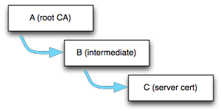

# 鍵と証明書

本章では、wolfSSLがサポートしている鍵と証明書のフォーマット、証明書と鍵の読み込みと検証の方法、および鍵、証明書、証明書署名要求の生成方法について説明します。

## サポートしているフォーマットとサイズ

wolfSSL（旧称CyaSSL）は証明書と鍵において**PEM**および**DER**フォーマットをサポートしています。
また、PKCS#8秘密鍵（PKCS#5またはPKCS#12暗号化付き）もサポートしています。

**PEM**、つまり「Privacy Enhanced Mail」は、認証局によって証明書が発行される最も一般的なフォーマットです。
PEMファイルはBase64エンコードされたASCIIファイルで、複数のサーバー証明書、中間証明書、秘密鍵を含むことができ、通常は`.pem`、`.crt`、`.cer`、または`.key`のファイル拡張子を持ちます。
PEMファイル内の証明書は「`-----BEGIN CERTIFICATE-----`」と「`-----END CERTIFICATE-----`」のステートメントで囲まれています。

**DER**、つまり「Distinguished Encoding Rules」は、証明書のバイナリフォーマットです。
DERファイル拡張子には`.der`と`.cer`があり、テキストエディタでは表示できません。

X.509証明書はASN.1フォーマットを使用してエンコードされます。
DERフォーマットはASN.1エンコーディングです。
PEMフォーマットはBase64エンコードされ、人間が読めるヘッダーとフッターで囲まれています。
TLSは証明書をDERフォーマットで送信します。

**PKCS #12**（PFXとも呼ばれます）は、秘密鍵とその証明書、CAチェーンを1つのファイルにまとめ、パスワードで保護したバンドルです。
通常は`.p12`または`.pfx`の拡張子を持ちます。
wolfSSLはwolfCryptのPKCS #12 APIを通じてこれらのバンドルの読み書きができます。詳細は[PKCS #12](chapter04.md#pkcs-12)をご参照ください。

## サポートしている証明書拡張

サポートしていない、または未知の拡張機能がクリティカルとしてマークされている場合、エラーメッセージを出力します。
それ以外の場合では、これらの拡張機能は無視されます。
ほとんどの拡張機能は、デフォルトのビルドで解析されます。
`--enable-certext`（マクロ`WOLFSSL_CERT_EXT`）または`WOLFSSL_SEP`が必要になるのは、Certificate Policies拡張を解析する場合と、拡張機能を生成する場合のみです。
以下は、一部またはすべての拡張機能が使用でき、**解析**に対応している証明書拡張機能の一覧です。

| [RFC 5280](https://tex2e.github.io/rfc-translater/html/rfc5280.html#4-2--Certificate-Extensions)からの拡張機能 | サポート |
| --- | --- |
| Authority Key Identifier | はい |
| Subject Key Identifier | はい |
| Key Usage | はい |
| Certificate Policies | はい（`WOLFSSL_CERT_EXT`または`WOLFSSL_SEP`が必要） |
| Policy Mappings | いいえ |
| Subject Alternative Name | はい |
| Issuer Alternative Name | いいえ |
| Subject Directory Attributes | はい（`WOLFSSL_SUBJ_DIR_ATTR`定義時） |
| Basic Constraints | はい |
| Name Constraints | はい |
| Policy Constraints | 一部（解析はしますが、`WOLFSSL_NO_ASN_STRICT`を定義しない限り、クリティカルの場合は拒否します） |
| Extended Key Usage | はい |
| CRL Distribution Points | はい |
| Inhibit anyPolicy | 一部（制約は適用せず、`WOLFSSL_NO_ASN_STRICT`を定義しない限り、クリティカルの場合は拒否します） |
| Freshest CRL | いいえ |
| Authority Information Access | はい（`WOLFSSL_ALLOW_CRIT_AIA`を定義しない限り、クリティカルの場合は拒否します） |
| Subject Information Access | はい（`WOLFSSL_SUBJ_INFO_ACC`定義時） |

| 追加の拡張機能 | サポート |
| --- | --- |
| Netscape | はい |
| Custom OID | はい |
| OCSP No Check | はい（`HAVE_OCSP`定義時） |
| 代替公開鍵と代替署名（SubjectAltPublicKeyInfo、AltSignatureAlgorithm、AltSignatureValue） | はい（`WOLFSSL_DUAL_ALG_CERTS`定義時） |
| ACME識別子 | はい（`WOLFSSL_ACME_OID`定義時） |

次のいくつかのセクションでは、個々の証明書拡張機能のサポート状況について詳しくご説明します。

### Authority / Subject Key Identifier

デフォルトでは、鍵IDは鍵のSHA-1ハッシュです。
鍵のSHA256ハッシュもサポートしています。

### Subject Alternative Names

| Alternative Name Types | サポート |
| ---------------------- | --- |
| メール | はい |
| DNS名 | はい |
| IPアドレス | はい |
| URI | はい |
| ディレクトリ名 | はい |
| 登録ID | はい |
| その他の名前 | はい（`WOLFSSL_SEP`または`WOLFSSL_FPKI`定義時に値をデコード：UPNに加え、`WOLFSSL_FPKI`ではFASC-N、`WOLFSSL_SEP`ではハードウェアモジュール名） |

### Key Usage

Key Usageは、証明書の解析完了後に取得・解析できます。

| Key Usage | サポート |
| --------- | --- |
| digitalSignature | はい |
| nonRepudiation | はい |
| keyEncipherment | はい |
| dataEncipherment | はい |
| keyAgreement | はい |
| keyCertSign | はい |
| cRLSign | はい |
| encipherOnly | はい |
| decipherOnly | はい |

### Extended Key Usage

wolfSSLバージョン3.15.5以降では、不明/サポートしていないExtended Key Usageは無視されます。
3.15.5より前のバージョンでは、不明なExtended Key Usage OIDは解析エラーを出力します。

| Extended Key Usage | サポート |
| ------------------ | --- |
| anyExtendedKeyUsage | はい |
| id-kp-serverAuth | はい |
| id-kp-clientAuth | はい |
| id-kp-codeSigning | はい |
| id-kp-emailProtection | はい |
| id-kp-timeStamping | はい |
| id-kp-OCSPSigning | はい |

### カスタムOID拡張

カスタムOID X.509拡張機能の挿入と解析はwolfSSLバージョン5.3.0で導入されました。
`wc_SetCustomExtension()`を使用して`Cert`構造体にカスタム拡張機能を設定するには、有効化オプション`--enable-certgen`と`--enable-certext`（`WOLFSSL_CERT_EXT`）を、マクロ`WOLFSSL_CUSTOM_OID`および`HAVE_OID_ENCODING`と一緒に使用する必要があります。
ASN.1テンプレートコード（`WOLFSSL_ASN_TEMPLATE`）も必要です。
ASN.1テンプレートコードは、`WOLFSSL_ASN_ORIGINAL`を定義しない限り、`WOLFSSL_USER_SETTINGS`を使用するビルドを含むすべてのビルドでデフォルトで使用されます。

`DecodedCert`構造体の解析時に未知の拡張機能OIDを処理するには、`wc_SetUnknownExtCallback()`でコールバックを登録します。
これには`WC_ASN_UNKNOWN_EXT_CB`が必要です。
`WC_ASN_UNKNOWN_EXT_CB`は、`WOLFSSL_CUSTOM_OID`、`HAVE_OID_DECODING`、およびASN.1テンプレートコードがすべて有効な場合に自動的に有効になります。
TLS接続で受信した証明書に対しては、`wolfSSL_CertManagerSetUnknownExtCallback()`を使用して証明書マネージャーにコールバックを登録します。
これらのコールバックはOIDを`word16`のアーク（arc）の配列として受け取るため、65535より大きいアークは切り捨てられます。
そのため、`word32`版の`wc_SetUnknownExtCallback32()`、`wc_SetUnknownExtCallback32Ex()`、`wolfSSL_CertManagerSetUnknownExtCallback32()`の使用を推奨します。
`...Ex`版では、ユーザーコンテキストもコールバックに渡されます。

configureオプション`--enable-asn=all`（`WOLFSSL_ASN_ALL`）を指定すると、`WOLFSSL_CERT_EXT`、`WOLFSSL_CUSTOM_OID`、`HAVE_OID_ENCODING`、`HAVE_OID_DECODING`が有効になります。

### 厳格なDER解析

wolfSSL 5.9.4は、DER構造の後ろに余分なバイトが続く証明書を拒否し、`WOLFSSL_X509`には証明書そのものだけをコピーします。
このような証明書を受け入れるには、`WOLFSSL_NO_ASN_STRICT`を定義してください。
パーサーは、クリティカルなpolicyConstraints拡張またはinhibitAnyPolicy拡張、空のcertificatePolicies、最後のPolicyInformationの後ろに続く余分なバイト、または重複したNetscape証明書タイプ拡張を含む証明書も拒否します。
Extended Key Usageは、リーフ証明書だけでなく、ピアがチェーンで送信するすべてのCA証明書に対して適用されます。
使用している用途を持たないCA証明書がチェーンに含まれている場合、ハンドシェイクは`EXTKEYUSE_AUTH_E`で失敗します。
読み込み済みのトラストアンカーと一致する（サブジェクトと公開鍵が同じ）チェーン内の証明書は、この検査の対象外です。
これは、RFC 5280ではトラストアンカーを証明書パスの外側に置くためです。
ただし、鍵のロールオーバー証明書のように、異なる鍵を持つ自己発行証明書は引き続き検査されます。
拡張が存在しない場合とanyExtendedKeyUsageの場合は、すべての用途が有効とみなされます。
`IGNORE_KEY_EXTENSIONS`を定義すると、この検査を行わないようにできます。

## 証明書の読み込み

証明書は通常ファイルシステムを使用して読み込まれますが、メモリバッファからの読み込みもサポートしています。
詳しくは、本章下部の「ファイルシステムなしでの証明書の使用」節をご参照ください。

### CA証明書の読み込み

CA証明書ファイルは[`wolfSSL_CTX_load_verify_locations()`](group__CertsKeys.md#function-wolfssl_ctx_load_verify_locations)関数を使用して読み込むことができます。

```c
int wolfSSL_CTX_load_verify_locations(WOLFSSL_CTX *ctx,
                                      const char *CAfile,
                                      const char *CApath);
```

複数のCA証明書情報を`CAfile`(PEMフォーマット)にまとめて記載しておくことで、それらを一括して解析することもできます。
これは初期化を容易にし、特にクライアントが起動時に複数のルートCAを読み込む必要がある場合に便利です。
このように処理することで、CAとして単一のファイルを使用することを想定しているツールに移植しやすくしています。

**注意**：ルート証明書と中間証明書のチェーンを読み込む必要がある場合、信頼の順にそれらを読み込む必要があります。
まずルートCAを読み込み、次に中間1、次に中間2などを読み込みます。
読み込む各証明書に対して[`wolfSSL_CTX_load_verify_locations()`](group__CertsKeys.md#function-wolfssl_ctx_load_verify_locations)を呼び出すか、順序付けられた証明書（ファイルの先頭にルートがあり、信頼のチェーンによって順序付けられた証明書）を含むファイルで一度だけこの関数を実行します。

### クライアントまたはサーバー証明書の読み込み

単一のクライアントまたはサーバー証明書の読み込みは[`wolfSSL_CTX_use_certificate_file()`](group__CertsKeys.md#function-wolfssl_ctx_use_certificate_file)関数で行うことができます。
この関数を証明書チェーンで使用する場合、実際の「最下位」の証明書のみが送信されます。

```c
int wolfSSL_CTX_use_certificate_file(WOLFSSL_CTX* ctx,
                                     const char* file,
                                     int format);
```

`file`はクライアントまたはサーバー（エンティティ）の証明書ファイルであり、`format`はそのエンコーディング（`WOLFSSL_FILETYPE_PEM`または`WOLFSSL_FILETYPE_ASN1`）です。

サーバーとクライアントは[`wolfSSL_CTX_use_certificate_chain_file()`](group__CertsKeys.md#function-wolfssl_ctx_use_certificate_chain_file)関数を使用して証明書チェーンを送信できます。
証明書チェーンファイルはPEMフォーマットである必要があり、サブジェクトの証明書（実際のクライアントまたはサーバー証明書）から始まり、中間証明書が続き、オプションで最上位のルートCA証明書で終わるように並べる必要があります。
サーバーのサンプルプログラム（`/examples/server/server.c`）では、この機能を使用しています。

**注意**：これは、検証のために証明書チェーンを読み込む場合とは正反対です。
このシナリオでのファイル内容は、ファイルの先頭にエンティティ証明書があり、その次にチェーンの次の証明書が続き、ファイルの最後にルートCAがある形になります。

```c
int wolfSSL_CTX_use_certificate_chain_file(WOLFSSL_CTX *ctx,
                                 const char *file);
```

### 秘密鍵の読み込み

サーバー秘密鍵は[`wolfSSL_CTX_use_PrivateKey_file()`](group__CertsKeys.md#function-wolfssl_ctx_use_privatekey_file)関数を使用して読み込むことができます。

```c
int wolfSSL_CTX_use_PrivateKey_file(WOLFSSL_CTX *ctx,
                      const char *keyFile, int type);
```

`keyFile`は秘密鍵ファイルであり、`type`は秘密鍵のフォーマット（例：`WOLFSSL_FILETYPE_PEM`）です。

### 暗号化された秘密鍵の読み込み

wolfSSLを`WOLFSSL_ENCRYPTED_KEYS`（`--enable-enckeys`で有効になり、`--enable-opensslextra`でも有効になります）付きでビルドすると、パスワードで保護された（暗号化された）PEMおよびPKCS #8の秘密鍵を同じ関数で読み込むことができます。
鍵を読み込む前に、`wolfSSL_CTX_set_default_passwd_cb()`でパスワードコールバックを登録します。
必要に応じて、`wolfSSL_CTX_set_default_passwd_cb_userdata()`でコールバックにユーザーデータを渡すこともできます。

```c
int myPasswordCb(char* passwd, int sz, int rw, void* userdata)
{
    const char* pass = "my-key-password";
    int len = (int)strlen(pass);

    (void)rw;
    (void)userdata;
    if (len > sz)
        return -1;
    memcpy(passwd, pass, len);
    return len; /* length of the password */
}

wolfSSL_CTX_set_default_passwd_cb(ctx, myPasswordCb);
ret = wolfSSL_CTX_use_PrivateKey_file(ctx, "./server-key-enc.pem",
                                      WOLFSSL_FILETYPE_PEM);
```

鍵の暗号化に使用した暗号アルゴリズムは、ビルドで有効になっている必要があります。
例えば、wolfSSLの`certs`ディレクトリにある暗号化されたテスト鍵はDESまたは3DESを使用していますが、これらはデフォルトで無効です。

### 信頼されるピア証明書の読み込み

信頼されるピア証明書の読み込みは[`wolfSSL_CTX_trust_peer_cert()`](group__Setup.md#function-wolfssl_ctx_trust_peer_cert)で行うことができます。

```c
int wolfSSL_CTX_trust_peer_cert(WOLFSSL_CTX *ctx,
                 const char *trustCert, int type);
```

`trustCert`は読み込む証明書ファイルであり、`type`は証明書のフォーマット（例：`WOLFSSL_FILETYPE_PEM`）です。
信頼されるピア証明書を使用するには、[`WOLFSSL_TRUST_PEER_CERT`](chapter02.md#wolfssl_trust_peer_cert)を定義してwolfSSLをビルドする必要があります。
専用のconfigureオプションはないため、`CFLAGS`で追加してください（例：`./configure CFLAGS="-DWOLFSSL_TRUST_PEER_CERT"`）。

### システムCA証明書の読み込み

オペレーティングシステムが信頼するCA証明書は、`wolfSSL_CTX_load_system_CA_certs()`で読み込むことができます。
この関数は、wolfSSLを[`--enable-sys-ca-certs`](chapter02.md#--disable-sys-ca-certs)（デフォルトで有効）でビルドした場合に利用できます。

```c
int wolfSSL_CTX_load_system_CA_certs(WOLFSSL_CTX* ctx);
```

### PEMからDERへの変換

メモリ上のPEMデータをDERに変換するために、wolfCryptは秘密鍵用の`wc_KeyPemToDer()`（暗号化された鍵の場合はオプションでパスワードを指定）、証明書用の`wc_CertPemToDer()`、およびより汎用的な`wc_PemToDer()`を提供しています。
`wc_PemToDer()`はPEMのタイプを引数に取り、`DerBuffer`を返します。
これらは`wolfssl/wolfcrypt/asn_public.h`で宣言されています。

```c
int wc_KeyPemToDer(const unsigned char* pem, int pemSz,
                   unsigned char* buff, int buffSz, const char* pass);
int wc_CertPemToDer(const unsigned char* pem, int pemSz,
                    unsigned char* buff, int buffSz, int type);
```

## 証明書チェーンの検証

wolfSSLでは、証明書チェーン全体を検証するために、チェーン内のトップまたは「ルート」証明書のみを信頼された証明書として読み込む必要があります。
つまり、証明書チェーン（A -> B -> C）があり、CがBによって署名され、BがAによって署名されている場合、wolfSSLはチェーン全体（A->B->C）を検証するために証明書Aのみを信頼された証明書として読み込む必要があります。

例えば、サーバー証明書チェーンが次のようになっているとき、



wolfSSLクライアントは、少なくともルート証明書（A）を信頼されたルートとして（[`wolfSSL_CTX_load_verify_locations()`](group__CertsKeys.md#function-wolfssl_ctx_load_verify_locations)で）あらかじめ読み込んでおく必要があります。
クライアントがサーバー証明書チェーンを受信すると、Aの署名を使用してBを検証し、Bが以前にwolfSSLに信頼されたルートとして読み込まれていない場合、BはwolfSSLの内部証明書チェーンに保存されます（wolfSSLは証明書を検証するために必要なもの、つまり共通名ハッシュ、公開鍵、鍵タイプなどのみを保存します）。
Bが有効であれば、それを使用してCを検証します。

このモデルに従えば、ルート証明書「A」がwolfSSLクライアントに信頼されたルートとして読み込まれている限り、サーバーが（A->B->C）または（B->C）を送信した場合でも、サーバー証明書チェーンは検証できます。
サーバーが中間証明書ではなく（C）のみを送信する場合、wolfSSLクライアントがすでにBを信頼されたルートとして読み込んでいない限り、チェーンは検証できません。

## サーバー証明書のドメイン名チェック

wolfSSLには、サーバー証明書のドメインを自動的にチェックするクライアント拡張機能があります。
OpenSSLモードでは、これを実行するために約十個の関数呼び出しが必要です。
wolfSSLは証明書の日付が範囲内であることをチェックし、署名を検証し、さらに[`wolfSSL_connect()`](group__IO.md#function-wolfssl_connect)を呼び出す前に[`wolfSSL_check_domain_name(WOLFSSL* ssl, const char* dn)`](group__Setup.md#function-wolfssl_check_domain_name)を呼び出した場合にドメインを検証します。
wolfSSLは`dn`（期待されるドメイン名）を、ピアのサーバー証明書のsubjectAltNameにあるDNSエントリと照合します。
証明書にsubjectAltNameのDNSエントリがない場合に限り、サブジェクトのCommon Nameと照合します。
名前が一致すれば[`wolfSSL_connect()`](group__IO.md#function-wolfssl_connect)は正常に進行しますが、名前が一致しない場合、[`wolfSSL_connect()`](group__IO.md#function-wolfssl_connect)は致命的なエラーを返し、[`wolfSSL_get_error()`](group__Debug.md#function-wolfssl_get_error)は`DOMAIN_NAME_MISMATCH`を返します。

証明書のドメイン名をチェックすることは、サーバーが実際に名乗っているものと一致していることを検証する重要なステップです。
この拡張機能は、チェックを実行する負担を軽減するためのものです。

## ファイルシステムなしでの証明書の使用

通常、秘密鍵、証明書、CAを読み込むためにファイルシステムを使用します。
wolfSSLは完全なファイルシステムのない環境で使用されることがあるため、代わりにメモリバッファを使用するための拡張機能も提供しています。
以下の関数は、証明書をサポートするすべてのビルドで利用でき（`NO_FILESYSTEM`には依存しません）、`NO_FILESYSTEM`を定義した場合は唯一の選択肢となります（`wolfSSL_CTX_trust_peer_buffer()`には`WOLFSSL_TRUST_PEER_CERT`も必要です）。

* [`int wolfSSL_CTX_load_verify_buffer(WOLFSSL_CTX* ctx, const unsigned char* in,long sz, int format);`](group__CertsKeys.md#function-wolfssl_ctx_load_verify_buffer)
* [`int wolfSSL_CTX_use_certificate_buffer(WOLFSSL_CTX* ctx, const unsigned char* in, long sz, int format);`](group__CertsKeys.md#function-wolfssl_ctx_use_certificate_buffer)
* [`int wolfSSL_CTX_use_PrivateKey_buffer(WOLFSSL_CTX* ctx, const unsigned char* in, long sz, int format);`](group__CertsKeys.md#function-wolfssl_ctx_use_privatekey_buffer)
* [`int wolfSSL_CTX_use_certificate_chain_buffer(WOLFSSL_CTX* ctx, const unsigned char* in,long sz);`](group__CertsKeys.md#function-wolfssl_ctx_use_certificate_chain_buffer)
* [`int wolfSSL_CTX_trust_peer_buffer(WOLFSSL_CTX* ctx, const unsigned char* in, long sz, int format);`](group__Setup.md#function-wolfssl_ctx_trust_peer_buffer)

これらの関数は、`*_buffer`ではなく`*_file`という名前の対応する関数と全く同じように使用します。
そしてファイル名を提供する代わりにメモリバッファを提供します。
使用法の詳細についてはAPIドキュメントをご参照ください。

### テスト証明書と鍵バッファ

wolfSSLには、テスト証明書と鍵のファイルが同梱されています。
さらに、ファイルシステムが利用できない環境で使用するためのテスト証明書と鍵バッファも同梱しています。
これらのバッファは、`USE_CERT_BUFFERS_1024`、`USE_CERT_BUFFERS_2048`、`USE_CERT_BUFFERS_3072`、`USE_CERT_BUFFERS_4096`、`USE_CERT_BUFFERS_256`、`USE_CERT_BUFFERS_25519`のうち1つ以上を定義すると`wolfssl/certs_test.h`で利用できます。

## シリアル番号の取得

X.509証明書のシリアル番号は[`wolfSSL_X509_get_serial_number()`](group__openSSL.md#function-wolfssl_x509_get_serial_number)を使用してwolfSSLから抽出できます。
シリアル番号は任意の長さになる可能性があります。

```c
int wolfSSL_X509_get_serial_number(WOLFSSL_X509* x509,
            unsigned char* buffer, int* inOutSz)
```

`buffer`には入力時に最大`*inOutSz`バイトが書き込まれます。
成功した場合、0が返され、呼び出し後に`*inOutSz`には`buffer`に実際に書き込まれたバイト数が保持されます。
完全なサンプルプログラムは`wolfssl/test.h`で提供しています。

## RSA鍵生成

wolfSSLは、`RSA_MIN_SIZE`（デフォルトでは2048ビット）から`RSA_MAX_SIZE`までの長さのRSA鍵生成をサポートしています。
`RSA_MAX_SIZE`は数学ライブラリの設定（`SP_INT_BITS`または`FP_MAX_BITS`）に依存します。
鍵生成はデフォルトではオフですが、`./configure`プロセスに`--enable-keygen`引数を加えることで（Windowsや非標準環境では、`WOLFSSL_KEY_GEN`を定義することで）有効化できます。
鍵の作成は簡単で、`rsa.h`から1つの関数のみを使用します。

```c
int wc_MakeRsaKey(RsaKey* key, int size, long e, WC_RNG* rng);
```

ここで`size`はビット単位の長さ、`e`は公開指数で、通常`e`には65537を使用するのが良いでしょう。
以下は、`wolfcrypt/test/test.c`を基にした、2048ビットのRSA鍵を作成する例です。

```c
RsaKey genKey;
WC_RNG rng;
int    ret;

ret = wc_InitRng(&rng);
if (ret != 0)
    /* ret contains error */;
ret = wc_InitRsaKey(&genKey, NULL);
if (ret != 0)
    /* ret contains error */;

ret = wc_MakeRsaKey(&genKey, 2048, 65537, &rng);
if (ret != 0)
    /* ret contains error */;
```

不要になったら、`wc_FreeRsaKey(&genKey)`と`wc_FreeRng(&rng)`で鍵とRNGを解放してください。

RsaKey `genKey`は、他のRsaKeyと同じように使用できます。
鍵をエクスポートする必要がある場合、`wc_RsaKeyToDer()`（`rsa.h`で宣言）で鍵をDERにエンコードし、`wc_DerToPem()`（`asn_public.h`で宣言）でDERをPEMに変換します。
`wc_DerToPem()`には`WOLFSSL_DER_TO_PEM`が必要です。
`WOLFSSL_DER_TO_PEM`は、`--enable-keygen`、`--enable-certgen`、`--enable-opensslextra`で自動的に有効になります。
いずれの場合も、まずは鍵をDERフォーマットに変換し、PEMが必要であれば汎用の`wc_DerToPem()`関数を次のように使用します。

```c
byte der[4096];
int  derSz = wc_RsaKeyToDer(&genKey, der, sizeof(der));
if (derSz < 0)
    /* derSz contains error */;
```

バッファ`der`には現在、鍵のDERフォーマットが含まれています。
DERバッファをPEMに変換するには、変換関数を使用します。

```c
byte pem[4096];
int  pemSz = wc_DerToPem(der, derSz, pem, sizeof(pem),
                      PRIVATEKEY_TYPE);
if (pemSz < 0)
    /* pemSz contains error */;
```

`wc_DerToPem()`の最後の引数はタイプパラメータを取り、通常は`PRIVATEKEY_TYPE`または`CERT_TYPE`のいずれかです。
現在バッファ`pem`には鍵のPEMフォーマットが含まれています。
サポートしているタイプは、以下の通りです。
一部のタイプは、対応する機能がコンパイルされている場合にのみ利用できます（例えば、`CERTREQ_TYPE`には`WOLFSSL_CERT_REQ`が、`ED448_TYPE`には`HAVE_ED448`が必要です）。

* `CA_TYPE`
* `TRUSTED_PEER_TYPE`
* `CHAIN_CERT_TYPE`
* `CERT_TYPE`
* `TRUSTED_CERT_TYPE`
* `CRL_TYPE`
* `DH_PARAM_TYPE`
* `X942_PARAM_TYPE`
* `DSA_PARAM_TYPE`
* `CERTREQ_TYPE`
* `PKCS7_TYPE`
* `ACERT_TYPE`
* `DSA_TYPE`
* `DSA_PRIVATEKEY_TYPE`
* `ECC_TYPE`
* `ECC_PRIVATEKEY_TYPE`
* `ECC_PARAM_TYPE`
* `RSA_TYPE`
* `PRIVATEKEY_TYPE`
* `ED25519_TYPE`
* `ED448_TYPE`
* `EDDSA_PRIVATEKEY_TYPE`
* `FALCON_LEVEL1_TYPE`、`FALCON_LEVEL5_TYPE`
* `ML_DSA_44_TYPE`、`ML_DSA_65_TYPE`、`ML_DSA_87_TYPE`
* `SLH_DSA_SHAKE_128F_TYPE`、`SLH_DSA_SHAKE_192F_TYPE`、`SLH_DSA_SHAKE_256F_TYPE`、`SLH_DSA_SHAKE_128S_TYPE`、`SLH_DSA_SHAKE_192S_TYPE`、`SLH_DSA_SHAKE_256S_TYPE`、および対応する`SLH_DSA_SHA2_*_TYPE`の値
* `PUBLICKEY_TYPE`
* `ECC_PUBLICKEY_TYPE`
* `RSA_PUBLICKEY_TYPE`
* `DH_PRIVATEKEY_TYPE`
* `PKCS8_PRIVATEKEY_TYPE`
* `PKCS8_ENC_PRIVATEKEY_TYPE`

### RSA鍵生成に関する注意

RSA秘密鍵には公開鍵も含まれています。
`test.c`で使用されているように、秘密鍵はwolfSSLによって秘密鍵と公開鍵の両方として使用できます。
通常、SSL/TLSに必要なのは秘密鍵と（証明書の形式の）公開鍵のみです。

必要に応じて、`wc_RsaPublicKeyDecode()`関数を使用して別の公開鍵をwolfSSLに手動で読み込むこともできます。
そして、[`wc_RsaKeyToPublicDer()`](group__RSA.md#function-wc_rsakeytopublicder)関数を使用してRSA公開鍵をエクスポートすることもできます。

## ECCおよびEd25519鍵生成

ECC鍵は`ecc.h`の`wc_ecc_make_key()`で生成します。
鍵サイズはバイト単位で指定します（デフォルトのP-256曲線では32）。
`wc_ecc_make_key_ex()`は、曲線IDも引数に取ります。
Ed25519鍵（`--enable-ed25519`）は`ed25519.h`の`wc_ed25519_make_key()`で生成します。
このとき、鍵サイズは`ED25519_KEY_SIZE`（32）である必要があります。
前述のRSAの例の`rng`を使用した例を以下に示します。

```c
ecc_key     eccKey;
ed25519_key edKey;

ret = wc_ecc_init(&eccKey);
if (ret == 0)
    ret = wc_ecc_make_key(&rng, 32, &eccKey);
if (ret != 0)
    /* ret contains error */;

ret = wc_ed25519_init(&edKey);
if (ret == 0)
    ret = wc_ed25519_make_key(&rng, ED25519_KEY_SIZE, &edKey);
if (ret != 0)
    /* ret contains error */;
```

使用後は、`wc_ecc_free()`と`wc_ed25519_free()`で鍵を解放してください。
`wc_EccKeyToDer()`（本章の「ECC鍵のDERへのエクスポート」節を参照）と`wc_Ed25519KeyToDer()`で、これらの鍵をDERフォーマットでエクスポートできます。

## 証明書生成

wolfSSLはX.509 v3証明書生成をサポートしています。
証明書生成はデフォルトではオフですが、`./configure`プロセスに`--enable-certgen`引数を加えることで（Windowsや非標準環境では、`WOLFSSL_CERT_GEN`を定義することで）有効化できます。

証明書を生成する前に、ユーザーは証明書のサブジェクト情報を入力する必要があります。
この情報は`wolfssl/wolfcrypt/asn_public.h`にある`Cert`という構造体に含まれています。

```c
/* for user to fill for certificate generation */
typedef struct Cert {
    int      version;                   /* x509 version  */
    byte     serial[CTC_SERIAL_SIZE];   /* serial number */
    int      serialSz;                  /* serial size */
    int      sigType;                   /* signature algo type */
    CertName issuer;                    /* issuer info */
    CertName subject;                   /* subject info */
    int      daysValid;                 /* validity days */
    int      selfSigned;                /* self signed flag */
    int      isCA;                      /* is this going to be a CA */
    byte     pathLen;                   /* max depth of valid certification
                                         * paths that include this cert */
    ...
} Cert;
```

CertNameは次のようになります（抜粋のため、完全な定義は`asn_public.h`をご参照ください）。

```c
typedef struct CertName {
    char country[CTC_NAME_SIZE];
    char countryEnc;
    char state[CTC_NAME_SIZE];
    char stateEnc;
    char street[CTC_NAME_SIZE];
    char streetEnc;
    char locality[CTC_NAME_SIZE];
    char localityEnc;
    char sur[CTC_NAME_SIZE];
    char surEnc;
    ...
    char org[CTC_NAME_SIZE];
    char orgEnc;
    char unit[CTC_NAME_SIZE];
    char unitEnc;
    char commonName[CTC_NAME_SIZE];
    char commonNameEnc;
    char serialDev[CTC_NAME_SIZE];
    char serialDevEnc;
    char userId[CTC_NAME_SIZE];
    char userIdEnc;
    char postalCode[CTC_NAME_SIZE];
    char postalCodeEnc;
    ...
    char email[CTC_NAME_SIZE];  /* !!!! email has to be last !!!! */
    ...
} CertName;
```

`WOLFSSL_CERT_NAME_ALL`を定義すると、この構造体には`givenName`、`initials`、`dnQualifier`、`dnName`フィールドも含まれます。
また、`WOLFSSL_CERT_EXT`を定義すると、`busCat`、`joiC`、`joiSt`フィールドが含まれます。
これらは`email`より前に配置されます。
`email`の後には、`name[]`（`WOLFSSL_MULTI_ATTRIB`定義時）と`custom`（`WOLFSSL_CUSTOM_OID`定義時）が続きます。

サブジェクト情報を入力する前に、次のように初期化関数を呼び出す必要があります。

```c
Cert myCert;
wc_InitCert(&myCert);
```

`wc_InitCert()`は、いくつかの変数にデフォルト値を設定します。
バージョンを**3** (0x02)、シリアル番号を**0**（ランダム生成）、sigTypeを`CTC_SHA256wRSA`（SHA-256が無効な場合は、SHA-384、SHA-512、SHA-224、またはSHA-1を使用するRSAにフォールバック）、daysValidを**500**、selfSignedを**1**（TRUE）に設定します。
サポートしている署名タイプは次の通りです。
各タイプは、対応するアルゴリズムがコンパイルされている場合に利用できます。

* `CTC_SHAwDSA`、`CTC_SHA256wDSA`
* `CTC_MD2wRSA`
* `CTC_MD5wRSA`
* `CTC_SHAwRSA`
* `CTC_SHAwECDSA`
* `CTC_SHA224wRSA`
* `CTC_SHA224wECDSA`
* `CTC_SHA256wRSA`
* `CTC_SHA256wECDSA`
* `CTC_SHA384wRSA`
* `CTC_SHA384wECDSA`
* `CTC_SHA512wRSA`
* `CTC_SHA512wECDSA`
* `CTC_SHA3_224wRSA`、`CTC_SHA3_256wRSA`、`CTC_SHA3_384wRSA`、`CTC_SHA3_512wRSA`
* `CTC_SHA3_224wECDSA`、`CTC_SHA3_256wECDSA`、`CTC_SHA3_384wECDSA`、`CTC_SHA3_512wECDSA`
* `CTC_RSASSAPSS`
* `CTC_ED25519`
* `CTC_ED448`
* `CTC_ML_DSA_44`、`CTC_ML_DSA_65`、`CTC_ML_DSA_87`
* `CTC_SLH_DSA_SHAKE_128F`、`CTC_SLH_DSA_SHAKE_192F`、`CTC_SLH_DSA_SHAKE_256F`、`CTC_SLH_DSA_SHAKE_128S`、`CTC_SLH_DSA_SHAKE_192S`、`CTC_SLH_DSA_SHAKE_256S`、および対応する`CTC_SLH_DSA_SHA2_*`の値
* `CTC_FALCON_LEVEL1`、`CTC_FALCON_LEVEL5`
* `CTC_HSS_LMS`
* `CTC_XMSS`、`CTC_XMSSMT`
* `CTC_SM3wSM2`

続いて、`wolfcrypt/test/test.c`にある以下の例のように、サブジェクト情報を初期化します。

```c
strncpy(myCert.subject.country, "US", CTC_NAME_SIZE);
strncpy(myCert.subject.state, "OR", CTC_NAME_SIZE);
strncpy(myCert.subject.locality, "Portland", CTC_NAME_SIZE);
strncpy(myCert.subject.org, "yaSSL", CTC_NAME_SIZE);
strncpy(myCert.subject.unit, "Development", CTC_NAME_SIZE);
strncpy(myCert.subject.commonName, "www.wolfssl.com", CTC_NAME_SIZE);
strncpy(myCert.subject.email, "facts@wolfssl.com", CTC_NAME_SIZE);
```

そして、上記の鍵生成例からの変数`genKey`と`rng`を使用して、自己署名証明書を生成できます。
もちろん、有効なRsaKeyやRNGであれば、どのようなものでも使用できます。

```c
byte derCert[4096];

int certSz = wc_MakeSelfCert(&myCert, derCert, sizeof(derCert), &genKey, &rng);
if (certSz < 0)
  /* certSz contains the error */;
```

バッファ`derCert`にはDERフォーマットの証明書が含まれています。
証明書のPEMフォーマットが必要な場合は、汎用の`wc_DerToPem()`関数を使用して、タイプを`CERT_TYPE`として指定します。

```c
byte pemCert[4096];

int pemCertSz = wc_DerToPem(derCert, certSz, pemCert, sizeof(pemCert), CERT_TYPE);
if (pemCertSz < 0)
  /* pemCertSz contains error */;
```

サポートしているタイプは、前述の「RSA鍵生成」節に記載しています。

これで、バッファ`pemCert`には証明書のPEMフォーマットが含まれています。

CA署名付き証明書を作成したい場合は、いくつかの手順が必要です。
前述のようにサブジェクト情報を入力した後、CA証明書から発行者情報を設定する必要があります。
これは`wc_SetIssuer()`を使用して次のように実行できます。
`wc_SetIssuer()`はCA証明書をPEMファイルから読み込むため、ファイルシステムのサポートが必要です。

```c
ret = wc_SetIssuer(&myCert, "./certs/ca-cert.pem");
if (ret < 0)
    /* ret contains error */;
```

ファイルシステムがない場合は、CA証明書をDERバッファとして受け取る`wc_SetIssuerBuffer()`を使用してください。

その後、証明書を作成し、それに署名する2段階のプロセスを実行する必要があります。
（`wc_MakeSelfCert()`は一度にこれら両方を実行します）
発行者（`caKey`）と対象（`key`）の両方の秘密鍵が必要です。
完全な使用方法については、`test.c`の実装例をご参照ください。

```c
byte derCert[4096];

int certSz = wc_MakeCert(&myCert, derCert, sizeof(derCert), &key, NULL, &rng);
if (certSz < 0)
   /*certSz contains the error*/;

certSz = wc_SignCert(myCert.bodySz, myCert.sigType, derCert,
            sizeof(derCert), &caKey, NULL, &rng);
if (certSz < 0)
   /*certSz contains the error*/;
```

これで、バッファ`derCert`にはCA署名付き証明書のDERフォーマットが含まれ、`wc_SignCert()`の戻り値である`certSz`がその全体のサイズとなります。
証明書のPEMフォーマットが必要な場合は、上記の自己署名の実装例をご参照ください。
`wc_MakeCert()`と`wc_SignCert()`の引数で渡せるのは、RSA鍵またはECC鍵のいずれかであることに注意してください。
上記の実装例ではRSA鍵を使用し、ECC鍵パラメータにはNULLを渡しています。
その他の鍵タイプについては、`wc_MakeCert_ex()`、`wc_SignCert_ex()`、`wc_MakeCertReq_ex()`が`keyType`（例えば`RSA_TYPE`、`ECC_TYPE`、`ED25519_TYPE`、`ED448_TYPE`、`ML_DSA_65_TYPE`、またはSLH-DSAのタイプのいずれか）と`void* key`を引数に取ります。

## 証明書署名要求（CSR）の生成

wolfSSLはX.509 v3証明書署名要求（CSR）生成をサポートしています。
CSR生成はデフォルトではオフですが、`./configure`プロセスに`--enable-certreq --enable-certgen`引数を加えることで（Windowsや非標準環境では、`WOLFSSL_CERT_GEN`**および**`WOLFSSL_CERT_REQ`を定義することで）有効化できます。

CSRを生成する前に、ユーザーは証明書のサブジェクトに関する情報を提供する必要があります。
この情報は`wolfssl/wolfcrypt/asn_public.h`にある`Cert`という構造体に含まれています。

CertとCertName構造体の詳細については、前述の「証明書生成」節をご参照ください。

サブジェクトの情報を入力する前に、次のように初期化関数を呼び出す必要があります。

```c
Cert req;
wc_InitCert(&req);
req.version = 0; /* PKCS #10 CSRs are version 0 */
```

`wc_InitCert()`は、前述の「証明書生成」節で説明したものと同じデフォルト値を設定し、サポートしている署名タイプも同じです。
デフォルトの`version`である2は、X.509 v3証明書のバージョンです。
CSRはバージョン0（PKCS #10、RFC 2986）である必要があり、`wc_MakeCertReq()`は`version`フィールドを設定された値のままエンコードするため、上記のように0を設定してください。

続いて、<https://github.com/wolfSSL/wolfssl-examples/blob/master/certgen/csr_example.c>にある以下の例のように、サブジェクト情報を初期化します。

```c
strncpy(req.subject.country, "US", CTC_NAME_SIZE);
strncpy(req.subject.state, "OR", CTC_NAME_SIZE);
strncpy(req.subject.locality, "Portland", CTC_NAME_SIZE);
strncpy(req.subject.org, "wolfSSL", CTC_NAME_SIZE);
strncpy(req.subject.unit, "Development", CTC_NAME_SIZE);
strncpy(req.subject.commonName, "www.wolfssl.com", CTC_NAME_SIZE);
strncpy(req.subject.email, "facts@wolfssl.com", CTC_NAME_SIZE);
```

そして、CSRを生成します。
この例では、「ECCおよびEd25519鍵生成」節で示したように`wc_ecc_make_key()`で初期化・生成したECC鍵`ecc_key key`を使用します（もちろん、有効なECC鍵またはRSA鍵であれば、どのようなものでも使用できます）。

```c
byte der[4096]; /* Store request in der format once made */
int  derSz;

ret = wc_MakeCertReq(&req, der, sizeof(der), NULL, &key);
/* check ret value for error handling, <= 0 indicates a failure */
```

次に、リクエストに署名して有効にします。
上記の鍵生成例から`rng`変数を使用します（もちろん、有効なECC鍵、RSA鍵、またはRNGであれば、どのようなものでも使用できます）。
`wc_SignCert()`は、署名されたリクエストの全体のサイズを返します。

```c
req.sigType = CTC_SHA256wECDSA;
derSz = wc_SignCert(req.bodySz, req.sigType, der, sizeof(der), NULL, &key, &rng);
/* check derSz for error handling, <= 0 indicates a failure */
```

最後に、CSRをPEMフォーマットに変換して、CA機関に送信して証明書の発行に使用します。
PEM出力はNUL終端されないため、返された長さを使用してください。

```c
byte pem[4096];

ret = wc_DerToPem(der, derSz, pem, sizeof(pem), CERTREQ_TYPE);
/* check ret value for error handling, <= 0 indicates a failure */
printf("%.*s", ret, (char*)pem); /* or write to a file */
```

### CSRの使用

`WOLFSSL_CERT_REQ`を定義すると、wolfSSLの証明書パーサーは、`CERTREQ_TYPE`タイプが指定された場合にCSRも受け付けます。
OpenSSL互換レイヤー（`--enable-opensslextra`）では、例えば`wolfSSL_X509_REQ_d2i()`、`wolfSSL_PEM_read_bio_X509_REQ()`、`wolfSSL_X509_REQ_verify()`を使用して、CSRを読み込んで検証できます。
CSRから証明書を発行するには、リクエストのサブジェクト名と公開鍵（`X509_REQ_get_subject_name()`と`X509_REQ_get_pubkey()`）を新しい`WOLFSSL_X509`にコピーし、発行者、シリアル番号、有効期間を設定してから、`wolfSSL_X509_sign()`で署名します。

**関連項目**：「証明書生成」節

## ECC鍵のDERへのエクスポート

`wc_EccKeyToDer()`は、秘密鍵を保持する`ecc_key`構造体をDERにエンコードします。

```c
int wc_EccKeyToDer(ecc_key* key, byte* output, word32 outLen);
```

この関数は、DERエンコーディングのサイズ、またはエラー時には負のエラーコードを返します。
関連する関数は次の通りです。

* `wc_EccPrivateKeyToDer()`：公開鍵を含めず、秘密鍵のみをエンコードします。
* `wc_EccPublicKeyToDer()`：公開鍵をエンコードします。
* `wc_KeyPemToDer()`：PEMの秘密鍵をDERに変換します（「PEMからDERへの変換」節を参照）。
* `wc_ecc_import_raw()`、`wc_ecc_export_private_raw()`、`wc_ecc_export_public_raw()`：生の鍵の値をインポートおよびエクスポートします。

### 実装例

```c
#define FOURK_BUF 4096
byte    der[FOURK_BUF];
int     derSz;
ecc_key userB;

ret = wc_ecc_init(&userB);
if (ret == 0)
    ret = wc_ecc_make_key(&rng, 32, &userB);
if (ret == 0) {
    derSz = wc_EccKeyToDer(&userB, der, FOURK_BUF);
    if (derSz < 0)
        /* derSz contains error */;
}
```
