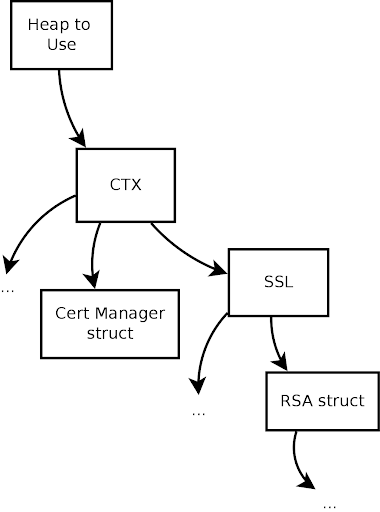
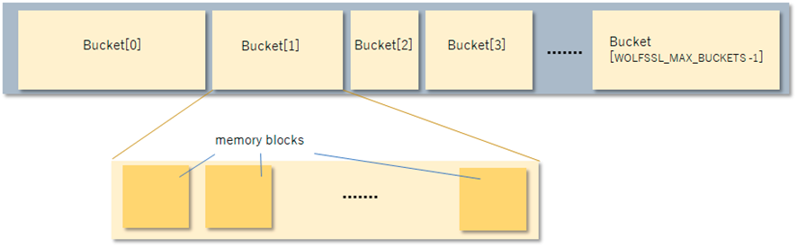

# Features

wolfSSL (formerly CyaSSL) supports the C programming language as a primary interface, but also supports several other host languages through dedicated wrappers:

* C# (`wrapper/CSharp` in the wolfSSL source tree)
* Ada/SPARK (`wrapper/Ada`)
* Rust (`wrapper/rust`, the `wolfssl-wolfcrypt` crate for the wolfCrypt API)
* Python, in separate repositories: wolfSSL-py ([https://github.com/wolfSSL/wolfssl-py](https://github.com/wolfSSL/wolfssl-py)) and wolfCrypt-py ([https://github.com/wolfSSL/wolfcrypt-py](https://github.com/wolfSSL/wolfcrypt-py))
* Java, in separate repositories: wolfSSL JNI/JSSE ([https://github.com/wolfSSL/wolfssljni](https://github.com/wolfSSL/wolfssljni)) and wolfCrypt JNI/JCE ([https://github.com/wolfSSL/wolfcrypt-jni](https://github.com/wolfSSL/wolfcrypt-jni))

If you have interest in hosting wolfSSL in another programming language that is not currently supported, please contact us.

This chapter covers some of the features of wolfSSL in more depth, including Stream Ciphers, AES-NI, IPv6 support, SSL Inspection (Sniffer) support, and more.

## Features Overview

For an overview of wolfSSL features, please reference the wolfSSL product webpage: [https://www.wolfssl.com/products/wolfssl](https://www.wolfssl.com/products/wolfssl)

## Protocol Support

wolfSSL supports **SSL 3.0**, **TLS** (**1.0**, **1.1**, **1.2, 1.3**), and **DTLS** (**1.0**, **1.2**, **1.3**). Only TLS 1.2 and TLS 1.3 are enabled in a default build. SSL 3.0, TLS 1.0 and TLS 1.1 need the [`--enable-sslv3`](chapter02.md#--enable-sslv3), [`--enable-tlsv10`](chapter02.md#--enable-tlsv10) and `--enable-oldtls` build options. DTLS needs [`--enable-dtls`](chapter02.md#--enable-dtls), plus `--enable-dtls13` for DTLS 1.3; DTLS 1.0 also needs the old TLS versions (`--enable-oldtls`). You can easily select a protocol to use by using one of the following functions (as shown for either the client or server).  wolfSSL does not support SSL 2.0, as it has been insecure for several years.  The client and server functions below change slightly when using the OpenSSL compatibility layer.  For the OpenSSL-compatible functions, please see [OpenSSL Compatibility](chapter13.md#openssl-compatibility).

### Server Functions

* [`wolfDTLSv1_server_method()`](group__Setup.md#function-wolfdtlsv1_server_method) - DTLS 1.0
* [`wolfDTLSv1_2_server_method()`](ssl_8h.md#function-wolfdtlsv1_2_server_method) - DTLS 1.2
* [`wolfDTLSv1_3_server_method()`](group__Setup.md#function-wolfdtlsv1_3_server_method) - DTLS 1.3
* [`wolfDTLS_server_method()`](group__Setup.md#function-wolfdtls_server_method) - Use highest possible DTLS version enabled in the build
* [`wolfSSLv3_server_method()`](group__Setup.md#function-wolfsslv3_server_method) - SSL 3.0
* [`wolfTLSv1_server_method()`](group__Setup.md#function-wolftlsv1_server_method) - TLS 1.0
* [`wolfTLSv1_1_server_method()`](group__Setup.md#function-wolftlsv1_1_server_method) - TLS 1.1
* [`wolfTLSv1_2_server_method()`](group__Setup.md#function-wolftlsv1_2_server_method) - TLS 1.2
* [`wolfTLSv1_3_server_method()`](group__Setup.md#function-wolftlsv1_3_server_method) - TLS 1.3
* [`wolfSSLv23_server_method()`](group__Setup.md#function-wolfsslv23_server_method) - Use the highest possible version, up to TLS 1.3 (downgrading to the lowest version enabled in the build)
* `wolfTLS_server_method()` - Same as `wolfSSLv23_server_method()`

The SSL 3.0 and TLS 1.0 methods are only available when wolfSSL is built with `WOLFSSL_ALLOW_SSLV3` and `WOLFSSL_ALLOW_TLSV10`, and the TLS 1.1 and DTLS 1.0 methods only when `NO_OLD_TLS` is not defined. The DTLS 1.3 methods need `WOLFSSL_DTLS13`.

wolfSSL supports robust server downgrade with the [`wolfSSLv23_server_method()`](group__Setup.md#function-wolfsslv23_server_method) function. See [Robust Client and Server Downgrade](#robust-client-and-server-downgrade) for details.

### Client Functions

* [`wolfDTLSv1_client_method()`](group__Setup.md#function-wolfdtlsv1_client_method) - DTLS 1.0
* `wolfDTLSv1_2_client_method()` - DTLS 1.2
* [`wolfDTLSv1_3_client_method()`](group__Setup.md#function-wolfdtlsv1_3_client_method) - DTLS 1.3
* [`wolfDTLS_client_method()`](group__Setup.md#function-wolfdtls_client_method) - Use highest possible DTLS version enabled in the build
* [`wolfSSLv3_client_method()`](group__Setup.md#function-wolfsslv3_client_method) - SSL 3.0
* [`wolfTLSv1_client_method()`](group__Setup.md#function-wolftlsv1_client_method) - TLS 1.0
* [`wolfTLSv1_1_client_method()`](group__Setup.md#function-wolftlsv1_1_client_method) - TLS 1.1
* [`wolfTLSv1_2_client_method()`](group__Setup.md#function-wolftlsv1_2_client_method) - TLS 1.2
* [`wolfTLSv1_3_client_method()`](group__Setup.md#function-wolftlsv1_3_client_method) - TLS 1.3
* [`wolfSSLv23_client_method()`](group__Setup.md#function-wolfsslv23_client_method) - Use the highest possible version, up to TLS 1.3 (downgrading to the lowest version enabled in the build)
* `wolfTLS_client_method()` - Same as `wolfSSLv23_client_method()`

Each method also has an `_ex` variant, for example [`wolfDTLSv1_2_client_method_ex()`](ssl_8h.md#function-wolfdtlsv1_2_client_method_ex), that takes a heap hint. The same build conditions apply as for the server functions.

wolfSSL supports robust client downgrade with the [`wolfSSLv23_client_method()`](group__Setup.md#function-wolfsslv23_client_method) function. See [Robust Client and Server Downgrade](#robust-client-and-server-downgrade) for details.

For details on how to use these functions, please see the [Getting Started](chapter03.md#getting-started) chapter. For a comparison between SSL, TLS, and DTLS, please see Appendix A.

### Robust Client and Server Downgrade

Both wolfSSL clients and servers have robust version downgrade capability.  If a specific protocol version method is used on either side, then only that protocol version will be negotiated or an error will be returned.  For example, if a client that uses TLS 1.0 tries to connect to an SSL 3.0 only server, then the connection will fail; likewise, connecting to a TLS 1.1 server will fail as well.

To resolve this issue, a client that uses the [`wolfSSLv23_client_method()`](group__Setup.md#function-wolfsslv23_client_method) function will support the highest protocol version supported by the server by downgrading if necessary. In a default build, the client will be able to connect to a server running TLS 1.2 or TLS 1.3, because TLS 1.0 and TLS 1.1 are compiled out. If older protocol versions are enabled when building wolfSSL, the client can also downgrade to them (TLS 1.0 and TLS 1.1, and SSL 3.0 if it is enabled).  The client can never connect to SSL 2.0, which has been insecure for years.

Similarly, a server using the [`wolfSSLv23_server_method()`](group__Setup.md#function-wolfsslv23_server_method) function can handle clients supporting TLS 1.2 and TLS 1.3 in a default build, and older versions only if they are enabled at build time.  A wolfSSL server can't accept a connection from SSLv2 because no security is provided.

To raise the lowest version that a client or server will downgrade to, call [`wolfSSL_CTX_SetMinVersion()`](group__Setup.md#function-wolfssl_ctx_setminversion) (or [`wolfSSL_SetMinVersion()`](group__TLS.md#function-wolfssl_setminversion) for a single `WOLFSSL` object), for example with `WOLFSSL_TLSV1_3` to allow only TLS 1.3.

### IPv6 Support

If you are an adopter of IPv6 and want to use an embedded SSL implementation then you may have been wondering if wolfSSL supports IPv6.  The answer is yes, we do support wolfSSL running on top of IPv6.

wolfSSL was designed as IP neutral, and will work with both IPv4 and IPv6, but the current test applications default to IPv4 (so as to apply to a broader range of systems).  To change the test applications to IPv6, use the **--enable-ipv6** option while building wolfSSL.

Further information on IPv6 can be found here:

[https://en.wikipedia.org/wiki/IPv6](https://en.wikipedia.org/wiki/IPv6).

### DTLS

wolfSSL has support for DTLS (“Datagram” TLS) for both client and server.  The current supported versions are DTLS 1.0, 1.2, and 1.3.

The TLS protocol was designed to provide a secure transport channel across a **reliable** medium (such as TCP).  As application layer protocols began to be developed using UDP transport (such as SIP and various electronic gaming protocols), a need arose for a way to provide communications security for applications which are delay sensitive. This need led to the creation of the DTLS protocol.

Many people believe the difference between TLS and DTLS is the same as TCP vs. UDP. This is incorrect.  UDP has the benefit of having no handshake, no tear-down, and no delay in the middle if something gets lost (compared with TCP).  DTLS on the other hand, has an extended SSL handshake and tear-down and must implement TCP-like behavior for the handshake.  In essence, DTLS reverses the benefits that are offered by UDP in exchange for a secure connection.

DTLS can be enabled when building wolfSSL by using the [`--enable-dtls`](chapter02.md#--enable-dtls) build option. DTLS 1.3 additionally requires `--enable-dtls13`.

### LwIP (Lightweight Internet Protocol)

wolfSSL supports the lightweight internet protocol implementation out of the box. To use  this protocol all you need to do is define `WOLFSSL_LWIP` or navigate to the `settings.h` file and uncomment the line:

```c
/*#define WOLFSSL_LWIP*/
```

The focus of lwIP is to reduce RAM usage while still providing a full TCP stack. That focus makes lwIP great for use in embedded systems, an area where wolfSSL is an ideal match for SSL/TLS needs.

### TLS Extensions

A list of TLS extensions supported by wolfSSL and the RFC corresponding to each extension:

| RFC | Extension | wolfSSL Type |
| --- | --------- | ------------ |
| [6066](https://datatracker.ietf.org/doc/html/rfc6066) | Server Name Indication | `TLSX_SERVER_NAME` |
| [6066](https://datatracker.ietf.org/doc/html/rfc6066) | Maximum Fragment Length Negotiation | `TLSX_MAX_FRAGMENT_LENGTH` |
| [6066](https://datatracker.ietf.org/doc/html/rfc6066) | Trusted CA Keys | `TLSX_TRUSTED_CA_KEYS` |
| [6066](https://datatracker.ietf.org/doc/html/rfc6066) | Truncated HMAC | `TLSX_TRUNCATED_HMAC` |
| [6066](https://datatracker.ietf.org/doc/html/rfc6066) | Status Request | `TLSX_STATUS_REQUEST` |
| [7919](https://datatracker.ietf.org/doc/html/rfc7919) | Supported Groups | `TLSX_SUPPORTED_GROUPS` |
| [8422](https://datatracker.ietf.org/doc/html/rfc8422) | EC Point Formats | `TLSX_EC_POINT_FORMATS` |
| [5246](https://datatracker.ietf.org/doc/html/rfc5246) | Signature Algorithm | `TLSX_SIGNATURE_ALGORITHMS` |
| [5764](https://datatracker.ietf.org/doc/html/rfc5764) | Use SRTP | `TLSX_USE_SRTP` |
| [7301](https://datatracker.ietf.org/doc/html/rfc7301) | Application Layer Protocol Negotiation | `TLSX_APPLICATION_LAYER_PROTOCOL` |
| [6961](https://datatracker.ietf.org/doc/html/rfc6961) | Multiple Certificate Status Request | `TLSX_STATUS_REQUEST_V2` |
| [7250](https://datatracker.ietf.org/doc/html/rfc7250) | Client Certificate Type (Raw Public Keys) | `TLSX_CLIENT_CERTIFICATE_TYPE` |
| [7250](https://datatracker.ietf.org/doc/html/rfc7250) | Server Certificate Type (Raw Public Keys) | `TLSX_SERVER_CERTIFICATE_TYPE` |
| [7366](https://datatracker.ietf.org/doc/html/rfc7366) | Encrypt-then-MAC | `TLSX_ENCRYPT_THEN_MAC` |
| [7627](https://datatracker.ietf.org/doc/html/rfc7627) | Extended Master Secret | `TLSX_EXTENDED_MASTER_SECRET` |
| [5077](https://datatracker.ietf.org/doc/html/rfc5077) | Session Ticket | `TLSX_SESSION_TICKET` |
| [5746](https://datatracker.ietf.org/doc/html/rfc5746) | Renegotiation Indication | `TLSX_RENEGOTIATION_INFO` |
| [8446](https://datatracker.ietf.org/doc/html/rfc8446) | Key Share | `TLSX_KEY_SHARE` |
| [8446](https://datatracker.ietf.org/doc/html/rfc8446) | Pre Shared Key | `TLSX_PRE_SHARED_KEY` |
| [8446](https://datatracker.ietf.org/doc/html/rfc8446) | PSK Key Exchange Modes | `TLSX_PSK_KEY_EXCHANGE_MODES` |
| [8446](https://datatracker.ietf.org/doc/html/rfc8446) | Early Data | `TLSX_EARLY_DATA` |
| [8446](https://datatracker.ietf.org/doc/html/rfc8446) | Cookie | `TLSX_COOKIE` |
| [8446](https://datatracker.ietf.org/doc/html/rfc8446) | Supported Versions | `TLSX_SUPPORTED_VERSIONS` |
| [8446](https://datatracker.ietf.org/doc/html/rfc8446) | Certificate Authorities | `TLSX_CERTIFICATE_AUTHORITIES` |
| [8446](https://datatracker.ietf.org/doc/html/rfc8446) | Post-Handshake Authentication | `TLSX_POST_HANDSHAKE_AUTH` |
| [8446](https://datatracker.ietf.org/doc/html/rfc8446) | Signature Algorithms Cert | `TLSX_SIGNATURE_ALGORITHMS_CERT` |
| [8773](https://datatracker.ietf.org/doc/html/rfc8773) | TLS 1.3 Certificate with External PSK | `TLSX_CERT_WITH_EXTERN_PSK` |
| [9001](https://datatracker.ietf.org/doc/html/rfc9001) | QUIC Transport Parameters | `TLSX_KEY_QUIC_TP_PARAMS` |
| [9146](https://datatracker.ietf.org/doc/html/rfc9146) | DTLS Connection ID | `TLSX_CONNECTION_ID` |
| [9849](https://datatracker.ietf.org/doc/html/rfc9849) | Encrypted Client Hello | `TLSX_ECH` |

### Session Resumption and Session Tickets

wolfSSL clients can resume a previous session to skip the full handshake. Save the session after a connection with [`wolfSSL_get1_session()`](group__Setup.md#function-wolfssl_get1_session) (or [`wolfSSL_get_session()`](group__IO.md#function-wolfssl_get_session)) and pass it to [`wolfSSL_set_session()`](group__Setup.md#function-wolfssl_set_session) on a new `WOLFSSL` object before connecting. The server keeps a session cache for TLS 1.2 session IDs. Stateless resumption with session tickets (RFC 5077, and the TLS 1.3 NewSessionTicket message) is enabled with [`--enable-session-ticket`](chapter02.md#--enable-session-ticket). TLS 1.3 resumption always uses tickets, so it needs this option. The client requests tickets with [`wolfSSL_UseSessionTicket()`](group__IO.md#function-wolfssl_usesessionticket) or [`wolfSSL_CTX_UseSessionTicket()`](group__Setup.md#function-wolfssl_ctx_usesessionticket). The server encrypts tickets with a built-in callback unless `WOLFSSL_NO_DEF_TICKET_ENC_CB` is defined; an application can supply its own with [`wolfSSL_CTX_set_TicketEncCb()`](ssl_8h.md#function-wolfssl_ctx_set_ticketenccb).

### Secure Renegotiation

Secure renegotiation (RFC 5746) for TLS 1.2 and earlier is enabled with [`--enable-secure-renegotiation`](chapter02.md#--enable-secure-renegotiation). Enable it on a connection with [`wolfSSL_UseSecureRenegotiation()`](group__IO.md#function-wolfssl_usesecurerenegotiation) and start a new handshake with [`wolfSSL_Rehandshake()`](group__IO.md#function-wolfssl_rehandshake). TLS 1.3 does not support renegotiation. Even without this option, wolfSSL supports the renegotiation_info extension on the initial handshake (`HAVE_SERVER_RENEGOTIATION_INFO`, on by default), and a TLS 1.2 client refuses to connect to a server that does not acknowledge it, unless wolfSSL is built with `--enable-legacy-server-connect`.

### TLS 1.3 Early Data (0-RTT)

TLS 1.3 early data lets a client send application data in its first flight when it resumes a session or uses a pre-shared key. Enable it with `--enable-earlydata`, which also needs session tickets ([`--enable-session-ticket`](chapter02.md#--enable-session-ticket)) and/or PSK ([`--enable-psk`](chapter02.md#--enable-psk)). The client sends data with [`wolfSSL_write_early_data()`](group__IO.md#function-wolfssl_write_early_data). The server sets the maximum amount of early data it accepts with [`wolfSSL_CTX_set_max_early_data()`](group__Setup.md#function-wolfssl_ctx_set_max_early_data) and reads it with [`wolfSSL_read_early_data()`](group__IO.md#function-wolfssl_read_early_data). Early data can be replayed by an attacker, so only use it for requests that are safe to repeat.

### TLS 1.3 Post-Handshake Authentication

With post-handshake authentication a TLS 1.3 server can request a client certificate after the handshake has completed. Enable it with `--enable-postauth`. The client announces support with [`wolfSSL_allow_post_handshake_auth()`](group__Setup.md#function-wolfssl_allow_post_handshake_auth) (or [`wolfSSL_CTX_allow_post_handshake_auth()`](group__Setup.md#function-wolfssl_ctx_allow_post_handshake_auth)), and the server sends the request with [`wolfSSL_request_certificate()`](group__IO.md#function-wolfssl_request_certificate).

### DTLS 1.3 and DTLS Connection ID

DTLS 1.3 (RFC 9147) is enabled with `--enable-dtls13`, which also turns on DTLS and TLS 1.3. Use [`wolfDTLSv1_3_client_method()`](group__Setup.md#function-wolfdtlsv1_3_client_method) and [`wolfDTLSv1_3_server_method()`](group__Setup.md#function-wolfdtlsv1_3_server_method), or the version-flexible [`wolfDTLS_client_method()`](group__Setup.md#function-wolfdtls_client_method) and [`wolfDTLS_server_method()`](group__Setup.md#function-wolfdtls_server_method).

The DTLS Connection ID (RFC 9146 for DTLS 1.2, RFC 9147 for DTLS 1.3) lets a connection survive changes of the peer's IP address or port. Enable it with `--enable-dtlscid`. Call [`wolfSSL_dtls_cid_use()`](ssl_8h.md#function-wolfssl_dtls_cid_use) before the handshake, and optionally [`wolfSSL_dtls_cid_set()`](ssl_8h.md#function-wolfssl_dtls_cid_set) to choose the connection ID that the peer should use when sending to you.

### Raw Public Keys

Raw Public Keys (RFC 7250) let the client and server authenticate with a bare public key instead of an X.509 certificate. Enable them with `--enable-rpk`. The certificate types that an endpoint accepts and offers are set with [`wolfSSL_CTX_set_client_cert_type()`](group__Setup.md#function-wolfssl_ctx_set_client_cert_type) and [`wolfSSL_CTX_set_server_cert_type()`](group__Setup.md#function-wolfssl_ctx_set_server_cert_type) (or the `wolfSSL_set_*` versions), using `WOLFSSL_CERT_TYPE_RPK` and `WOLFSSL_CERT_TYPE_X509`.

### Encrypted Client Hello

Encrypted Client Hello (ECH, RFC 9849) encrypts the sensitive parts of the TLS 1.3 ClientHello, such as the server name, using a public key published by the server. Enable it with `--enable-ech`, which also turns on HPKE, Curve25519 and SNI. A server creates its ECH configuration with `wolfSSL_CTX_GenerateEchConfig()` and exports it with `wolfSSL_CTX_GetEchConfigs()`. A client loads the server's configuration with `wolfSSL_SetEchConfigs()` or `wolfSSL_SetEchConfigsBase64()`.

### QUIC

wolfSSL provides the TLS 1.3 handshake for QUIC implementations (RFC 9001), but does not implement the QUIC protocol itself. Enable it with `--enable-quic`. A QUIC stack registers its callbacks with `wolfSSL_CTX_set_quic_method()` or `wolfSSL_set_quic_method()`, and wolfSSL then hands it the handshake messages and traffic secrets instead of writing TLS records. The QUIC stack ngtcp2 supports wolfSSL. See `doc/QUIC.md` in the wolfSSL source tree for details.

## Cipher Support

### Cipher Suite Strength and Choosing Proper Key Sizes

To see which cipher suites are available you can call the method: [`wolfSSL_get_ciphers()`](group__IO.md#function-wolfssl_get_ciphers).

`wolfSSL_get_ciphers(buf, len)` writes a colon-separated list of every cipher suite compiled into the library to `buf`. To see the cipher suite negotiated on a connection, use [`wolfSSL_get_cipher_name()`](group__IO.md#function-wolfssl_get_cipher_name).

Cipher suites come in a variety of strengths.  Because they are made up of several different types of algorithms (authentication, encryption, and message authentication code (MAC)), the strength of each varies with the chosen key sizes.

There can be many methods of grading the strength of a cipher suite - the specific method used seems to vary between different projects and companies and can include things such as symmetric and public key algorithm key sizes, type of algorithm, performance, and known weaknesses.

**NIST** (National Institute of Standards and Technology) makes recommendations on choosing an acceptable cipher suite by providing comparable algorithm strengths for varying key sizes of each.  The NIST Special Publication, [SP800-57](https://csrc.nist.gov/publications/detail/sp/800-57-part-1/rev-5/final), states how two algorithms can be compared:

> Two algorithms are considered to be of comparable strength for the given key sizes (X and Y) if the amount of work needed to “break the algorithms” or determine the keys (with the given key sizes) is approximately the same using a given resource. The security strength of an algorithm for a given key size is traditionally described in terms of the amount of work it takes to try all keys for a symmetric algorithm with a key size of “X” that has no shortcut attacks (i.e., the most efficient attack is to try all possible keys).

The following table is based on both Table 2 (pg. 56) and Table 4 (pg. 59) from [NIST SP800-57](https://csrc.nist.gov/publications/detail/sp/800-57-part-1/rev-5/final), and shows comparable security strength between algorithms as well as a strength measurement (based off of NIST's suggested algorithm security lifetimes using bits of security).

**Note**:  In the following table “L” is the size of the public key for finite field cryptography (FFC), “N” is the size of the private key for FFC, “k” is considered the key size for integer factorization cryptography (IFC), and “f” is considered the key size for elliptic curve cryptography.

| Bits of Security | Symmetric Key Algorithms | **FFC** Key Size (DSA, DH, etc.) | **IFC** Key Size (RSA, etc.) | **ECC** Key Size (ECDSA, etc.) | Description |
| ---------------- | ------------------------ | -------------------------------- | ---------------------------- | ------------------------------ | ----------- |
| 80 | 2TDEA, etc. | L = 1024, N = 160 | k = 1024 | f = 160-223 | Disallowed (legacy use only) |
| 112 | 3TDEA, etc. | L = 2048, N = 224 | k = 2048 | f = 224-255 | Acceptable through 2030 |
| 128 | AES-128, etc. | L = 3072, N = 256 | k = 3072 | f = 256-383 | Acceptable beyond 2030 |
| 192 | AES-192, etc. | L = 7680, N = 384 | k = 7680 | f = 384-511 | Long Term Protection |
| 256 | AES-256, etc. | L = 15360, N = 512 | k = 15360 | f = 512+ | Secure for the foreseeable future |

Using this table as a guide, to begin to classify a cipher suite, we categorize it based on the strength of the symmetric encryption algorithm.  In doing this, a rough grade classification can be devised to classify each cipher suite based on bits of security (only taking into account symmetric key size):

* **LOW** - bits of security smaller than 128 bits
* **MEDIUM** - bits of security equal to 128 bits
* **HIGH** - bits of security larger than 128 bits

Outside of the symmetric encryption algorithm strength, the strength of a cipher suite will depend greatly on the key sizes of the key exchange and authentication algorithm keys.  The strength is only as good as the cipher suite’s weakest link.

Following the above grading methodology (and only basing it on symmetric encryption algorithm strength), the cipher suites listed below can each be graded as LOW, MEDIUM or HIGH.  The strength classification could change depending on the chosen key sizes of the other algorithms involved. For a reference on hash function security strength, see Table 3 (pg. 56) of [NIST SP800-57](https://csrc.nist.gov/publications/detail/sp/800-57-part-1/rev-5/final).

In some cases, you will see ciphers referenced as “**EXPORT**” ciphers.  These ciphers originated from the time period in US history (as late as 1992) when it was illegal to export software with strong encryption from the United States.  Strong encryption was classified as “Munitions” by the US Government (under the same category as Nuclear Weapons, Tanks, and Ballistic Missiles). Because of this restriction, software being exported included “weakened” ciphers (mostly in smaller key sizes).  In the current day, this restriction has been lifted, and as such, EXPORT ciphers are no longer a mandated necessity.

### Supported Cipher Suites

The following cipher suites are supported by wolfSSL. A cipher suite is a combination of authentication, encryption, and message authentication code (MAC) algorithms which are used during the TLS or SSL handshake to negotiate security settings for a connection.

Each TLS 1.2 (and earlier) cipher suite defines a key exchange algorithm, a bulk encryption algorithm, and a message authentication code algorithm (MAC). The **key exchange algorithm** (RSA, DHE, ECDH, ECDHE, PSK) and the authentication algorithm (RSA, ECDSA, PSK) determine how the client and server will authenticate during the handshake process. The **bulk encryption algorithm** (AES in CBC, GCM or CCM mode, ChaCha20-Poly1305, Camellia, ARIA, SM4, 3DES, RC4), including block ciphers and stream ciphers, is used to encrypt the message stream. The **message authentication code (MAC) algorithm** (MD5, SHA-1, SHA-256, SHA-384, SM3) is a hash function used to create the message digest. TLS 1.3 cipher suites only specify the AEAD algorithm and the hash; the key exchange ((EC)DHE, ML-KEM or a hybrid of them, chosen with the supported groups and key share extensions) and the authentication are negotiated separately.

The lists below match up to the cipher suites (and categories) found in the "actual cipher values, 2nd byte" enum in `<wolfssl_root>/wolfssl/internal.h`.  Which of them are available depends on the build options; `./examples/client/client -e` lists the suites compiled into a build.  If you are looking for a cipher suite which is not in the following list, please contact us to discuss getting it added to wolfSSL.

TLS 1.3 cipher suites:

* `TLS_AES_128_GCM_SHA256`
* `TLS_AES_256_GCM_SHA384`
* `TLS_CHACHA20_POLY1305_SHA256`
* `TLS_AES_128_CCM_SHA256`
* `TLS_AES_128_CCM_8_SHA256`
* `TLS_SM4_GCM_SM3`
* `TLS_SM4_CCM_SM3`

TLS 1.3 integrity-only cipher suites (no encryption):

* `TLS_SHA256_SHA256`
* `TLS_SHA384_SHA384`

RSA, DHE and PSK cipher suites:

* `TLS_DHE_RSA_WITH_3DES_EDE_CBC_SHA`
* `TLS_DHE_RSA_WITH_AES_256_CBC_SHA`
* `TLS_DHE_RSA_WITH_AES_128_CBC_SHA`
* `TLS_DH_anon_WITH_AES_128_CBC_SHA`
* `TLS_RSA_WITH_AES_256_CBC_SHA`
* `TLS_RSA_WITH_AES_128_CBC_SHA`
* `TLS_RSA_WITH_NULL_MD5`
* `TLS_RSA_WITH_NULL_SHA`
* `TLS_PSK_WITH_AES_256_CBC_SHA`
* `TLS_PSK_WITH_AES_128_CBC_SHA256`
* `TLS_PSK_WITH_AES_256_CBC_SHA384`
* `TLS_PSK_WITH_AES_128_CBC_SHA`
* `TLS_PSK_WITH_NULL_SHA256`
* `TLS_PSK_WITH_NULL_SHA384`
* `TLS_PSK_WITH_NULL_SHA`
* `SSL_RSA_WITH_RC4_128_SHA`
* `SSL_RSA_WITH_RC4_128_MD5`
* `SSL_RSA_WITH_3DES_EDE_CBC_SHA`

ECC cipher suites:

* `TLS_ECDHE_RSA_WITH_AES_256_CBC_SHA`
* `TLS_ECDHE_RSA_WITH_AES_128_CBC_SHA`
* `TLS_ECDHE_ECDSA_WITH_AES_256_CBC_SHA`
* `TLS_ECDHE_ECDSA_WITH_AES_128_CBC_SHA`
* `TLS_ECDHE_RSA_WITH_RC4_128_SHA`
* `TLS_ECDHE_ECDSA_WITH_RC4_128_SHA`
* `TLS_ECDHE_RSA_WITH_3DES_EDE_CBC_SHA`
* `TLS_ECDHE_ECDSA_WITH_3DES_EDE_CBC_SHA`
* `TLS_ECDHE_RSA_WITH_AES_128_CBC_SHA256`
* `TLS_ECDHE_ECDSA_WITH_AES_128_CBC_SHA256`
* `TLS_ECDHE_RSA_WITH_AES_256_CBC_SHA384`
* `TLS_ECDHE_ECDSA_WITH_AES_256_CBC_SHA384`
* `TLS_ECDHE_PSK_WITH_NULL_SHA256`
* `TLS_ECDHE_PSK_WITH_AES_128_CBC_SHA256`
* `TLS_ECDHE_PSK_WITH_AES_128_GCM_SHA256`
* `TLS_ECDHE_ECDSA_WITH_NULL_SHA`

Static ECC cipher suites:

* `TLS_ECDH_RSA_WITH_AES_256_CBC_SHA`
* `TLS_ECDH_RSA_WITH_AES_128_CBC_SHA`
* `TLS_ECDH_ECDSA_WITH_AES_256_CBC_SHA`
* `TLS_ECDH_ECDSA_WITH_AES_128_CBC_SHA`
* `TLS_ECDH_RSA_WITH_RC4_128_SHA`
* `TLS_ECDH_ECDSA_WITH_RC4_128_SHA`
* `TLS_ECDH_RSA_WITH_3DES_EDE_CBC_SHA`
* `TLS_ECDH_ECDSA_WITH_3DES_EDE_CBC_SHA`
* `TLS_ECDH_RSA_WITH_AES_128_CBC_SHA256`
* `TLS_ECDH_ECDSA_WITH_AES_128_CBC_SHA256`
* `TLS_ECDH_RSA_WITH_AES_256_CBC_SHA384`
* `TLS_ECDH_ECDSA_WITH_AES_256_CBC_SHA384`

SHA-256 cipher suites:

* `TLS_DHE_RSA_WITH_AES_256_CBC_SHA256`
* `TLS_DHE_RSA_WITH_AES_128_CBC_SHA256`
* `TLS_RSA_WITH_AES_256_CBC_SHA256`
* `TLS_RSA_WITH_AES_128_CBC_SHA256`
* `TLS_RSA_WITH_NULL_SHA256`
* `TLS_DHE_PSK_WITH_AES_128_CBC_SHA256`
* `TLS_DHE_PSK_WITH_NULL_SHA256`

SHA-384 cipher suites:

* `TLS_DHE_PSK_WITH_AES_256_CBC_SHA384`
* `TLS_DHE_PSK_WITH_NULL_SHA384`

AES-GCM cipher suites:

* `TLS_RSA_WITH_AES_128_GCM_SHA256`
* `TLS_RSA_WITH_AES_256_GCM_SHA384`
* `TLS_DHE_RSA_WITH_AES_128_GCM_SHA256`
* `TLS_DHE_RSA_WITH_AES_256_GCM_SHA384`
* `TLS_DH_anon_WITH_AES_256_GCM_SHA384`
* `TLS_PSK_WITH_AES_128_GCM_SHA256`
* `TLS_PSK_WITH_AES_256_GCM_SHA384`
* `TLS_DHE_PSK_WITH_AES_128_GCM_SHA256`
* `TLS_DHE_PSK_WITH_AES_256_GCM_SHA384`

ECC AES-GCM cipher suites:

* `TLS_ECDHE_ECDSA_WITH_AES_128_GCM_SHA256`
* `TLS_ECDHE_ECDSA_WITH_AES_256_GCM_SHA384`
* `TLS_ECDH_ECDSA_WITH_AES_128_GCM_SHA256`
* `TLS_ECDH_ECDSA_WITH_AES_256_GCM_SHA384`
* `TLS_ECDHE_RSA_WITH_AES_128_GCM_SHA256`
* `TLS_ECDHE_RSA_WITH_AES_256_GCM_SHA384`
* `TLS_ECDH_RSA_WITH_AES_128_GCM_SHA256`
* `TLS_ECDH_RSA_WITH_AES_256_GCM_SHA384`

AES-CCM cipher suites:

* `TLS_RSA_WITH_AES_128_CCM_8`
* `TLS_RSA_WITH_AES_256_CCM_8`
* `TLS_ECDHE_ECDSA_WITH_AES_128_CCM`
* `TLS_ECDHE_ECDSA_WITH_AES_128_CCM_8`
* `TLS_ECDHE_ECDSA_WITH_AES_256_CCM_8`
* `TLS_PSK_WITH_AES_128_CCM`
* `TLS_PSK_WITH_AES_256_CCM`
* `TLS_PSK_WITH_AES_128_CCM_8`
* `TLS_PSK_WITH_AES_256_CCM_8`
* `TLS_DHE_PSK_WITH_AES_128_CCM`
* `TLS_DHE_PSK_WITH_AES_256_CCM`

Camellia cipher suites:

* `TLS_RSA_WITH_CAMELLIA_128_CBC_SHA`
* `TLS_RSA_WITH_CAMELLIA_256_CBC_SHA`
* `TLS_RSA_WITH_CAMELLIA_128_CBC_SHA256`
* `TLS_RSA_WITH_CAMELLIA_256_CBC_SHA256`
* `TLS_DHE_RSA_WITH_CAMELLIA_128_CBC_SHA`
* `TLS_DHE_RSA_WITH_CAMELLIA_256_CBC_SHA`
* `TLS_DHE_RSA_WITH_CAMELLIA_128_CBC_SHA256`
* `TLS_DHE_RSA_WITH_CAMELLIA_256_CBC_SHA256`

ChaCha cipher suites:

* `TLS_ECDHE_RSA_WITH_CHACHA20_POLY1305_SHA256`
* `TLS_ECDHE_ECDSA_WITH_CHACHA20_POLY1305_SHA256`
* `TLS_DHE_RSA_WITH_CHACHA20_POLY1305_SHA256`
* `TLS_ECDHE_PSK_WITH_CHACHA20_POLY1305_SHA256`
* `TLS_PSK_WITH_CHACHA20_POLY1305_SHA256`
* `TLS_DHE_PSK_WITH_CHACHA20_POLY1305_SHA256`
* `TLS_ECDHE_RSA_WITH_CHACHA20_OLD_POLY1305_SHA256`
* `TLS_ECDHE_ECDSA_WITH_CHACHA20_OLD_POLY1305_SHA256`
* `TLS_DHE_RSA_WITH_CHACHA20_OLD_POLY1305_SHA256`

ARIA-GCM cipher suites:

* `TLS_ECDHE_ECDSA_WITH_ARIA_128_GCM_SHA256`
* `TLS_ECDHE_ECDSA_WITH_ARIA_256_GCM_SHA384`

SM (ShangMi) TLS 1.2 cipher suites:

* `TLS_ECDHE_ECDSA_WITH_SM4_CBC_SM3`
* `TLS_ECDHE_ECDSA_WITH_SM4_GCM_SM3`
* `TLS_ECDHE_ECDSA_WITH_SM4_CCM_SM3`

Renegotiation Indication Extension Special Suite:

* `TLS_EMPTY_RENEGOTIATION_INFO_SCSV`

Fallback Signaling Cipher Suite Value (RFC 7507):

* `TLS_FALLBACK_SCSV`

### AEAD Suites

wolfSSL supports AEAD suites, including AES-GCM, AES-CCM, and CHACHA-POLY1305. wolfCrypt additionally provides the AES-GCM-SIV (RFC 8452) nonce misuse resistant AEAD, enabled with [`--enable-aesgcm-siv`](chapter02.md#--enable-aesgcm-siv), for application use outside of TLS. The big difference between these AEAD suites and others is that they authenticate the encrypted data with any additional cleartext data. This helps with mitigating man in the middle attacks that result in having data tampered with. AEAD suites use a combination of a block cipher (or more recently also a stream cipher) algorithm combined with a tag produced by a keyed hash algorithm. Combining these two algorithms is handled by the wolfSSL encrypt and decrypt process which makes it easier for users. All that is needed for using a specific AEAD suite is simply enabling the algorithms that are used in a supported suite.

### Block and Stream Ciphers

wolfSSL supports the **AES**, **DES**, **3DES**, **Camellia**, **ARIA** and **SM4** block ciphers and the **RC4** and **CHACHA20** stream ciphers. wolfCrypt also provides the **Ascon** lightweight AEAD. AES (in CBC and GCM modes) and ChaCha20 are enabled by default. DES/3DES (`--enable-des3`), RC4 ([`--enable-arc4`](chapter02.md#--enable-arc4)), AES-CCM ([`--enable-aesccm`](chapter02.md#--enable-aesccm)), Camellia ([`--enable-camellia`](chapter02.md#--enable-camellia)), ARIA (`--enable-aria`), SM4 (`--enable-sm4-ecb`, `--enable-sm4-cbc`, `--enable-sm4-ctr`, `--enable-sm4-gcm` and `--enable-sm4-ccm`) and Ascon (`--enable-ascon`) must be enabled explicitly.  Please see the examples for usage and the [wolfCrypt Usage Reference](chapter10.md#wolfcrypt-usage-reference) for specific usage information.

RC4 is prohibited in TLS (RFC 7465). It is disabled by default (`--enable-arc4` turns it on), and configure prints a warning when RC4 cipher suites are enabled. ChaCha20-Poly1305 is the recommended stream cipher AEAD.

To see a comparison of cipher performance, visit the wolfSSL Benchmark web page, located here: <https://www.wolfssl.com/docs/benchmarks>.

#### What’s the Difference?

A block cipher has to be encrypted in chunks that are the block size for the cipher. For example, AES has a block size of 16 bytes. So if you're encrypting a bunch of small, 2 or 3 byte chunks back and forth, over 80% of the data is useless padding, decreasing the speed of the encryption/decryption process and needlessly wasting network bandwidth to boot. Basically, block ciphers are designed for large chunks of data, have block sizes requiring padding, and use a fixed, unvarying transformation.

Stream ciphers work well for large or small chunks of data. They are suitable for smaller data sizes because no block size is required. If speed is a concern, stream ciphers are your answer, because they use a simpler transformation that typically involves an xor'd keystream. So if you need to stream media, encrypt various data sizes including small ones, or have a need for a fast cipher then stream ciphers are your best bet.

### Hashing Functions

wolfSSL supports several different hashing functions, including **MD2**, **MD4**, **MD5**, **SHA-1**, **SHA-2** (SHA-224, SHA-256, SHA-384, SHA-512, SHA-512/224, SHA-512/256), **SHA-3** (including the SHAKE128 and SHAKE256 extendable output functions), **SM3**, **BLAKE2**, and **RIPEMD-160**.  MD2, MD4, MD5, SM3, BLAKE2 and RIPEMD-160 are disabled by default; MD5, for example, is enabled with `--enable-md5`.  Detailed usage of these functions can be found in the wolfCrypt Usage Reference, [Hash Functions](chapter10.md#hash-functions).

The SP 800-185 SHA-3 derived functions **cSHAKE** and **KMAC** are available with [`--enable-cshake`](chapter02.md#--enable-cshake) and [`--enable-kmac`](chapter02.md#--enable-kmac). For password hashing, wolfCrypt provides PBKDF2, scrypt and, as of wolfSSL 5.9.4, **Argon2** (RFC 9106, all of Argon2d, Argon2i and Argon2id) with [`--enable-argon2`](chapter02.md#--enable-argon2).

### Public Key Options

wolfSSL supports the **RSA**, **ECC**, **DSA/DSS** and **DH** public key options, with support for **EDH** (Ephemeral Diffie-Hellman) on the wolfSSL server. wolfCrypt also supports **Curve25519** (X25519), **Ed25519**, **Curve448** (X448), **Ed448**, **SM2**, and the identity-based **ECCSI** and **SAKKE** schemes. RSA, ECC and DH are enabled by default; DSA ([`--enable-dsa`](chapter02.md#--enable-dsa)), Curve25519 ([`--enable-curve25519`](chapter02.md#--enable-curve25519)), Ed25519 ([`--enable-ed25519`](chapter02.md#--enable-ed25519)), Curve448 (`--enable-curve448`), Ed448 (`--enable-ed448`), SM2 (`--enable-sm2`), ECCSI (`--enable-eccsi`) and SAKKE (`--enable-sakke`) must be enabled explicitly.  Detailed usage of these functions can be found in the wolfCrypt Usage Reference, [Public Key Cryptography](chapter10.md#public-key-cryptography).

#### ML-KEM, ML-DSA

ML-KEM (Module Lattice Key Encapsulation Mechanism) is a NIST-standardized, lattice-based post-quantum algorithm derived from Kyber. It enables two parties to establish a shared key over an insecure channel using a key encapsulation mechanism, protecting against both classical and quantum adversaries.

ML-DSA (Module Lattice Digital Signature Algorithm) is a NIST-standardized, lattice-based post-quantum digital signature scheme derived from Dilithium. It enables a sender to produce a verifiable signature that proves the origin and integrity of a message.

Both ML-KEM and ML-DSA are public-key algorithms designed to resist cryptographically relevant quantum computers. They are part of NIST's Post-Quantum Cryptography standards (FIPS 203 and FIPS 204) and can be deployed today, often in hybrid form, to prepare for the post-quantum era.

ML-KEM is enabled by default (`--enable-mlkem`), together with the TLS 1.3 PQ/T hybrid groups that combine it with an ECDH key exchange, such as `SecP256r1MLKEM768` and `SecP384r1MLKEM1024` (`X25519MLKEM768` also needs Curve25519). Using ML-KEM on its own as a TLS key exchange (`ML_KEM_512`, `ML_KEM_768`, `ML_KEM_1024`) needs `--enable-tls-mlkem-standalone`. The example client and server select a group with the `--pqc <alg>` option, for example `./examples/client/client -v 4 --pqc SecP256r1MLKEM768`. ML-DSA is disabled by default and is enabled with [`--enable-mldsa`](chapter02.md#--enable-mldsa) (alias `--enable-dilithium`).

#### SLH-DSA, Falcon, FrodoKEM

SLH-DSA (Stateless Hash-based Digital Signature Algorithm, FIPS 205) is the NIST-standardized form of SPHINCS+. Its security rests only on the underlying hash function, making it a conservative choice alongside the lattice based schemes. wolfCrypt implements all twelve parameter sets. wolfSSL 5.9.4 added the ability to use SLH-DSA to authenticate TLS 1.3 and DTLS 1.3 handshakes (draft-reddy-tls-slhdsa). Enable it with [`--enable-slhdsa`](chapter02.md#--enable-slhdsa).

Falcon is a lattice based signature scheme with compact signatures. wolfSSL 5.9.4 brought Falcon (levels 1 and 5) in as a native wolfCrypt implementation with crypto callback support and ARM DSP / AArch64 NEON acceleration, dropping the old liboqs dependency. Falcon is not yet standardized, so it also requires `--enable-experimental`: enable it with `--enable-experimental` [`--enable-falcon`](chapter02.md#--enable-falcon).

FrodoKEM is a conservative, unstructured lattice (LWE) key encapsulation mechanism. The wolfCrypt implementation includes fast, small and small-stack C code and assembly for x86_64, AArch64, AArch32 and Thumb2, along with ASN.1 keys and X.509 certificates. FrodoKEM is experimental, so enable it with `--enable-experimental` [`--enable-frodokem`](chapter02.md#--enable-frodokem).

wolfSSL 5.9.4 also supports TLS 1.3 builds that use only post-quantum algorithms: ML-KEM for the key exchange, ML-DSA or SLH-DSA for authentication, and no RSA, ECC or DH. See the appendix [Experimenting with Post-Quantum Cryptography](appendix09.md#experimenting-with-post-quantum-cryptography).

### ECC Support

wolfSSL has support for Elliptic Curve Cryptography (ECC) including but not limited to: ECDH-ECDSA, ECDHE-ECDSA, ECDH-RSA, ECDHE-PSK and ECDHE-RSA.

wolfSSL’s ECC implementation can be found in the `<wolfssl_root>/wolfssl/wolfcrypt/ecc.h` header file and the `<wolfssl_root>/wolfcrypt/src/ecc.c` source file.

Supported cipher suites are shown in the table above.  ECC is enabled by default on all platforms. It can be disabled with [`--disable-ecc`](chapter02.md#--enable-ecc), and is enabled in builds that do not use autoconf with the `HAVE_ECC` define. When using the autoconf system:

```sh
./configure --enable-ecc
make
make check
```

When `make check` runs, note the numerous cipher suites that wolfSSL checks (if make check doesn't produce a list of cipher suites run `./testsuite/testsuite.test` on its own).  Any of these cipher suites can be tested individually, e.g., to try ECDHE-ECDSA with AES256-SHA, the example wolfSSL server can be started like this:

```sh
./examples/server/server -d -l ECDHE-ECDSA-AES256-SHA -c ./certs/server-ecc.pem -k ./certs/ecc-key.pem
```

(`-d`) disables client cert check while (`-l`) specifies the cipher suite list. (`-c`) is the certificate to use and (`-k`) is the corresponding private key to use.  To have the client connect try:

```sh
./examples/client/client -A ./certs/ca-ecc-cert.pem
```

where (`-A`) is the CA certificate to use to verify the server. `./certs/ca-ecc-cert.pem` is the ECC CA certificate that issued `./certs/server-ecc.pem`.

### PKCS Support

PKCS (Public Key Cryptography Standards) refers to a group of standards created and published by RSA Security, Inc. wolfSSL has support for **PKCS #1, PKCS #3, PKCS #5, PKCS #7, PKCS #8, PKCS #9, PKCS #10, PKCS #11,** and **PKCS #12.**

Additionally, wolfSSL also provides support for RSA-Probabilistic Signature Scheme (PSS), which is standardized as part of PKCS #1.

#### PKCS #5, PBKDF1, PBKDF2, PKCS #12

PKCS #5 is a password-based key derivation method which combines a password, a salt, and an iteration count to generate a password-based key.  wolfSSL supports both PBKDF1 and PBKDF2 key derivation functions. A key derivation function produces a derived key from a base key and other parameters (such as the salt and iteration count as explained above). PBKDF1 applies a hash function (MD5, SHA1, etc) to derive keys, where the derived key length is bounded by the length of the hash function output. With PBKDF2, a pseudorandom function is applied (such as HMAC-SHA-1) to derive the keys. In the case of PBKDF2, the derived key length is unbounded.

wolfSSL also supports the PBKDF function from PKCS #12 in addition to PBKDF1 and PBKDF2. The function prototypes look like this:

```c
int wc_PBKDF2(byte* output, const byte* passwd, int pLen,
           const byte* salt, int sLen, int iterations,
           int kLen, int hashType);

int wc_PKCS12_PBKDF(byte* output, const byte* passwd, int pLen,
                 const byte* salt, int sLen, int iterations,
                 int kLen, int hashType, int purpose);
```

`output` contains the derived key, `passwd` holds the user password of length `pLen`, `salt` holds the salt input of length `sLen`, `iterations` is the number of iterations to perform, `kLen` is the desired derived key length, and `hashType` is the hash to use (which can be MD5, SHA1, or SHA2).

If you are using `./configure` to build wolfssl, the way to enable this functionality is to use the option [`--enable-pwdbased`](chapter02.md#--enable-pwdbased)

A full example can be found in `<wolfSSL Root>/wolfcrypt/test/test.c`, for example in `pbkdf2_test()` and `pkcs12_pbkdf_test()`. More information can be found on PKCS #5, PBKDF1, and PBKDF2 from the following specifications:

PKCS#5, PBKDF1, PBKDF2: [https://www.rfc-editor.org/rfc/rfc8018](https://www.rfc-editor.org/rfc/rfc8018)

#### PKCS #8

PKCS #8 is designed as the Private-Key Information Syntax Standard, which is used to store private key information - including a private key for some public-key algorithm and set of attributes.

The PKCS #8 standard has two versions which describe the syntax to store both encrypted private keys and non-encrypted keys. wolfSSL supports both unencrypted and encrypted PKCS #8. Supported formats include PKCS #5 version 1 - version 2, and PKCS#12. Types of encryption available include DES, 3DES, RC4, and AES.

PKCS#8:  [https://tools.ietf.org/html/rfc5208](https://tools.ietf.org/html/rfc5208)

#### PKCS #7

PKCS #7 is designed to transfer bundles of data whether as an enveloped certificate or unencrypted but signed string of data. The functionality is turned on by using the enable option ([`--enable-pkcs7`](chapter02.md#--enable-pkcs7)) or by using the macro `HAVE_PKCS7`. Note that degenerate cases are allowed by default as per the RFC having an empty set of signers. To toggle allowing degenerate cases on and off the function `wc_PKCS7_AllowDegenerate()` can be called.

Supported features include:

* Degenerate bundles
* KARI, KEKRI, PWRI, ORI, KTRI bundles
* Detached signatures
* Compressed and Firmware package bundles
* Custom callback support
* Limited streaming capability

##### PKCS #7 Callbacks

Additional callbacks and supporting functions were added to allow for a user to choose their keys after the PKCS7 bundle has been parsed. For unwrapping the CEK the function `wc_PKCS7_SetWrapCEKCb()` can be called. The callback set by this function gets called in the case of KARI and KEKRI bundles. The keyID or SKID gets passed from wolfSSL to the user along with the originator key in the case of KARI. After the user unwraps the CEK with their KEK the decrypted key to be used should then be passed back to wolfSSL. An example of this can be found in the wolfssl-examples repository in the file `signedData-EncryptionFirmwareCB.c`.

An additional callback was added for decryption of PKCS7 bundles. For setting a decryption callback function the API `wc_PKCS7_SetDecodeEncryptedCb()` can be used. To set a user defined context the API `wc_PKCS7_SetDecodeEncryptedCtx()` should be used. This callback will get executed on calls to `wc_PKCS7_DecodeEncryptedData()`.

##### PKCS #7 Streaming

Stream oriented API for PKCS7 decoding gives the option of passing inputs in smaller chunks instead of all at once. By default the streaming functionality with PKCS7 is on. To turn off support for streaming PKCS7 API the macro `NO_PKCS7_STREAM` can be defined. An example of doing this with autotools would be `./configure --enable-pkcs7 CFLAGS=-DNO_PKCS7_STREAM`.

For streaming when decoding/verifying bundles the following functions are supported:

1. `wc_PKCS7_DecodeEncryptedData()`
2. [`wc_PKCS7_VerifySignedData()`](group__PKCS7.md#function-wc_pkcs7_verifysigneddata)
3. [`wc_PKCS7_VerifySignedData_ex()`](group__PKCS7.md#function-wc_pkcs7_verifysigneddata_ex)
4. [`wc_PKCS7_DecodeEnvelopedData()`](group__PKCS7.md#function-wc_pkcs7_decodeenvelopeddata)
5. `wc_PKCS7_DecodeAuthEnvelopedData()`

**Note**: that when calling [`wc_PKCS7_VerifySignedData_ex`](group__PKCS7.md#function-wc_pkcs7_verifysigneddata_ex) it is expected that the argument pkiMsgFoot is the full buffer. The internal structure only supports streaming of one buffer, which in this case would be `pkiMsgHead`.

##### PKCS #7 Enrollment and Post-Quantum Support

wolfSSL 5.9.4 can now encode degenerate certs-only SignedData and SignedData with absent eContent (signed-attributes-only), the forms used by EST and SCEP enrollment, and it includes a multi-certificate decode fix. ML-DSA (FIPS 204) signing and verification of SignedData follows RFC 9882.

#### PKCS #12

PKCS #12 defines the PFX bundle format: a single, password-protected file that carries a private key together with its certificate and, optionally, the rest of the CA chain. It is the format behind the `.p12` and `.pfx` files commonly produced by OpenSSL, Java keytool, and Windows certificate export. wolfSSL implements the format as described in [RFC 7292](https://www.rfc-editor.org/rfc/rfc7292).

PKCS #12 support is enabled by using the configure option `--enable-pkcs12` or by defining the macro [`HAVE_PKCS12`](chapter02.md#have_pkcs12). It relies on password-based key derivation, so [`--enable-pwdbased`](chapter02.md#--enable-pwdbased) is required as well; both are on by default in a normal build and can be turned off with [`--disable-pkcs12`](chapter02.md#--disable-pkcs12). Older bundles are frequently encrypted with RC2 or single DES, so reading files produced by legacy tools may additionally require `--enable-rc2` or `--enable-des3`.

The wolfCrypt API is declared in `<wolfssl/wolfcrypt/pkcs12.h>` and operates on an opaque `WC_PKCS12` structure. All of the functions are documented in the [PKCS12 API Reference](group__PKCS12.md).

##### Reading a PKCS #12 Bundle

Reading a bundle is a three step process: allocate a `WC_PKCS12` structure, decode the DER into it, then verify the MAC and decrypt the contents.

```c
WC_PKCS12* pkcs12 = NULL;
byte* key  = NULL;
byte* cert = NULL;
WC_DerCertList* ca = NULL;
word32 keySz  = 0;
word32 certSz = 0;

/* wc_d2i_PKCS12_fp allocates the WC_PKCS12 when *pkcs12 is NULL */
if (wc_d2i_PKCS12_fp("./certs/test-servercert.p12", &pkcs12) != 0) {
    /* error reading or decoding the file */
}

if (wc_PKCS12_parse(pkcs12, "password", &key, &keySz, &cert, &certSz,
                    &ca) != 0) {
    /* error parsing the bundle, most commonly a wrong password */
}

/* use the DER key, cert, and ca chain here, for example with
 * wolfSSL_CTX_use_certificate_buffer() and
 * wolfSSL_CTX_use_PrivateKey_buffer() */

XFREE(key, NULL, DYNAMIC_TYPE_PUBLIC_KEY);
XFREE(cert, NULL, DYNAMIC_TYPE_PKCS);
wc_FreeCertList(ca, NULL);
wc_PKCS12_free(pkcs12);
```

If the bundle is already in memory rather than on disk, use [`wc_d2i_PKCS12()`](group__PKCS12.md#function-wc_d2i_pkcs12) with a `WC_PKCS12` obtained from [`wc_PKCS12_new()`](group__PKCS12.md#function-wc_pkcs12_new) or [`wc_PKCS12_new_ex()`](group__PKCS12.md#function-wc_pkcs12_new_ex). The `_ex` variant takes a heap hint, which is stored in the structure and used for every allocation made on its behalf.

[`wc_PKCS12_parse()`](group__PKCS12.md#function-wc_pkcs12_parse) returns the private key and the certificate in newly allocated DER buffers, and the caller owns all three results. Note that the key and the certificate are freed with different dynamic types, and that the CA list has its own free function:

| Output | How to free |
| ------ | ----------- |
| `pkey` | `XFREE(pkey, heap, DYNAMIC_TYPE_PUBLIC_KEY)` |
| `cert` | `XFREE(cert, heap, DYNAMIC_TYPE_PKCS)` |
| `ca`   | [`wc_FreeCertList(ca, heap)`](group__PKCS12.md#function-wc_freecertlist) |

The `heap` above is the same heap hint that was passed to `wc_PKCS12_new_ex()`, or `NULL` when `wc_PKCS12_new()` was used. The `ca` argument is optional; pass `NULL` if the extra certificates are not needed.

By default the PKCS #8 header is stripped from the returned private key. To keep it, call [`wc_PKCS12_parse_ex()`](group__PKCS12.md#function-wc_pkcs12_parse_ex) with a non-zero `keepKeyHeader` argument; it is otherwise identical to `wc_PKCS12_parse()`.

##### Creating a PKCS #12 Bundle

[`wc_PKCS12_create()`](group__PKCS12.md#function-wc_pkcs12_create) builds a bundle from a DER private key, a DER certificate, and an optional `WC_DerCertList` of additional certificates. The resulting structure is then serialized with [`wc_i2d_PKCS12()`](group__PKCS12.md#function-wc_i2d_pkcs12).

```c
WC_PKCS12* pkcs12 = NULL;
byte* der = NULL;
int derSz = 0;
char pass[] = "password";

pkcs12 = wc_PKCS12_create(pass, sizeof(pass) - 1, NULL,
                          key, keySz, cert, certSz, ca,
                          PBE_AES256_CBC,          /* key encryption  */
                          PBE_AES256_CBC,          /* cert encryption */
                          WC_PKCS12_ITT_DEFAULT,   /* encryption iterations */
                          WC_PKCS12_ITT_DEFAULT,   /* MAC iterations */
                          0, NULL);
if (pkcs12 == NULL) {
    /* error creating the bundle */
}

/* passing a NULL *der asks wc_i2d_PKCS12 to allocate the buffer */
if ((derSz = wc_i2d_PKCS12(pkcs12, &der, NULL)) <= 0) {
    /* error encoding the bundle */
}

/* write der/derSz out to a .p12 file here */

XFREE(der, NULL, DYNAMIC_TYPE_PKCS);
wc_PKCS12_free(pkcs12);
```

The `nidKey` and `nidCert` arguments choose the password-based encryption applied to the private key and to the certificate. The supported values are `PBE_SHA1_RC4_128`, `PBE_SHA1_DES`, `PBE_SHA1_DES3`, `PBE_AES128_CBC`, and `PBE_AES256_CBC`; passing `-1` stores that part of the bundle unencrypted. `PBE_AES256_CBC` is recommended for new bundles, with the SHA-1 based options reserved for interoperability with older software. When `iter` is zero or negative, `WC_PKCS12_ITT_DEFAULT` (2048) iterations are used.

The `name` (friendlyName) and `keyType` arguments are accepted for API compatibility but are not currently used.

`wc_i2d_PKCS12()` has three modes, selected by its `der` and `derSz` arguments:

* Passing `NULL` for `der` only computes the size. The required length is stored in `*derSz` and `LENGTH_ONLY_E` is returned.
* Passing a `der` whose `*der` is `NULL` allocates a buffer of the right size and stores its address in `*der`. The caller frees it with `XFREE(*der, NULL, DYNAMIC_TYPE_PKCS)`.
* Passing a `der` whose `*der` points to a caller-supplied buffer writes into that buffer, returning `BUFFER_E` if `derSz` indicates it is too small. Following the usual `i2d` convention, `*der` is advanced to one byte past the encoded DER on success, so keep a separate copy of the original pointer.

##### OpenSSL Compatibility Layer

When the compatibility layer is enabled, the familiar OpenSSL spellings are also available from `<wolfssl/openssl/pkcs12.h>`: `d2i_PKCS12_bio()`, `PKCS12_parse()`, `PKCS12_verify_mac()`, and `PKCS12_create()`. These map onto [`wolfSSL_d2i_PKCS12_bio()`](group__openSSL.md), `wolfSSL_PKCS12_parse()`, and friends, which wrap the wolfCrypt functions described above and return `WOLFSSL_X509` and `WOLFSSL_EVP_PKEY` objects instead of DER buffers.

#### Time-Stamp Protocol (RFC 3161)

wolfCrypt includes an RFC 3161 Time-Stamp Protocol implementation, enabled with [`--enable-tsp`](chapter02.md#--enable-tsp). The `wc_TspRequest_*` functions build a TimeStampReq (hash algorithm, message imprint, optional nonce and policy), and the `wc_TspResponse_*` functions decode and verify the TimeStampResp returned by a Time Stamping Authority. `wc_TspResponse_Verify()` requires a trusted TSA certificate, and the message imprint setters cross-check the digest length against the hash algorithm. An OpenSSL compatibility layer, tests, certificates and examples are provided.

### Forcing the Use of a Specific Cipher

By default, wolfSSL will pick the "best" (highest security) cipher suite that both sides of the connection can support.  To force a specific cipher, such as 128 bit AES, add something similar to:

```c
wolfSSL_CTX_set_cipher_list(ctx, "ECDHE-RSA-AES128-GCM-SHA256");
```

after the call to [`wolfSSL_CTX_new()`](group__Setup.md#function-wolfssl_ctx_new) so that you have:

```c
ctx = wolfSSL_CTX_new(method);
wolfSSL_CTX_set_cipher_list(ctx, "ECDHE-RSA-AES128-GCM-SHA256");
```

TLS 1.3 suites use names such as `"TLS13-AES128-GCM-SHA256"`. Static RSA key exchange suites such as `"AES128-SHA"` are only available when wolfSSL is built with `WOLFSSL_STATIC_RSA`.

### Post-Quantum Cryptography

All post-quantum algorithms in wolfSSL (ML-KEM, ML-DSA, SLH-DSA, Falcon, FrodoKEM, LMS/HSS and XMSS/XMSS^MT) are now native wolfCrypt implementations; the earlier integration with the Open Quantum Safe liboqs library is gone. Please see the appendix [Experimenting with Post-Quantum Cryptography](appendix09.md#experimenting-with-post-quantum-cryptography) in this document for more details.

## Hardware Accelerated Crypto

wolfSSL is able to take advantage of several hardware accelerated (or “assisted”) crypto functionalities in various processors and chips.  The following sections explain which technologies wolfSSL supports out-of-the-box.

### AES-NI

AES is a key encryption standard used by governments worldwide, which wolfSSL has always supported. Intel's AES-NI instruction set, available since 2010, is a faster way to implement AES, and wolfSSL supports it for production environments.

Essentially, Intel and AMD have added AES instructions at the chip level that perform the computationally-intensive parts of the AES algorithm, boosting performance.  For a list of Intel’s chips that currently have support for AES-NI, you can look here:

[https://ark.intel.com/search/advanced/?s=t&AESTech=true](https://ark.intel.com/search/advanced/?s=t&AESTech=true)

We have added the functionality to wolfSSL to allow it to call  the instructions directly from the chip, instead of running the algorithm in software. This means that when you’re running wolfSSL on a chipset that supports AES-NI, you can run your AES crypto 5-10 times faster!

If you are running on an AES-NI supported chipset, enable AES-NI with the [`--enable-aesni` build option](chapter02.md#--enable-aesni). The [`--enable-intelasm`](chapter02.md#--enable-intelasm) option enables AES-NI together with the AVX1/AVX2 accelerated code paths for other algorithms.  To build wolfSSL with AES-NI, GCC 4.4.3 or later is required to make use of the assembly code.  wolfSSL supports the ASM instructions on AMD processors using the same build options.

References and further reading on AES-NI, ordered from general to specific, are listed below.  For information about performance gains with AES-NI, please see the third link to the Intel Software Network page.

* [AES (Wikipedia)](https://en.wikipedia.org/wiki/Advanced_Encryption_Standard)
* [AES-NI (Wikipedia)](https://en.wikipedia.org/wiki/AES_instruction_set)
* [AES-NI (Intel Software Network page)](https://software.intel.com/en-us/articles/intel-advanced-encryption-standard-instructions-aes-ni/)

AES-NI will accelerate the following AES cipher modes: AES-CBC, AES-GCM, AES-CCM-8, AES-CCM, AES-CTR, AES-XTS and AES-GCM-SIV. AES-GCM is further accelerated with the use of the 128-bit multiply function added to the Intel chips for the GHASH authentication.

### ARMv8 Cryptographic Extensions and NEON

On ARM processors, the [`--enable-armasm`](chapter02.md#--enable-armasm) build option enables assembly code that uses the ARMv8 Cryptographic Extensions (for AES, AES-GCM, SHA-1 and SHA-256) and NEON, together with assembly for ChaCha20, Poly1305, SHA-512, SHA-3, Curve25519, ML-KEM and ML-DSA. 32-bit ARM and Thumb-2 have their own implementations. Further options, such as `--enable-armasm=sha512-crypto` and `--enable-armasm=sha3-crypto`, use the SHA-512 and SHA-3 instructions on AArch64 CPUs that have them.

### Single Precision (SP) Math Assembly

The [`--enable-sp-asm`](chapter02.md#--enable-sp-asm) option (which also turns on `--enable-sp`) enables hand-optimized assembly for the SP math implementation of RSA, DH and ECC operations on x86_64, AArch64, 32-bit ARM, ARM Thumb, Cortex-M (Thumb-2) and 64-bit RISC-V. See [`--enable-sp-math-all`](chapter02.md#--enable-sp-math-all) and the following options in Chapter 2 for details.

### Crypto Callbacks and PKCS #11

Other hardware can be used through the crypto callback framework ([`--enable-cryptocb`](chapter02.md#--enable-cryptocb)), which lets an application or port take over individual cryptographic operations by device ID while the software implementation remains available as a fallback. See [Crypto Callbacks (cryptocb)](chapter06.md#crypto-callbacks-cryptocb). Hardware security modules and tokens with a PKCS #11 interface can be used with [`--enable-pkcs11`](chapter02.md#--enable-pkcs11).

### Other Hardware Ports

The wolfSSL source tree contains many other hardware ports in `wolfcrypt/src/port/`, each with its own README. These include, among others:

* Intel QuickAssist (`--with-intelqa=PATH`, using the asynchronous crypto framework)
* NXP i.MX CAAM (`--enable-caam`), EdgeLock Enclave (`--enable-ele`), SE050 (`--with-se050=PATH`) and ELS/PKC
* Renesas TSIP, FSP SM and RX64 hardware (`wolfcrypt/src/port/Renesas`)
* Microchip ATECC508A/608A and PIC32 (`wolfcrypt/src/port/atmel`, `wolfcrypt/src/port/pic32`), and the Microchip MPFS Athena accelerator (`wolfcrypt/src/port/microchip`)
* STMicroelectronics STSAFE-A secure elements (`--enable-stsafe`)
* Tropic Square TROPIC01 (`--with-tropic01=PATH`)
* Analog Devices (Maxim) MAXQ10xx (`--with-maxq10xx=PART`)
* The Arm Platform Security Architecture (PSA) crypto API (`--enable-psa`)

### STM32

wolfSSL is able to use the STM32 hardware-based cryptography, hash and random number generator on a wide range of STM32 families, including F1, F2, F3, F4, F7, L4, L5, G0, G4, H5, H7, H7S, U0, U3, U5, WB, WBA, WL, MP13, N6, C5 and V8. The port works with the STM32CubeMX HAL (`WOLFSSL_STM32_CUBEMX`), the legacy Standard Peripheral Library, or direct register access without a HAL (`WOLFSSL_STM32_BARE`).

To enable support, define the family macro for the device, for example `WOLFSSL_STM32F4` or `WOLFSSL_STM32H7`; see `settings.h` for the full list. The family define turns on `STM32_RNG` (hardware RNG), `STM32_CRYPTO` (hardware AES), `STM32_HASH` (hardware hash) and `STM32_HMAC` by default. Each of them can be turned off individually with `NO_STM32_RNG`, `NO_STM32_CRYPTO`, `NO_STM32_HASH` or `NO_STM32_HMAC`.

More details, including which features each family supports, are available in the README.md in wolfcrypt/src/port/st of the wolfSSL repository tree.

### Cavium NITROX

wolfSSL has support for Marvell (previously Cavium) NITROX (<https://www.marvell.com/products/security-solutions.html>). NITROX V is supported through the asynchronous crypto framework. To enable it when building wolfSSL use the following configure options:

```sh
./configure --with-cavium-v=/home/user/CNN55XX-SDK --enable-asynccrypt
```

Where the `--with-cavium-v=PATH` option is pointing to your licensed NITROX V SDK directory. With NITROX V, wolfSSL can offload RNG, AES-CBC, AES-GCM, 3DES, RC4, HMAC (including the SHA-224 and SHA-3 variants), RSA, ECDH and ECDSA. See `README-async.md` and the README.md in `wolfcrypt/src/port/cavium` of the wolfSSL repository tree for the full build instructions.

The older NITROX III is enabled with the [`--with-cavium=PATH`](chapter02.md#--with-cavium) option, pointing to your licensed cavium/software directory.  Since Cavium doesn't build a library wolfSSL pulls in the `cavium_common.o` file which gives a libtool warning about the portability of this.  Please see the `HAVE_CAVIUM` define.

### Espressif ESP32

wolfSSL is able to use the hardware-based cryptography of the Espressif ESP32 family when built with the ESP-IDF.

The ESP-IDF build defines `WOLFSSL_ESPIDF`, and `WOLFSSL_ESP32` selects the ESP32 hardware acceleration support (`WOLFSSL_ESPWROOM32` is a legacy alias for `WOLFSSL_ESP32`). Hardware acceleration of RNG, AES, SHA and RSA/big integer math is available on the ESP32, ESP32-S2, ESP32-S3, ESP32-C2, ESP32-C3 and ESP32-C6; the set of accelerated algorithms depends on the chip. The ESP32-H2 is supported with software cryptography only. Individual hardware features can be disabled with `NO_ESP32_CRYPT` and the more specific `NO_WOLFSSL_ESP32_CRYPT_*` defines. The example projects, including a TLS client and server (`wolfssl_client`, `wolfssl_server`), the wolfCrypt test (`wolfssl_test`) and the benchmark (`wolfssl_benchmark`), can be found in the `IDE/Espressif/ESP-IDF/examples` directory of the wolfSSL source tree.

### ESP8266

Unlike the ESP32, there's no hardware-based cryptography available for the ESP8266. See the `WOLFSSL_ESP8266` define in `user_settings.h`
or use `./configure CFLAGS="-DWOLFSSL_ESP8266"` to compile for the embedded ESP8266 target.

### EFR32

wolfSSL is able to use the EFR32 family of devices for hardware-based cryptography.

The port has two mutually exclusive modes. The direct mode, enabled by defining `WOLFSSL_SILABS_SE_ACCEL` in user_settings.h, replaces the software implementations at compile time and accelerates RNG, AES-CBC, AES-GCM, AES-CCM, SHA-1, SHA-2, ECDHE, and ECDSA on the EFR32 platform. The crypto callback mode, enabled with `WOLFSSL_SILABS_CRYPTOCB`, routes operations through the crypto callback framework and falls back to software for anything the Secure Engine cannot do. It offloads the TRNG, SHA-1, SHA-224 and SHA-256, AES ECB/CBC/CTR/GCM/CCM, AES-CMAC, and ECC key generation, ECDSA and ECDH (P-192 and P-256). Secure Vault High devices also accelerate SHA-384, SHA-512, P-384, P-521, ChaCha20-Poly1305, HKDF and PBKDF2.

More details and benchmarks are available in the README.md in wolfcrypt/src/port/silabs of the wolfSSL repository tree.

### MAX32665/MAX32666

wolfSSL supports using the Trust Protection Unit (TPU), Modular Arithmetic Accelerator (MAA) and TRNG found on supported models of the [MAX32666](https://www.analog.com/en/products/max32666.html)/[MAX32665](https://www.analog.com/en/products/max32665.html#part-details) microcontrollers from Analog Devices.

To enable support define `WOLFSSL_MAX3266X` and `WOLFSSL_SP_MATH_ALL`. wolfSSL currently supports the hardware acceleration of RNG, AES-CBC, AES-GCM, AES-ECB, SHA-1, SHA-2, RSA 2048, and ECDSA.

This HW also supports the use of wolfSSL's crypto callback feature to allow the usage of both HW and SW implementations.

More details of the support can be found in the README.md at wolfcrypt/src/port/maxim of the wolfSSL repository tree.

## SSL Inspection (Sniffer)

Beginning with the wolfSSL 1.5.0 release, wolfSSL has included a build option allowing it to be built with SSL Sniffer (SSL Inspection) functionality. This means that you can collect SSL traffic packets and with the correct key file, are able to decrypt them as well. The ability to “inspect” SSL traffic can be useful for several reasons, some of which include:

* Analyzing Network Problems
* Detecting network misuse by internal and external users
* Monitoring network usage and data in motion
* Debugging client/server communications

To enable sniffer support, build wolfSSL with the [`--enable-sniffer`](chapter02.md#--enable-sniffer) option on \*nix or use the **vcproj** files on Windows. You will need to have **pcap** installed on \*nix or **WinPcap** on Windows. The main sniffer functions which can be found in `sniffer.h` are listed below with a short description of each:

* `ssl_SetPrivateKey` - Sets the private key for a specific server and port.
* `ssl_SetNamedPrivateKey` - Sets the private key for a specific server, port and domain name.
* `ssl_DecodePacket` - Passes in a TCP/IP packet for decoding.
* `ssl_Trace` - Enables / Disables debug tracing to the traceFile.
* `ssl_InitSniffer` - Initialize the overall sniffer.
* `ssl_FreeSniffer` - Free the overall sniffer.
* `ssl_EnableRecovery` - Enables option to attempt to pick up decoding of SSL traffic in the case of lost packets.
* `ssl_GetSessionStats` - Obtains memory usage for the sniffer sessions.

To look at wolfSSL's sniffer support and see a complete example, please see the `snifftest` app in the `sslSniffer/sslSnifferTest` folder from the wolfSSL download.

Keep in mind that because the encryption keys are setup in the SSL Handshake, the handshake needs to be decoded by the sniffer in order for future application data to be decoded. For example, if you are using "snifftest" with the wolfSSL example echoserver and echoclient, the snifftest application must be started before the handshake begins between the server and client.

The sniffer can decode streams encrypted with the following algorithms: AES-CBC, AES-GCM, AES-CCM, ChaCha20-Poly1305, ARIA-GCM, Camellia-CBC, DES3-CBC, ARC4 and the NULL cipher (each one only if it is enabled in the build). With a server private key loaded, the sniffer can decode RSA and static ECDH key exchanges. Ephemeral (EC)DHE key exchanges, including TLS 1.3, can be decoded when the server uses a static ephemeral key that is also loaded into the sniffer with `ssl_SetEphemeralKey()` (`WOLFSSL_STATIC_EPHEMERAL`, which `--enable-sniffer` turns on), or by loading the session secrets from an NSS keylog file with `ssl_LoadSecretsFromKeyLogFile()` (build with `WOLFSSL_SNIFFER_KEYLOGFILE`; TLS 1.2 and TLS 1.3). See `sslSniffer/README.md` in the wolfSSL source tree for details.

Watch callbacks with wolfSSL sniffer can be turned on with `WOLFSSL_SNIFFER_WATCH`. With the sniffer watch feature compiled in, the function `ssl_SetWatchKeyCallback()` can be used to set a custom callback. The callback is then used to inspect the certificate chain, error value, and digest of the certificate sent from the peer. If a non 0 value is returned from the callback then an error state is set when processing the peer’s certificate. Additional supporting functions for the watch callbacks are:

* `ssl_SetWatchKeyCtx`: Sets a custom user context that gets passed to the watch callback.
* `ssl_SetWatchKey_buffer`: Loads a new DER format key into server session.
* `ssl_SetWatchKey_file`: File version of `ssl_SetWatchKey_buffer`.

Statistics collecting with the sniffer can be compiled in by defining the macro `WOLFSSL_SNIFFER_STATS`. The statistics are kept in a SSLStats structure and are copied to an application's SSLStats structure by a call to `ssl_ReadStatistics`. Additional API to use with sniffer statistics is `ssl_ResetStatistics` (resets the collection of statistics) and `ssl_ReadResetStatistics` (reads the current statistic values and then resets the internal state). The following is the current statistics kept when turned on:

* `sslStandardConns`
* `sslClientAuthConns`
* `sslResumedConns`
* `sslEphemeralMisses`
* `sslResumeMisses`
* `sslCiphersUnsupported`
* `sslKeysUnmatched`
* `sslKeyFails`
* `sslDecodeFails`
* `sslAlerts`
* `sslDecryptedBytes`
* `sslEncryptedBytes`
* `sslEncryptedPackets`
* `sslDecryptedPackets`
* `sslKeyMatches`
* `sslEncryptedConns`
* `sslResumptionInserts`

## Static Buffer Allocation Option


By default, wolfSSL assumes that the execution environment provides dynamic memory allocation, i.e., buffers can be allocated/freed with the malloc/free functions. The wolfCrypt cryptography library, which wolfSSL uses internally for underlying cryptography operations, can alternatively be configured to not use dynamic memory. This can be helpful for environments without dynamic memory support, or safety-critical applications where dynamic memory use is disallowed.

### Basic Operation of Static Buffer Allocation

“Dynamic memory allocation” is a management method that dynamically finds/allocates and provides a buffer of a “specified size (variable length)”. Buffer usage efficiency is high, but processing is relatively complicated. On the other hand, the “static buffer allocation” provided by wolfSSL is a memory management model that searches for a buffer close to the requested size from among several types of buffers prepared in advance (statically) and provides it back to the caller. A memory block larger than the requested size may be allocated and returned to the requester of the buffer (thus reducing the efficiency of use). Although not as precise in memory management, it is simple and simulates dynamic memory allocation that dynamically allocates a memory block of any size.

Using static-buffer-allocation is equivalent in API to using dynamic memory with wolfSSL. This functional equivalency is achieved in wolfSSL by abstracting memory allocation/free into XMALLOC/XFREE function calls. Once static-buffer-allocation is set, wolfSSL will use it from then on to allocate buffers and other structures used internally. Since this feature is set for WOLFSSL_CTX, it will continue to work for the lifetime of the context object.

The static-buffer-allocation set in a WOLFSSL_CTX is thread-safe. Even if the same WOLFSSL_CTX is shared by different threads, buffer allocation/free is used under exclusive control inside wolfSSL. The following is a visual representation of the CTX structure, the arrows indicate passing a pointer to the heap and "..." references all structs and not to the ones listed.



In comparison to a memory pool functionality offered by an RTOS implementation, memory functionality in an RTOS will commonly suspend a thread (task) if an unused memory block cannot be found when requested until a free block becomes available. wolfSSL’s static memory functionality has no such synchronization capability.

### Specifying Static Buffer Use

With static-buffer-allocation in wolfSSL, it is possible to divide memory between two purposes. It's possible to allocate and free buffers separately between general purposes and I/O use cases. The buffer used for I/O is set relatively large (about 17KB) to accommodate the maximum TLS fragment size of up to 2^14 bytes (16 KB) plus the record overhead. This is different from the buffer sizes for other general uses. Additionally, when setting the buffer configuration the user can limit the maximum number of WOLFSSL objects that can be created simultaneously. If the maximum number of WOLFSSL sessions is limited, each use of the wolfSSL_new() function will check the number of WOLFSSL objects that can be created and will error out if the limit is exceeded.

### Enabling Static Buffer Allocation

Enable the static-buffer-allocation option when building wolfSSL. For systems built using Autoconf, specify "--enable-staticmemory" as follows:

```sh
$ ./configure --enable-staticmemory
```
Or if you are using a user_settings.h header, add the following macro definition:

```c
/* user_settings.h */

    #define WOLFSSL_STATIC_MEMORY
```

The static-buffer-allocation option is implemented by default to fall back to the standard malloc() function when a NULL heap hint is passed in. If a heap hint is passed in and the memory associated with it is exhausted, an error will occur. If the environment does not provide dynamic memory management functionality, a link error will occur. Therefore, also define the **WOLFSSL_NO_MALLOC** macro to disable this feature if needed:

```c
/* user_settings.h */

    #define WOLFSSL_STATIC_MEMORY
    #define WOLFSSL_NO_MALLOC
```

In addition there are two build configurations. One is `--enable-staticmemory=small` which is a
smaller version that has smaller struct sizes and less supporting API's available. The other build
configuration is `--enable-staticmemory=debug` that enables the ability to set a callback function. This is
useful in cases where printf() is not available for determining what is being allocated and what
bucket sizes are being used. Here is what the example client output looks like with example
callback:

```text
./examples/client/client
...
...
...
Free'ing : 16128
OUT BUFFER: Alloc'd 6 bytes using bucket size 16992
Alloc'd 848 bytes using bucket size 1024
OUT BUFFER: Alloc'd 150 bytes using bucket size 16992
Alloc'd 13 bytes using bucket size 64
Alloc'd 12 bytes using bucket size 64
Alloc'd 848 bytes using bucket size 1024
IN BUFFER: Alloc'd 40 bytes using bucket size 16992
Alloc'd 13 bytes using bucket size 64
Alloc'd 12 bytes using bucket size 64
Free'ing : 1024
Free'ing : 512

...
...
...
```

### Using Static Buffer Allocation

#### Static buffer setup function and its arguments

For TLS, static buffers are assigned to a `WOLFSSL_CTX` with the `wolfSSL_CTX_load_static_memory()` function:

```c
int wolfSSL_CTX_load_static_memory(
      WOLFSSL_CTX** ctx, /* address of the variable to hold WOLFSSL_CTX */
      wolfSSL_method_func method,/* method pointer */
      unsigned char* buf,   /* pointer to the buffer to use as heap */
      unsigned int sz,      /* buffer size */
      int flag,              /* heap usage */
      int max);              /* maximum number of objects allowed */
```

* parameter **ctx** specifies the address of a variable that receives a pointer to the generated WOLFSSL_CTX structure.

* parameter **method** specifies a pointer to a method function with "_ex", such as `wolfSSLv23_client_method_ex`. Pass the function itself, without calling it; wolfSSL calls it with the heap hint that it creates in the buffer. The functions that can be used are listed later in this section, in [Method Functions for Use with Static Memory](#method-functions-for-use-with-static-memory).

* parameter **buf** and **sz** specify the address and size of the buffer used for the heap, respectively. For information on determining the buffer size to be set, see [Advanced Static Buffer Size Calculation](#advanced-static-buffer-size-calculation) and [Memory Padding Calculation](#memory-padding-calculation).

* parameter **flag** is a flag that specifies the usage of the buffer. You can also specify whether to track the allocation status. When specifying for general use, specify "**0**" or **WOLFMEM_GENERAL**. For I/O use, specify **WOLFMEM_IO_POOL** or **WOLFMEM_IO_POOL_FIXED**. When tracking the allocation status of static buffers, **OR** the value specifying the usage with **WOLFMEM_TRACK_STATS**.

* parameter **max** is related to the use of the buffer specified by the argument flag. If the buffer is for general use, you may want to set the maximum number of WOLFSSL objects that can be generated simultaneously (the number of objects that can exist at the same time). Specify **0** if there is **no need to limit**. If you specify a limit value other than 0, subsequent calls to wolfSSL_new() will fail if the number of concurrent WOLFSSL objects created exceeds the set value.

#### How to call the static buffer setup function

When using the static-buffer-allocation option, call the wolfSSL_CTX_load_static_memory() function **twice**. The first sets up a buffer for general use, and then uses that buffer to allocate a WOLFSSL_CTX structure. The second call sets up the I/O buffer:

```c
#define GEN_MEM_SIZE        320000  /* sizes used by the example client */
#define IO_MEM_SIZE         34500   /* room for one input and one output buffer */
#define MAX_CONCURRENT_TLS  0
#define MAX_CONCURRENT_IO   0

unsigned char GEN_MEM[GEN_MEM_SIZE];
unsigned char IO_MEM[IO_MEM_SIZE];

WOLFSSL_CTX* ctx = NULL; /* pass NULL to generate WOLFSSL_CTX */
int ret;

/* set up a general-purpose buffer and generate WOLFSSL_CTX from it on the first call. */
ret = wolfSSL_CTX_load_static_memory(
        &ctx,                         /* set NULL to ctx */
        wolfSSLv23_client_method_ex,  /* pass the "_ex" function, do not call it */
        GEN_MEM, GEN_MEM_SIZE,        /* buffer and its size */
        WOLFMEM_GENERAL,              /* general purpose */
        MAX_CONCURRENT_TLS);          /* max concurrent objects */
if (ret != WOLFSSL_SUCCESS) {
    /* handle error case */
}

/* set up a I/O-purpose buffer on the second call. */
ret = wolfSSL_CTX_load_static_memory(
        &ctx,                   /* make sure ctx is holding the object */
        NULL,                   /* pass it to NULL this time */
        IO_MEM, IO_MEM_SIZE,    /* buffer and its size */
        WOLFMEM_IO_POOL_FIXED,  /* I/O purpose */
        MAX_CONCURRENT_IO);     /* max concurrent objects */
if (ret != WOLFSSL_SUCCESS) {
    /* handle error case */
}
```

The buffer sizes above are the ones the example client uses; the sizes needed depend on the build options, the algorithms used and the number of connections. After this, when you are done using the WOLFSSL_CTX structure, free it with the usual wolfSSL_CTX_free().

### Using Static Memory Without TLS (Crypto-Only)

wolfSSL also supports using static memory allocation for wolfCrypt operations without requiring TLS functionality. This is useful for applications that only need cryptographic operations (hashing, encryption, random number generation, etc.) without the overhead of TLS connections.

The `wc_LoadStaticMemory()` function is used to set aside static memory for wolfCrypt use. Memory can be used by passing the created heap hint into functions that support it. An example of this is when calling `wc_InitRng_ex()`.

`wc_LoadStaticMemory()` and `wc_LoadStaticMemory_ex()` create the `WOLFSSL_HEAP_HINT` structure inside the supplied buffer, so pass the address of a `WOLFSSL_HEAP_HINT` pointer that is set to `NULL`. They return 0 on success.

**Example:**
```c
WOLFSSL_HEAP_HINT* hint = NULL;
WC_RNG rng;
int ret;
unsigned char memory[MAX];
int memorySz = MAX;
int flag = WOLFMEM_GENERAL;

// load in memory for use
ret = wc_LoadStaticMemory(&hint, memory, memorySz, flag, 0);
if (ret != 0) {
    // handle error case
}

ret = wc_InitRng_ex(&rng, hint, INVALID_DEVID);
// check ret value
```

**Example with Global Heap Hint:**
```c
WOLFSSL_HEAP_HINT* hint = NULL;
void* oldHint;
int ret;
unsigned char memory[MAX];

// Set up static memory
ret = wc_LoadStaticMemory(&hint, memory, MAX, WOLFMEM_GENERAL, 0);
if (ret != 0) {
    // handle error case
}

// Set as global heap hint (not thread safe)
oldHint = wolfSSL_SetGlobalHeapHint(hint);

// Now all NULL heap hint calls will use this global hint
// ... use wolfSSL functions ...

// Restore previous global heap hint when done
wolfSSL_SetGlobalHeapHint(oldHint);
wc_UnloadStaticMemory(hint);
```


**Example with Custom Buffer Sizes:**
```c
WOLFSSL_HEAP_HINT* hint = NULL;
word32 customSizes[] = {64, 128, 256, 512, 1024};
word32 customDist[] = {10, 5, 3, 2, 1};
int usableSize, ret;
unsigned char memory[MAX];

// Calculate how much of the buffer the custom configuration can use
usableSize = wolfSSL_StaticBufferSz_ex(5, customSizes, customDist,
                                       memory, MAX, WOLFMEM_GENERAL);
printf("Usable buffer size: %d bytes\n", usableSize);

if (usableSize > 0) {
    // Load static memory with custom bucket configuration
    ret = wc_LoadStaticMemory_ex(&hint, 5, customSizes, customDist,
                                 memory, usableSize, WOLFMEM_GENERAL, 0);
    if (ret != 0) {
        // handle error case
    }

    // Use the custom-configured static memory
    // ... use wolfSSL functions with hint ...

    // Clean up when done
    wc_UnloadStaticMemory(hint);
}

// Calculate padding overhead
int paddingSize = wolfSSL_MemoryPaddingSz();
printf("Memory padding per bucket: %d bytes\n", paddingSize);
```

#### Setting a Global Heap Hint

A global heap hint can be set using the API `void* wolfSSL_SetGlobalHeapHint(void* heap)`.
When a global heap hint is set all calls to XMALLOC and XFREE using a NULL pointer as the
heap hint will be redirected to use the global heap hint set. This is useful in cases where
no system malloc is available to fall back to and NULL heap hint pointers are being used.
The function wolfSSL_SetGlobalHeapHint returns the current global heap hint set, and is NOT
considered to be thread safe.

The getter function `void* wolfSSL_GetGlobalHeapHint(void)` can be used to get the current
global heap hint set.

This functionality was added in versions of wolfSSL after version 5.7.0.

#### Debug Memory Callback

When using static memory allocation with the `WOLFSSL_STATIC_MEMORY_DEBUG_CALLBACK` build option, you can set a debug callback function using `void wolfSSL_SetDebugMemoryCb(DebugMemoryCb cb)`. This callback is called during memory allocation and deallocation operations to provide debugging information about memory usage.

The callback function signature is:
```c
typedef void (*DebugMemoryCb)(size_t sz, int bucketSz, byte st, int type);
```

Where:
- `sz` is the requested size
- `bucketSz` is the bucket size used
- `st` is the status (0=alloc, 1=fail, 2=free, 3=init)
- `type` is the memory type

#### Unloading Static Memory

When you're done using static memory allocation, you should call `void wc_UnloadStaticMemory(WOLFSSL_HEAP_HINT* heap)` to properly free the static memory heap and associated mutex. This ensures proper cleanup of resources.

#### Advanced Static Buffer Size Calculation

The function `int wolfSSL_StaticBufferSz_ex(unsigned int listSz, const word32 *sizeList, const word32 *distList, byte* buffer, word32 sz, int flag)` is a pre-allocation planning tool that calculates how much of a given buffer can be effectively used for static memory allocation, based on the provided bucket sizes and distribution. It returns the usable portion of the buffer that fits complete buckets, excluding any unusable leftover space. This is useful for sizing and tuning static memory pools to maximize utilization and reduce overall memory usage. [`wolfSSL_StaticBufferSz()`](group__Memory.md#function-wolfssl_staticbuffersz) does the same using the default bucket sizes and distribution from `memory.h`.

Parameters:
- `listSz`: Number of bucket sizes in the list
- `sizeList`: Array of bucket sizes
- `distList`: Array of distribution counts for each bucket size
- `buffer`: Buffer to test (must not be NULL, otherwise `BAD_FUNC_ARG` is returned)
- `sz`: Size of the buffer
- `flag`: Memory flag (WOLFMEM_GENERAL, WOLFMEM_IO_POOL, etc.)

#### Memory Padding Calculation

The function `int wolfSSL_MemoryPaddingSz(void)` calculates the size of management memory needed for each memory bucket, including alignment padding. This is useful for understanding the overhead of static memory allocation and for precise memory planning.

### Adjustment of Static Buffer Allocation

The static-buffer-allocation option provided by wolfSSL manages the specified buffer by dividing it into multiple areas called "buckets" as shown in the following diagram. Multiple memory blocks of the same size are linked within a bucket. The figure below omits the structure that manages the memory block, but a buffer with a size that includes the omitted structure is required.



#### Macros for General Use Buffers

Each bucket varies in size depending on the number of memory blocks it contains and their size.

The memory block size and number of blocks for each area to be used are defined in /wolfssl/wolfcrypt/memory.h with the following macros. The default values depend on the build options, so check `memory.h` for the values that apply to your build. As one example, a default `--enable-staticmemory` build (which has ML-KEM enabled) uses:

```c
/* /wolfssl/wolfcrypt/memory.h */

   #define WOLFSSL_STATIC_ALIGN 16  /* alignment 16 bytes by default*/
   #define WOLFMEM_DEF_BUCKETS  9   /* number of default buckets */
   #define WOLFMEM_MAX_BUCKETS  WOLFMEM_DEF_BUCKETS /* max number of buckets */
   #define WOLFMEM_IO_SZ        16992   /* buffer size for I/O  */
   #define LARGEST_MEM_BUCKET   16128   /* the max block size */
   #define WOLFMEM_BUCKETS      64,128,256,512,1024,2432,4096,\
                                8192,LARGEST_MEM_BUCKET
   #define WOLFMEM_DIST         49,10,6,14,5,6,14,1,1
```

Builds without ML-KEM use `64,128,256,512,1024,2432,3456,4544,LARGEST_MEM_BUCKET` with a distribution of `49,10,6,14,5,6,9,1,1`. Builds with ML-DSA or FrodoKEM use larger buckets, with `LARGEST_MEM_BUCKET` set to 131072, and builds with `SESSION_CERTS` or `OPENSSL_EXTRA` also use other values.

* **WOLFSSL_STATIC_ALIGN** specifies the buffer alignment size. It is 16 bytes by default. You need to change it according to the alignment size of your MCU.
* **WOLFMEM_MAX_BUCKETS** shows the maximum number of buckets. It defaults to **WOLFMEM_DEF_BUCKETS**, the number of values in the default lists, which means using 9 different bucket sizes.
* **WOLFMEM_BUCKETS** specifies the number of bytes in blocks in each bucket, separated by commas, from smallest to largest. This definition applies to general purpose buffers.

* **WOLFMEM_DIST** specifies the number of same-sized blocks in each bucket, separated by commas, corresponding to each block in WOLFMEM_BUCKETS. This definition applies to general purpose buffers.

In the example above, a bucket with a block size of 64 bytes is the minimum size, and that bucket would have 49 memory blocks. The next larger bucket means 10 memory blocks with a block size of 128 bytes. The above defined values can be used as default values, but the size of each bucket and the number of memory blocks it contains may need to be adjusted when used in an actual environment.

#### Method Functions for Use with Static Memory

The following method functions can be passed to `wolfSSL_CTX_load_static_memory()`. Each one is only available when the protocol version is enabled in the build.

For TLS client:

- `wolfTLSv1_3_client_method_ex`
- `wolfTLSv1_2_client_method_ex`
- `wolfTLSv1_1_client_method_ex`
- `wolfSSLv23_client_method_ex`

For TLS server:

- `wolfTLSv1_3_server_method_ex`
- `wolfTLSv1_2_server_method_ex`
- `wolfTLSv1_1_server_method_ex`
- `wolfSSLv23_server_method_ex`

For DTLS client:

- `wolfDTLSv1_3_client_method_ex`
- `wolfDTLSv1_2_client_method_ex`
- `wolfDTLSv1_client_method_ex`
- `wolfDTLS_client_method_ex`

For DTLS server:

- `wolfDTLSv1_3_server_method_ex`
- `wolfDTLSv1_2_server_method_ex`
- `wolfDTLSv1_server_method_ex`
- `wolfDTLS_server_method_ex`

#### APIs for Static Buffer Allocation


|API|description|
|:---|:---|
|[`wolfSSL_CTX_load_static_memory`](group__Memory.md#function-wolfssl_ctx_load_static_memory)| Set buffer for WOLFSSL_CTX as a heap memory. |
|[`wolfSSL_CTX_is_static_memory`](group__Memory.md#function-wolfssl_ctx_is_static_memory)| Returns whether "Static buffer Allocation" is used. If it is the case, gets usage report. |
|[`wolfSSL_is_static_memory`](group__Memory.md#function-wolfssl_is_static_memory)| Returns whether "Static buffer Allocation" is used. If it is the case, gets usage report. |
|[`wc_LoadStaticMemory`](group__Memory.md#function-wc_loadstaticmemory)| Used to set aside static memory for wolfCrypt use. |
|[`wc_LoadStaticMemory_ex`](group__Memory.md#function-wc_loadstaticmemory_ex)| Used to set aside static memory for wolfCrypt use with custom bucket sizes and distributions. |
|[`wolfSSL_SetGlobalHeapHint`](group__Memory.md#function-wolfssl_setglobalheaphint)| Set a global heap hint that will be used when NULL heap hint is passed to memory allocation functions. Returns the previous global heap hint. |
|[`wolfSSL_GetGlobalHeapHint`](group__Memory.md#function-wolfssl_getglobalheaphint)| Get the current global heap hint that is used when NULL heap hint is passed to memory allocation functions. |
|[`wolfSSL_SetDebugMemoryCb`](group__Memory.md#function-wolfssl_setdebugmemorycb)| Set a debug callback function for static memory allocation tracking. Used with WOLFSSL_STATIC_MEMORY_DEBUG_CALLBACK build option. |
|[`wc_UnloadStaticMemory`](group__Memory.md#function-wc_unloadstaticmemory)| Free static memory heap and associated mutex. Should be called when done using static memory allocation. |
|[`wolfSSL_StaticBufferSz`](group__Memory.md#function-wolfssl_staticbuffersz)| Returns how much of a given buffer can be used for "Static buffer Allocation" with the default bucket sizes and distribution defined in /wolfssl/wolfcrypt/memory.h. |
|[`wolfSSL_StaticBufferSz_ex`](group__Memory.md#function-wolfssl_staticbuffersz_ex)| Returns how much of a given buffer can be used for static memory allocation with custom bucket sizes and distributions. |
|[`wolfSSL_MemoryPaddingSz`](group__Memory.md#function-wolfssl_memorypaddingsz)| Calculate the size of management memory needed for each memory bucket, including alignment padding. |


## Compression

wolfSSL supports data compression with the **zlib** library. Enable it with the [`--with-libz[=PATH]`](chapter02.md#--with-libzpath) configure option (configure does not detect zlib automatically). If you're building in some other way define the constant `HAVE_LIBZ` and include the path to zlib.h for your includes.

Compression is off by default for a given cipher. To turn it on, use the function [`wolfSSL_set_compression()`](group__Setup.md#function-wolfssl_set_compression) before SSL connecting or accepting. Both the client and server must have compression turned on in order for compression to be used.

Keep in mind that while compressing data before sending decreases the actual size of the messages being sent and received, the amount of data saved by compression usually takes longer time to analyze than it does to send it raw on all but the slowest of networks.

**NOTE**: TLS 1.3 removed record compression (RFC 8446 only allows the null compression method), and compression is discouraged for TLS 1.2 and earlier because it makes connections vulnerable to CRIME-style attacks that recover secrets from the compressed size of the data.

## Pre-Shared Keys

wolfSSL has support for these ciphers with static pre-shared keys:

* `TLS_PSK_WITH_AES_256_CBC_SHA`
* `TLS_PSK_WITH_AES_128_CBC_SHA256`
* `TLS_PSK_WITH_AES_256_CBC_SHA384`
* `TLS_PSK_WITH_AES_128_CBC_SHA`
* `TLS_PSK_WITH_NULL_SHA256`
* `TLS_PSK_WITH_NULL_SHA384`
* `TLS_PSK_WITH_NULL_SHA`
* `TLS_PSK_WITH_AES_128_GCM_SHA256`
* `TLS_PSK_WITH_AES_256_GCM_SHA384`
* `TLS_PSK_WITH_AES_128_CCM`
* `TLS_PSK_WITH_AES_256_CCM`
* `TLS_PSK_WITH_AES_128_CCM_8`
* `TLS_PSK_WITH_AES_256_CCM_8`
* `TLS_PSK_WITH_CHACHA20_POLY1305_SHA256`

PSK is disabled by default (`NO_PSK` is defined) and is enabled with the [`--enable-psk`](chapter02.md#--enable-psk) build option. The static (non-ephemeral) PSK suites above are additionally only built into wolfSSL when `WOLFSSL_STATIC_PSK` is defined. To only use these ciphers at runtime use the function [`wolfSSL_CTX_set_cipher_list()`](group__Setup.md#function-wolfssl_ctx_set_cipher_list) with the desired ciphersuite.

wolfSSL has support for ephemeral key PSK suites:

* `ECDHE-PSK-AES128-CBC-SHA256`
* `ECDHE-PSK-AES128-GCM-SHA256`
* `ECDHE-PSK-NULL-SHA256`
* `ECDHE-PSK-CHACHA20-POLY1305`
* `DHE-PSK-CHACHA20-POLY1305`
* `DHE-PSK-AES256-GCM-SHA384`
* `DHE-PSK-AES128-GCM-SHA256`
* `DHE-PSK-AES256-CBC-SHA384`
* `DHE-PSK-AES128-CBC-SHA256`
* `DHE-PSK-AES128-CCM`
* `DHE-PSK-AES256-CCM`
* `DHE-PSK-NULL-SHA256`
* `DHE-PSK-NULL-SHA384`

TLS 1.3 also supports PSK, using the TLS 1.3 cipher suites, with or without an (EC)DHE key exchange. It uses the same client and server callbacks described below, or the TLS 1.3 specific [`wolfSSL_CTX_set_psk_client_tls13_callback()`](group__Setup.md#function-wolfssl_ctx_set_psk_client_tls13_callback) and [`wolfSSL_CTX_set_psk_server_tls13_callback()`](group__Setup.md#function-wolfssl_ctx_set_psk_server_tls13_callback).

On the client, use the function [`wolfSSL_CTX_set_psk_client_callback()`](ssl_8h.md#function-wolfssl_ctx_set_psk_client_callback) to setup the callback. The client example in `<wolfSSL_Home>/examples/client/client.c` gives example usage for setting up the client identity and key, though the actual callback is implemented in `wolfssl/test.h`.

On the server side two additional calls are required:

* [`wolfSSL_CTX_set_psk_server_callback()`](ssl_8h.md#function-wolfssl_ctx_set_psk_server_callback)
* [`wolfSSL_CTX_use_psk_identity_hint()`](group__CertsKeys.md#function-wolfssl_ctx_use_psk_identity_hint)

The server stores its identity hint to help the client with the 2nd call, in our server example that's "cyassl server".  An example server psk callback can also be found in `my_psk_server_cb()` in `wolfssl/test.h`.

wolfSSL supports pre-shared keys up to 64 octets (`MAX_PSK_KEY_LEN`). The maximum length of identities and hints is `MAX_PSK_ID_LEN`: 128 octets in builds without TLS 1.3, and 1536 octets (or `SESSION_TICKET_STATIC_LEN`, if it is defined) in builds with TLS 1.3, which is the default. Both limits can be overridden at build time.

## Client Authentication

Client authentication is a feature which enables the server to authenticate clients by requesting that the clients send a certificate to the server for authentication when they connect. Client authentication requires an X.509 client certificate from a CA (or self-signed if generated by you or someone other than a CA).

By default, wolfSSL validates all certificates that it receives - this includes both client and server. To set up client authentication, the server must load the list of trusted CA certificates to be used to verify the client certificate against:

```c
wolfSSL_CTX_load_verify_locations(ctx, caCert, 0);
```

To turn on client verification and control its behavior, the [`wolfSSL_CTX_set_verify()`](group__Setup.md#function-wolfssl_ctx_set_verify) function is used.  In the following example, `SSL_VERIFY_PEER` turns on a certificate request from the server to the client.  `SSL_VERIFY_FAIL_IF_NO_PEER_CERT` instructs the server to fail if the client does not present a certificate to validate on the server side.  Other options to [`wolfSSL_CTX_set_verify()`](group__Setup.md#function-wolfssl_ctx_set_verify) include `SSL_VERIFY_NONE` and `SSL_VERIFY_CLIENT_ONCE`.

```c
wolfSSL_CTX_set_verify(ctx, SSL_VERIFY_PEER | SSL_VERIFY_FAIL_IF_NO_PEER_CERT,
                       NULL);
```

If the server also accepts PSK connections, use `SSL_VERIFY_FAIL_EXCEPT_PSK` instead of `SSL_VERIFY_FAIL_IF_NO_PEER_CERT` so that a client certificate is not required when a pre-shared key is used.

An example of client authentication can be found in the example server (`server.c`) included in the wolfSSL download (`/examples/server/server.c`).

## Server Name Indication

SNI is useful when a server hosts multiple 'virtual' servers at a single underlying network address. It may be desirable for clients to provide the name of the server which it is contacting. SNI is enabled by default on x86_64, x86, aarch64 and amd64 builds. On other targets, enable SNI with wolfSSL with:

```sh
./configure --enable-sni
```

Using SNI on the client side requires an additional function call, which should be one of the following functions:

* [`wolfSSL_CTX_UseSNI()`](ssl_8h.md#function-wolfssl_ctx_usesni)
* [`wolfSSL_UseSNI()`](ssl_8h.md#function-wolfssl_usesni)

[`wolfSSL_CTX_UseSNI()`](ssl_8h.md#function-wolfssl_ctx_usesni) is most recommended when the client contacts the same server multiple times. Setting the SNI extension at the context level will enable the SNI usage in all SSL objects created from that same context from the moment of the call forward.

[`wolfSSL_UseSNI()`](ssl_8h.md#function-wolfssl_usesni) will enable SNI usage for one SSL object only, so it is recommended to use this function when the server name changes between sessions.

On the server side one of the same function calls is required. Since the wolfSSL server doesn't host multiple 'virtual' servers, the SNI usage is useful when the termination of the connection is desired in the case of SNI mismatch. In this scenario, [`wolfSSL_CTX_UseSNI()`](ssl_8h.md#function-wolfssl_ctx_usesni) will be more efficient, as the server will set it only once per context creating all subsequent SSL objects with SNI from that same context.

## Handshake Modifications

### Grouping Handshake Messages

wolfSSL has the ability to group handshake messages if the user desires.  This can be done at the context level with [`wolfSSL_CTX_set_group_messages(ctx);`](group__Setup.md#function-wolfssl_ctx_set_group_messages) or at the SSL object level with [`wolfSSL_set_group_messages(ssl);`](group__Setup.md#function-wolfssl_set_group_messages).

## Truncated HMAC

Currently defined TLS cipher suites use the HMAC to authenticate record-layer communications. In TLS, the entire output of the hash function is used as the MAC tag. However, it may be desirable in constrained environments to save bandwidth by truncating the output of the hash function to 80 bits when forming MAC tags. To enable the usage of Truncated HMAC at wolfSSL you can simply do:

```sh
./configure --enable-truncatedhmac
```

Using Truncated HMAC on the client side requires an additional function call, which should be one of the following functions:

* [`wolfSSL_CTX_UseTruncatedHMAC()`](ssl_8h.md#function-wolfssl_ctx_usetruncatedhmac)
* [`wolfSSL_UseTruncatedHMAC()`](ssl_8h.md#function-wolfssl_usetruncatedhmac)

[`wolfSSL_CTX_UseTruncatedHMAC()`](ssl_8h.md#function-wolfssl_ctx_usetruncatedhmac) is most recommended when the client would like to enable Truncated HMAC for all sessions. Setting the Truncated HMAC extension at context level will enable it in all SSL objects created from that same context from the moment of the call forward.

[`wolfSSL_UseTruncatedHMAC()`](ssl_8h.md#function-wolfssl_usetruncatedhmac) will enable it for one SSL object only, so it's recommended to use this function when there is no need for Truncated HMAC on all sessions.

On the server side no call is required. The server will automatically attend to the client's request for Truncated HMAC.

All TLS extensions can also be enabled with:

```sh
./configure --enable-tlsx
```

## Timing-Resistance in wolfSSL

wolfSSL provides the function “ConstantCompare” which guarantees constant time when doing comparison operations that could potentially leak timing information. This API is used at both the TLS and crypto level in wolfSSL to deter against timing based, side-channel attacks.

The wolfSSL ECC implementation has the define `ECC_TIMING_RESISTANT` to enable timing-resistance in the ECC algorithm. Similarly the define `TFM_TIMING_RESISTANT` is provided in the fast math libraries for RSA algorithm timing-resistance. The function exptmod uses the timing resistant Montgomery ladder. The default SP math library (`sp_int.c`) is timing and cache resistant unless `WC_NO_HARDEN` or `WC_NO_CACHE_RESISTANT` is defined, which is what `--disable-harden` does.

See also: [`--disable-harden`](chapter02.md#--disable-harden)

Timing resistance and cache resistance defines enabled with `--enable-harden`:

* DEPRECATED: `WOLFSSL_SP_CACHE_RESISTANT`: Always on by default, see [`--disable-harden`](chapter02.md#--disable-harden) to disable default cache resistance.
* `WC_RSA_BLINDING`: Enables blinding mode, to prevent timing attacks.
* `ECC_TIMING_RESISTANT`: ECC specific timing resistance.
* `TFM_TIMING_RESISTANT`: Fast math specific timing resistance.

## Fixed ABI

wolfSSL provides a fixed Application Binary Interface (ABI) for a subset of the Application Programming Interface (API). The fixed ABI was introduced in wolfSSL v4.3.0, and functions that are part of it are marked with `WOLFSSL_ABI` in the wolfSSL headers. These functions will be compatible across all future releases of wolfSSL. As of wolfSSL 5.9.4 the following functions are marked with `WOLFSSL_ABI`:

From `<wolfssl/ssl.h>`:

* [`wolfTLSv1_2_client_method()`](group__Setup.md#function-wolftlsv1_2_client_method)
* [`wolfTLSv1_2_server_method()`](group__Setup.md#function-wolftlsv1_2_server_method)
* [`wolfTLSv1_3_client_method()`](group__Setup.md#function-wolftlsv1_3_client_method)
* [`wolfTLSv1_3_server_method()`](group__Setup.md#function-wolftlsv1_3_server_method)
* [`wolfSSL_CTX_use_certificate_file()`](group__CertsKeys.md#function-wolfssl_ctx_use_certificate_file)
* [`wolfSSL_CTX_use_PrivateKey_file()`](group__CertsKeys.md#function-wolfssl_ctx_use_privatekey_file)
* [`wolfSSL_CTX_load_verify_locations()`](group__CertsKeys.md#function-wolfssl_ctx_load_verify_locations)
* [`wolfSSL_CTX_use_certificate_chain_file()`](group__CertsKeys.md#function-wolfssl_ctx_use_certificate_chain_file)
* [`wolfSSL_use_certificate_file()`](group__openSSL.md#function-wolfssl_use_certificate_file)
* [`wolfSSL_use_PrivateKey_file()`](group__openSSL.md#function-wolfssl_use_privatekey_file)
* [`wolfSSL_use_certificate_chain_file()`](group__openSSL.md#function-wolfssl_use_certificate_chain_file)
* [`wolfSSL_CTX_new()`](group__Setup.md#function-wolfssl_ctx_new)
* [`wolfSSL_new()`](group__Setup.md#function-wolfssl_new)
* [`wolfSSL_set_fd()`](group__Setup.md#function-wolfssl_set_fd)
* [`wolfSSL_connect()`](group__IO.md#function-wolfssl_connect)
* [`wolfSSL_write()`](group__IO.md#function-wolfssl_write)
* [`wolfSSL_read()`](group__IO.md#function-wolfssl_read)
* [`wolfSSL_accept()`](group__IO.md#function-wolfssl_accept)
* [`wolfSSL_CTX_free()`](group__Setup.md#function-wolfssl_ctx_free)
* [`wolfSSL_free()`](group__Setup.md#function-wolfssl_free)
* [`wolfSSL_shutdown()`](group__TLS.md#function-wolfssl_shutdown)
* [`wolfSSL_get_error()`](group__Debug.md#function-wolfssl_get_error)
* [`wolfSSL_set_session()`](group__Setup.md#function-wolfssl_set_session)
* [`wolfSSL_get_session()`](group__IO.md#function-wolfssl_get_session)
* [`wolfSSL_flush_sessions()`](group__IO.md#function-wolfssl_flush_sessions)
* [`wolfSSL_CTX_set_verify()`](group__Setup.md#function-wolfssl_ctx_set_verify)
* [`wolfSSL_pending()`](group__IO.md#function-wolfssl_pending)
* [`wolfSSL_CTX_set_session_cache_mode()`](group__Setup.md#function-wolfssl_ctx_set_session_cache_mode)
* [`wolfSSL_X509_NAME_oneline()`](group__CertsKeys.md#function-wolfssl_x509_name_oneline)
* [`wolfSSL_get_peer_certificate()`](group__CertsKeys.md#function-wolfssl_get_peer_certificate)
* [`wolfSSL_check_domain_name()`](group__Setup.md#function-wolfssl_check_domain_name)
* [`wolfSSL_check_ip_address()`](group__Setup.md#function-wolfssl_check_ip_address)
* [`wolfSSL_Init()`](group__TLS.md#function-wolfssl_init)
* [`wolfSSL_Cleanup()`](group__TLS.md#function-wolfssl_cleanup)
* [`wolfSSL_set_timeout()`](group__Setup.md#function-wolfssl_set_timeout)
* [`wolfSSL_CTX_set_timeout()`](group__Setup.md#function-wolfssl_ctx_set_timeout)
* [`wolfSSL_X509_get_issuer_name()`](group__CertsKeys.md#function-wolfssl_x509_get_issuer_name)
* [`wolfSSL_X509_get_subject_name()`](group__CertsKeys.md#function-wolfssl_x509_get_subject_name)
* [`wolfSSL_X509_load_certificate_file()`](group__CertsKeys.md#function-wolfssl_x509_load_certificate_file)
* [`wolfSSL_X509_free()`](ssl_8h.md#function-wolfssl_x509_free)
* [`wolfSSL_get_sessionID()`](group__openSSL.md#function-wolfssl_get_sessionid)
* [`wolfSSL_X509_notBefore()`](group__CertsKeys.md#function-wolfssl_x509_notbefore)
* [`wolfSSL_X509_notAfter()`](group__CertsKeys.md#function-wolfssl_x509_notafter)
* [`wolfSSL_X509_get_next_altname()`](group__CertsKeys.md#function-wolfssl_x509_get_next_altname)
* [`wolfSSL_GetRNG()`](ssl_8h.md#function-wolfssl_getrng)
* [`wolfSSL_CTX_SetMinVersion()`](group__Setup.md#function-wolfssl_ctx_setminversion)
* [`wolfSSL_CTX_SetEccSignCb()`](ssl_8h.md#function-wolfssl_ctx_seteccsigncb)
* [`wolfSSL_SetDevId()`](ssl_8h.md#function-wolfssl_setdevid)
* [`wolfSSL_CTX_SetDevId()`](ssl_8h.md#function-wolfssl_ctx_setdevid)
* [`wolfSSL_CTX_GetDevId()`](ssl_8h.md#function-wolfssl_ctx_getdevid)
* [`wolfSSL_UseSNI()`](ssl_8h.md#function-wolfssl_usesni)
* [`wolfSSL_CTX_UseSNI()`](ssl_8h.md#function-wolfssl_ctx_usesni)
* [`wolfSSL_UseALPN()`](group__Setup.md#function-wolfssl_usealpn)

From `<wolfssl/wolfcrypt/asn_public.h>`:

* [`wc_InitCert()`](group__ASN.md#function-wc_initcert)
* [`wc_CertNew()`](group__ASN.md#function-wc_certnew)
* [`wc_CertFree()`](group__ASN.md#function-wc_certfree)
* [`wc_MakeCert()`](group__ASN.md#function-wc_makecert)
* [`wc_MakeCertReq()`](group__ASN.md#function-wc_makecertreq)
* [`wc_MakeSelfCert()`](group__ASN.md#function-wc_makeselfcert)
* [`wc_SetIssuer()`](group__ASN.md#function-wc_setissuer)
* [`wc_SetSubject()`](group__ASN.md#function-wc_setsubject)
* [`wc_SetAltNames()`](group__ASN.md#function-wc_setaltnames)
* [`wc_SetCert_Free()`](group__ASN.md#function-wc_setcert_free)
* [`wc_SetIssuerBuffer()`](group__ASN.md#function-wc_setissuerbuffer)
* [`wc_SetSubjectBuffer()`](group__ASN.md#function-wc_setsubjectbuffer)
* [`wc_SetAltNamesBuffer()`](group__ASN.md#function-wc_setaltnamesbuffer)
* [`wc_SetDatesBuffer()`](group__ASN.md#function-wc_setdatesbuffer)
* [`wc_GetSubjectRaw()`](group__ASN.md#function-wc_getsubjectraw)
* [`wc_SetSubjectRaw()`](group__ASN.md#function-wc_setsubjectraw)
* [`wc_SetIssuerRaw()`](group__ASN.md#function-wc_setissuerraw)
* [`wc_DerToPem()`](group__ASN.md#function-wc_dertopem)
* [`wc_EccPrivateKeyDecode()`](group__ASN.md#function-wc_eccprivatekeydecode)
* [`wc_EccKeyToDer()`](group__ASN.md#function-wc_ecckeytoder)
* [`wc_EccPublicKeyDecode()`](group__ASN.md#function-wc_eccpublickeydecode)
* [`wc_EccPublicKeyToDer()`](group__ASN.md#function-wc_eccpublickeytoder)

From `<wolfssl/wolfcrypt/chacha20_poly1305.h>`:

* [`wc_ChaCha20Poly1305_Encrypt()`](group__ChaCha20Poly1305.md#function-wc_chacha20poly1305_encrypt)
* [`wc_ChaCha20Poly1305_Decrypt()`](group__ChaCha20Poly1305.md#function-wc_chacha20poly1305_decrypt)

From `<wolfssl/wolfcrypt/ecc.h>`:

* [`wc_ecc_key_new()`](group__ECC.md#function-wc_ecc_key_new)
* [`wc_ecc_key_new_ex()`](group__ECC.md#function-wc_ecc_key_new_ex)
* [`wc_ecc_key_free()`](group__ECC.md#function-wc_ecc_key_free)
* [`wc_ecc_make_key()`](group__ECC.md#function-wc_ecc_make_key)
* [`wc_ecc_make_key_ex()`](group__ECC.md#function-wc_ecc_make_key_ex)
* [`wc_ecc_check_key()`](group__ECC.md#function-wc_ecc_check_key)
* [`wc_ecc_shared_secret()`](group__ECC.md#function-wc_ecc_shared_secret)
* [`wc_ecc_sign_hash()`](group__ECC.md#function-wc_ecc_sign_hash)
* [`wc_ecc_verify_hash()`](group__ECC.md#function-wc_ecc_verify_hash)
* [`wc_ecc_init()`](group__ECC.md#function-wc_ecc_init)
* [`wc_ecc_init_ex()`](group__ECC.md#function-wc_ecc_init_ex)
* [`wc_ecc_free()`](group__ECC.md#function-wc_ecc_free)
* [`wc_ecc_fp_free()`](group__ECC.md#function-wc_ecc_fp_free)
* [`wc_ecc_export_x963()`](group__ECC.md#function-wc_ecc_export_x963)
* [`wc_ecc_export_x963_ex()`](group__ECC.md#function-wc_ecc_export_x963_ex)
* [`wc_ecc_import_x963()`](group__ECC.md#function-wc_ecc_import_x963)
* [`wc_ecc_import_private_key()`](group__ECC.md#function-wc_ecc_import_private_key)
* [`wc_ecc_rs_to_sig()`](group__ECC.md#function-wc_ecc_rs_to_sig)
* [`wc_ecc_import_raw()`](group__ECC.md#function-wc_ecc_import_raw)
* [`wc_ecc_export_private_only()`](group__ECC.md#function-wc_ecc_export_private_only)
* [`wc_ecc_size()`](group__ECC.md#function-wc_ecc_size)
* [`wc_ecc_sig_size_calc()`](group__ECC.md#function-wc_ecc_sig_size_calc)
* [`wc_ecc_sig_size()`](group__ECC.md#function-wc_ecc_sig_size)
* [`wc_ecc_ctx_new()`](group__ECC.md#function-wc_ecc_ctx_new)
* [`wc_ecc_ctx_free()`](group__ECC.md#function-wc_ecc_ctx_free)
* [`wc_ecc_ctx_reset()`](group__ECC.md#function-wc_ecc_ctx_reset)
* [`wc_ecc_encrypt()`](group__ECC.md#function-wc_ecc_encrypt)
* [`wc_ecc_decrypt()`](group__ECC.md#function-wc_ecc_decrypt)

From `<wolfssl/wolfcrypt/error-crypt.h>`:

* [`wc_GetErrorString()`](group__Error.md#function-wc_geterrorstring)

From `<wolfssl/wolfcrypt/random.h>`:

* [`wc_rng_new()`](group__Random.md#function-wc_rng_new)
* [`wc_rng_free()`](group__Random.md#function-wc_rng_free)
* [`wc_InitRng()`](group__Random.md#function-wc_initrng)
* [`wc_RNG_GenerateBlock()`](group__Random.md#function-wc_rng_generateblock)

From `<wolfssl/wolfcrypt/wc_port.h>`:

* [`wolfCrypt_Init()`](group__wolfCrypt.md#function-wolfcrypt_init)
* [`wolfCrypt_Cleanup()`](group__wolfCrypt.md#function-wolfcrypt_cleanup)
