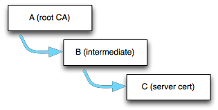

# Keys and Certificates

This chapter covers the key and certificate formats wolfSSL supports, how certificates and keys are loaded and verified, and how to generate keys, certificates and certificate signing requests.

## Supported Formats and Sizes

wolfSSL (formerly CyaSSL) has support for **PEM**, and **DER** formats for certificates and keys, as well as PKCS#8 private keys (with PKCS#5 or PKCS#12 encryption).

**PEM**, or “Privacy Enhanced Mail” is the most common format that certificates are issued in by certificate authorities. PEM files are Base64 encoded ASCII files which can include multiple server certificates, intermediate certificates, and private keys, and usually have a `.pem`, `.crt`, `.cer`, or `.key` file extension. Certificates inside PEM files are wrapped in the “`-----BEGIN CERTIFICATE-----`” and “`-----END CERTIFICATE-----`” statements.

**DER**, or “Distinguished Encoding Rules”, is a binary format of a certificate. DER file extensions can include `.der` and `.cer`, and cannot be viewed with a text editor.

An X.509 certificate is encoded using ASN.1 format. The DER format is the ASN.1 encoding. The PEM format is Base64 encoded and wrapped with a human readable header and footer. TLS sends certificates in DER format.

**PKCS #12**, also called PFX, is a password-protected bundle that carries a private key together with its certificate and CA chain in a single file, usually with a `.p12` or `.pfx` extension. wolfSSL can read and write these bundles through the wolfCrypt PKCS #12 API; see [PKCS #12](chapter04.md#pkcs-12) for details.

## Supported Certificate Extensions

    
If an unsupported or unknown extension that is marked as critical is found, then 
an error message is returned, otherwise unsupported or unknown extensions found 
are ignored. Most extensions are parsed in a default build. `--enable-certext`
(macro `WOLFSSL_CERT_EXT`), or `WOLFSSL_SEP`, is only needed to parse the
Certificate Policies extension and to generate extensions. This is a high level
list of certificate extensions that can be **parsed** and at least part, if not
all, of the extensions can be used.
    
| Extension From [RFC 5280](https://datatracker.ietf.org/doc/html/rfc5280#section-4.2) | Supported |
| ------------------------ | --------- |
| Authority Key Identifier | Yes |
| Subject Key Identifier | Yes |
| Key Usage | Yes |
| Certificate Policies | Yes (requires `WOLFSSL_CERT_EXT` or `WOLFSSL_SEP`) |
| Policy Mappings | No |
| Subject Alternative Name | Yes |
| Issuer Alternative Name | No |
| Subject Directory Attributes | Yes (with `WOLFSSL_SUBJ_DIR_ATTR`) |
| Basic Constraints | Yes |
| Name Constraints | Yes |
| Policy Constraints | Partial (parsed; rejected when critical unless `WOLFSSL_NO_ASN_STRICT`) |
| Extended Key Usage | Yes |
| CRL Distribution Points | Yes |
| Inhibit anyPolicy | Partial (not enforced; rejected when critical unless `WOLFSSL_NO_ASN_STRICT`) |
| Freshest CRL | No |
| Authority Information Access | Yes (rejected when critical unless `WOLFSSL_ALLOW_CRIT_AIA`) |
| Subject Information Access | Yes (with `WOLFSSL_SUBJ_INFO_ACC`) |
    
| Additional Extension | Supported |
| -------------------- | --------- |
| Netscape | Yes |
| Custom OID | Yes |
| OCSP No Check | Yes (with `HAVE_OCSP`) |
| Alternative public key and signature (SubjectAltPublicKeyInfo, AltSignatureAlgorithm, AltSignatureValue) | Yes (with `WOLFSSL_DUAL_ALG_CERTS`) |
| ACME identifier | Yes (with `WOLFSSL_ACME_OID`) |
    
The next couple of sections delve deeper into the support of the individual 
certificate extensions.
    
### Auth/Subject Key ID
    
By default key IDs are a SHA-1 hash of the key. SHA256 hashes of the key are 
also supported.
    
### Subject Alternative Names
    
    
| Alternative Name Types | Supported |
| ---------------------- | --------- |
| email | Yes |
| DNS name | Yes |
| IP address | Yes |
| URI | Yes |
| directory name | Yes |
| registered ID | Yes |
| other name | Yes (values decoded with `WOLFSSL_SEP` or `WOLFSSL_FPKI`: UPN, plus FASC-N with `WOLFSSL_FPKI` and hardware module name with `WOLFSSL_SEP`) |
    
### Key Usage
    
Key usage can be parsed and retrieved after parsing of the certificate is 
complete.
    
| Key Usage | Supported |
| --------- | --------- |
| digitalSignature | Yes |
| nonRepudiation | Yes |
| keyEncipherment | Yes |
| dataEncipherment | Yes |
| keyAgreement | Yes |
| keyCertSign | Yes |
| cRLSign | Yes |
| encipherOnly | Yes |
| decipherOnly | Yes |
    
### Extended Key Usage
    
Starting at wolfSSL version 3.15.5 if an extended key usage is 
unknown/unsupported then it is ignored. For versions before 3.15.5 an unknown 
extended key usage OID will cause a parsing error.
   
| Extended Key Usage | Supported |
| ------------------ | --------- |
| anyExtendedKeyUsage | Yes |
| id-kp-serverAuth | Yes |
| id-kp-clientAuth | Yes |
| id-kp-codeSigning | Yes |
| id-kp-emailProtection | Yes |
| id-kp-timeStamping | Yes |
| id-kp-OCSPSigning | Yes |
    
### Custom OID Extensions
    
Custom OID X.509 extension injection and parsing was introduced in wolfSSL
version 5.3.0. To set a custom extension in a `Cert` struct with
`wc_SetCustomExtension()`, the enable options `--enable-certgen` and
`--enable-certext` (`WOLFSSL_CERT_EXT`) must be used along with the macros
`WOLFSSL_CUSTOM_OID` and `HAVE_OID_ENCODING`. The ASN.1 template code
(`WOLFSSL_ASN_TEMPLATE`) is also required. It is the default for all builds,
including `WOLFSSL_USER_SETTINGS` builds, unless `WOLFSSL_ASN_ORIGINAL` is
defined.

To handle unknown extension OIDs when parsing a `DecodedCert` struct, register
a callback with `wc_SetUnknownExtCallback()`. This needs
`WC_ASN_UNKNOWN_EXT_CB`, which is enabled automatically when
`WOLFSSL_CUSTOM_OID`, `HAVE_OID_DECODING` and the ASN.1 template code are all
enabled. For certificates received in a TLS connection, register the callback
on the certificate manager with `wolfSSL_CertManagerSetUnknownExtCallback()`.
These callbacks receive the OID as an array of `word16` arcs, which truncates
arcs larger than 65535, so prefer the `word32` variants
`wc_SetUnknownExtCallback32()`, `wc_SetUnknownExtCallback32Ex()` and
`wolfSSL_CertManagerSetUnknownExtCallback32()`. The `...Ex` variants also pass
a user context to the callback.

The configure option `--enable-asn=all` (`WOLFSSL_ASN_ALL`) turns on
`WOLFSSL_CERT_EXT`, `WOLFSSL_CUSTOM_OID`, `HAVE_OID_ENCODING` and
`HAVE_OID_DECODING`.

### Strict DER Parsing

wolfSSL 5.9.4 rejects a certificate that carries trailing bytes after the DER structure, and only the certificate itself is copied into a `WOLFSSL_X509`. Define `WOLFSSL_NO_ASN_STRICT` to accept such certificates. The parser also rejects certificates with critical policyConstraints or inhibitAnyPolicy extensions, empty certificatePolicies, trailing bytes after the last PolicyInformation, or duplicate Netscape certificate type extensions. Extended Key Usage is enforced on every CA the peer transmits in its chain, not only on the leaf: a chain CA that does not carry the purpose in use fails the handshake with `EXTKEYUSE_AUTH_E`. A chain certificate that matches a loaded trust anchor (same subject and same public key) is exempt, as RFC 5280 keeps the anchor outside the certification path; a self-issued certificate with a different key, such as a key rollover certificate, is still checked. An absent extension and anyExtendedKeyUsage leave all purposes valid, and `IGNORE_KEY_EXTENSIONS` opts out.

## Certificate Loading

Certificates are normally loaded using the file system (although loading from memory buffers is supported as well - see [No File System and using Certificates](#no-file-system-and-using-certificates)).

### Loading CA Certificates

CA certificate files can be loaded using the [`wolfSSL_CTX_load_verify_locations()`](group__CertsKeys.md#function-wolfssl_ctx_load_verify_locations) function:

```c
int wolfSSL_CTX_load_verify_locations(WOLFSSL_CTX *ctx,
                                      const char *CAfile,
                                      const char *CApath);
```

CA loading can also parse multiple CA certificates per file using the above function by passing in a `CAfile` in PEM format with as many certs as possible. This makes initialization easier, and is useful when a client needs to load several root CAs at startup.  This makes wolfSSL easier to port into tools that expect to be able to use a single file for CAs.

**NOTE**: If you have to load a chain of Roots and Intermediate certificates you must load them in the order of trust. Load ROOT CA first followed by Intermediate 1 followed by Intermediate 2 and so on. You may call [`wolfSSL_CTX_load_verify_locations()`](group__CertsKeys.md#function-wolfssl_ctx_load_verify_locations) for each cert to be loaded or just once with a file containing the certs in order (Root at the top of the file and certs ordered by the chain of trust)

### Loading Client or Server Certificates

Loading single client or server certificates can be done with the [`wolfSSL_CTX_use_certificate_file()`](group__CertsKeys.md#function-wolfssl_ctx_use_certificate_file) function.  If this function is used with a certificate chain, only the actual, or “bottom” certificate will be sent.

```c
int wolfSSL_CTX_use_certificate_file(WOLFSSL_CTX* ctx,
                                     const char* file,
                                     int format);
```

`file` is the client or server (entity) certificate file, and `format` is its encoding, `WOLFSSL_FILETYPE_PEM` or `WOLFSSL_FILETYPE_ASN1`.

The server and client can send certificate chains using the [`wolfSSL_CTX_use_certificate_chain_file()`](group__CertsKeys.md#function-wolfssl_ctx_use_certificate_chain_file) function.  The certificate chain file must be in PEM format and must be sorted starting with the subject's certificate (the actual client or server cert), followed by any intermediate certificates and ending (optionally) at the root "top" CA.  The example server (`/examples/server/server.c`) uses this functionality.

**NOTE**: This is the exact reverse of the order necessary when loading a certificate chain for verification! Your file contents in this scenario would be Entity cert at the top of the file followed by the next cert up the chain and so on with Root CA at the bottom of the file.

```c
int wolfSSL_CTX_use_certificate_chain_file(WOLFSSL_CTX *ctx,
                                 const char *file);
```

### Loading Private Keys

Server private keys can be loaded using the [`wolfSSL_CTX_use_PrivateKey_file()`](group__CertsKeys.md#function-wolfssl_ctx_use_PrivateKey_file) function.

```c
int wolfSSL_CTX_use_PrivateKey_file(WOLFSSL_CTX *ctx,
                      const char *keyFile, int type);
```

`keyFile` is the private key file, and `type` is the format of the private key (e.g. `WOLFSSL_FILETYPE_PEM`).

### Loading Encrypted Private Keys

Password-protected (encrypted) PEM and PKCS #8 private keys can be loaded with the same functions when wolfSSL is built with `WOLFSSL_ENCRYPTED_KEYS` (`--enable-enckeys`, also enabled by `--enable-opensslextra`). Register a password callback before loading the key with `wolfSSL_CTX_set_default_passwd_cb()`, and optionally pass it user data with `wolfSSL_CTX_set_default_passwd_cb_userdata()`:

```c
int myPasswordCb(char* passwd, int sz, int rw, void* userdata)
{
    const char* pass = "my-key-password";
    int len = (int)strlen(pass);

    (void)rw;
    (void)userdata;
    if (len > sz)
        return -1;
    memcpy(passwd, pass, len);
    return len; /* length of the password */
}

wolfSSL_CTX_set_default_passwd_cb(ctx, myPasswordCb);
ret = wolfSSL_CTX_use_PrivateKey_file(ctx, "./server-key-enc.pem",
                                      WOLFSSL_FILETYPE_PEM);
```

The cipher used to encrypt the key must be enabled in the build. For example, the encrypted test keys in the wolfSSL `certs` directory use DES or 3DES, which are disabled by default.

### Loading Trusted Peer Certificates

Loading a trusted peer certificate to use can be done with [`wolfSSL_CTX_trust_peer_cert()`](group__Setup.md#function-wolfssl_ctx_trust_peer_cert).

```c
int wolfSSL_CTX_trust_peer_cert(WOLFSSL_CTX *ctx,
                 const char *trustCert, int type);
```

`trustCert` is the certificate file to load, and `type` is the format of the certificate (i.e. `WOLFSSL_FILETYPE_PEM`). Trusted peer certificates require wolfSSL to be built with [`WOLFSSL_TRUST_PEER_CERT`](chapter02.md#wolfssl_trust_peer_cert) defined. There is no dedicated configure option for it, so add it through `CFLAGS` (for example `./configure CFLAGS="-DWOLFSSL_TRUST_PEER_CERT"`).

### Loading System CA Certificates

The CA certificates trusted by the operating system can be loaded with `wolfSSL_CTX_load_system_CA_certs()`, which is available when wolfSSL is built with [`--enable-sys-ca-certs`](chapter02.md#--enable-sys-ca-certs) (enabled by default).

```c
int wolfSSL_CTX_load_system_CA_certs(WOLFSSL_CTX* ctx);
```

### Converting PEM to DER

To convert PEM data in memory to DER, wolfCrypt provides `wc_KeyPemToDer()` for private keys (with an optional password for encrypted keys), `wc_CertPemToDer()` for certificates, and the more general `wc_PemToDer()`, which takes the PEM type and returns a `DerBuffer`. They are declared in `wolfssl/wolfcrypt/asn_public.h`:

```c
int wc_KeyPemToDer(const unsigned char* pem, int pemSz,
                   unsigned char* buff, int buffSz, const char* pass);
int wc_CertPemToDer(const unsigned char* pem, int pemSz,
                    unsigned char* buff, int buffSz, int type);
```

## Certificate Chain Verification

wolfSSL requires only the top or “root” certificate in a chain to be loaded as a trusted certificate in order to verify a certificate chain. This means that if you have a certificate chain (A -\> B -\> C), where C is signed by B, and B is signed by A, wolfSSL only requires that certificate A be loaded as a trusted certificate in order to verify the entire chain (A-\>B-\>C).

For example, if a server certificate chain looks like:



The wolfSSL client should already have at least the root cert (A) loaded as a trusted root (with [`wolfSSL_CTX_load_verify_locations()`](group__CertsKeys.md#function-wolfssl_ctx_load_verify_locations)).  When the client receives the server cert chain, it uses the signature of A to verify B, and if B has not been previously loaded into wolfSSL as a trusted root, B gets stored in wolfSSL's internal cert chain (wolfSSL just stores what is necessary to verify a certificate: common name hash, public key and key type, etc.).  If B is valid, then it is used to verify C.

Following this model, as long as root cert "A" has been loaded as a trusted root into the wolfSSL client, the server certificate chain will still be able to be verified if the server sends (A-\>B-\>C), or (B-\>C).  If the server just sends (C), and not the intermediate certificate, the chain will not be able to be verified unless the wolfSSL client has already loaded B as a trusted root.

## Domain Name Check for Server Certificates

wolfSSL has an extension on the client that automatically checks the domain of the server certificate. In OpenSSL mode nearly a dozen function calls are needed to perform this. wolfSSL checks that the date of the certificate is in range, verifies the signature, and additionally verifies the domain if you call [`wolfSSL_check_domain_name(WOLFSSL* ssl, const char* dn)`](group__Setup.md#function-wolfssl_check_domain_name) before calling [`wolfSSL_connect()`](group__IO.md#function-wolfssl_connect). wolfSSL matches `dn` (the expected domain name) against the subjectAltName DNS entries of the peer's server certificate. It falls back to the subject Common Name only when the certificate has no subjectAltName DNS entry. If the names match [`wolfSSL_connect()`](group__IO.md#function-wolfssl_connect) will proceed normally, however if there is a name mismatch, [`wolfSSL_connect()`](group__IO.md#function-wolfssl_connect) will return a fatal error and [`wolfSSL_get_error()`](group__Debug.md#function-wolfssl_get_error) will return `DOMAIN_NAME_MISMATCH`.

Checking the domain name of the certificate is an important step that verifies the server is actually who it claims to be. This extension is intended to ease the burden of performing the check.

## No File System and using Certificates

Normally a file system is used to load private keys, certificates, and CAs. Since wolfSSL is sometimes used in environments without a full file system, an extension to use memory buffers instead is provided. The following functions are available in every build with certificate support (they do not depend on `NO_FILESYSTEM`), and are the only option when `NO_FILESYSTEM` is defined (`wolfSSL_CTX_trust_peer_buffer()` also needs `WOLFSSL_TRUST_PEER_CERT`):

* [`int wolfSSL_CTX_load_verify_buffer(WOLFSSL_CTX* ctx, const unsigned char* in,long sz, int format);`](group__CertsKeys.md#function-wolfssl_ctx_load_verify_buffer)
* [`int wolfSSL_CTX_use_certificate_buffer(WOLFSSL_CTX* ctx, const unsigned char* in, long sz, int format);`](group__CertsKeys.md#function-wolfssl_ctx_use_certificate_buffer)
* [`int wolfSSL_CTX_use_PrivateKey_buffer(WOLFSSL_CTX* ctx, const unsigned char* in, long sz, int format);`](group__CertsKeys.md#function-wolfssl_ctx_use_PrivateKey_buffer)
* [`int wolfSSL_CTX_use_certificate_chain_buffer(WOLFSSL_CTX* ctx, const unsigned char* in,long sz);`](group__CertsKeys.md#function-wolfssl_ctx_use_certificate_chain_buffer)
* [`int wolfSSL_CTX_trust_peer_buffer(WOLFSSL_CTX* ctx, const unsigned char* in, long sz, int format);`](group__Setup.md#function-wolfssl_ctx_trust_peer_buffer)

Use these functions exactly like their counterparts that are named `*_file` instead of `*_buffer`.  And instead of providing a filename provide a memory buffer.  See API documentation for usage details.

### Test Certificate and Key Buffers

wolfSSL comes bundled with test certificate and key files.  Additionally, it also comes bundled with test certificate and key buffers for use in environments with no filesystem available.  These buffers are available in `wolfssl/certs_test.h` when defining one or more of `USE_CERT_BUFFERS_1024`, `USE_CERT_BUFFERS_2048`, `USE_CERT_BUFFERS_3072`, `USE_CERT_BUFFERS_4096`, `USE_CERT_BUFFERS_256` or `USE_CERT_BUFFERS_25519`.

## Serial Number Retrieval

The serial number of an X.509 certificate can be extracted from wolfSSL using [`wolfSSL_X509_get_serial_number()`](group__openSSL.md#function-wolfssl_x509_get_serial_number).  The serial number can be of any length.

```c
int wolfSSL_X509_get_serial_number(WOLFSSL_X509* x509,
            unsigned char* buffer, int* inOutSz)
```

`buffer` will be written to with at most `*inOutSz` bytes on input. After the call, if successful (return of 0), `*inOutSz` will hold the actual number of bytes written to `buffer`. A full example is included in `wolfssl/test.h`.

## RSA Key Generation

wolfSSL supports RSA key generation of lengths from `RSA_MIN_SIZE` (2048 bits by default) up to `RSA_MAX_SIZE`, which depends on the math library configuration (`SP_INT_BITS` or `FP_MAX_BITS`). Key generation is off by default but can be turned on during the `./configure` process with `--enable-keygen` or by defining `WOLFSSL_KEY_GEN` in Windows or non-standard environments. Creating a key is easy, only requiring one function from `rsa.h`:

```c
int wc_MakeRsaKey(RsaKey* key, int size, long e, WC_RNG* rng);
```

Where `size` is the length in bits and `e` is the public exponent (using 65537 is usually a good choice for `e`). The following, based on `wolfcrypt/test/test.c`, gives an example creating an RSA key of 2048 bits:

```c
RsaKey genKey;
WC_RNG rng;
int    ret;

ret = wc_InitRng(&rng);
if (ret != 0)
    /* ret contains error */;
ret = wc_InitRsaKey(&genKey, NULL);
if (ret != 0)
    /* ret contains error */;

ret = wc_MakeRsaKey(&genKey, 2048, 65537, &rng);
if (ret != 0)
    /* ret contains error */;
```

When they are no longer needed, free the key and RNG with `wc_FreeRsaKey(&genKey)` and `wc_FreeRng(&rng)`.

The RsaKey `genKey` can now be used like any other RsaKey. If you need to export the key, `wc_RsaKeyToDer()` (declared in `rsa.h`) encodes it as DER, and `wc_DerToPem()` (declared in `asn_public.h`) converts DER to PEM. `wc_DerToPem()` needs `WOLFSSL_DER_TO_PEM`, which `--enable-keygen`, `--enable-certgen` and `--enable-opensslextra` enable automatically. Always convert the key to DER format first, and then if you need PEM use the generic `wc_DerToPem()` function like this:

```c
byte der[4096];
int  derSz = wc_RsaKeyToDer(&genKey, der, sizeof(der));
if (derSz < 0)
    /* derSz contains error */;
```

The buffer `der` now holds a DER format of the key. To convert the DER buffer to PEM use the conversion function:

```c
byte pem[4096];
int  pemSz = wc_DerToPem(der, derSz, pem, sizeof(pem),
                      PRIVATEKEY_TYPE);
if (pemSz < 0)
    /* pemSz contains error */;
```

The last argument of _DerToPem()_ takes a type parameter, usually either `PRIVATEKEY_TYPE` or `CERT_TYPE`. Now the buffer `pem` holds the PEM format of the key. Supported types are listed below. Some are only available when the matching feature is compiled in (for example `CERTREQ_TYPE` needs `WOLFSSL_CERT_REQ` and `ED448_TYPE` needs `HAVE_ED448`):

* `CA_TYPE`
* `TRUSTED_PEER_TYPE`
* `CHAIN_CERT_TYPE`
* `CERT_TYPE`
* `TRUSTED_CERT_TYPE`
* `CRL_TYPE`
* `DH_PARAM_TYPE`
* `X942_PARAM_TYPE`
* `DSA_PARAM_TYPE`
* `CERTREQ_TYPE`
* `PKCS7_TYPE`
* `ACERT_TYPE`
* `DSA_TYPE`
* `DSA_PRIVATEKEY_TYPE`
* `ECC_TYPE`
* `ECC_PRIVATEKEY_TYPE`
* `ECC_PARAM_TYPE`
* `RSA_TYPE`
* `PRIVATEKEY_TYPE`
* `ED25519_TYPE`
* `ED448_TYPE`
* `EDDSA_PRIVATEKEY_TYPE`
* `FALCON_LEVEL1_TYPE`, `FALCON_LEVEL5_TYPE`
* `ML_DSA_44_TYPE`, `ML_DSA_65_TYPE`, `ML_DSA_87_TYPE`
* `SLH_DSA_SHAKE_128F_TYPE`, `SLH_DSA_SHAKE_192F_TYPE`, `SLH_DSA_SHAKE_256F_TYPE`, `SLH_DSA_SHAKE_128S_TYPE`, `SLH_DSA_SHAKE_192S_TYPE`, `SLH_DSA_SHAKE_256S_TYPE` and the matching `SLH_DSA_SHA2_*_TYPE` values
* `PUBLICKEY_TYPE`
* `ECC_PUBLICKEY_TYPE`
* `RSA_PUBLICKEY_TYPE`
* `DH_PRIVATEKEY_TYPE`
* `PKCS8_PRIVATEKEY_TYPE`
* `PKCS8_ENC_PRIVATEKEY_TYPE`

### RSA Key Generation Notes

The RSA private key contains the public key as well.  The private key can be used as both a private and public key by wolfSSL as used in test.c. The private key and the public key (in the form of a certificate) is all that is typically needed for SSL.

A separate public key can be loaded into wolfSSL manually using the wc_RsaPublicKeyDecode() function if need be. Additionally, the [`wc_RsaKeyToPublicDer()`](group__RSA.md#function-wc_rsakeytopublicder) function can be used to export the public RSA key.

## ECC and Ed25519 Key Generation

ECC keys are generated with `wc_ecc_make_key()` from `ecc.h`, where the key size is given in bytes (32 for the default P-256 curve). `wc_ecc_make_key_ex()` also takes a curve ID. Ed25519 keys (`--enable-ed25519`) are generated with `wc_ed25519_make_key()` from `ed25519.h`, where the key size must be `ED25519_KEY_SIZE` (32). Using the `rng` from the RSA example above:

```c
ecc_key     eccKey;
ed25519_key edKey;

ret = wc_ecc_init(&eccKey);
if (ret == 0)
    ret = wc_ecc_make_key(&rng, 32, &eccKey);
if (ret != 0)
    /* ret contains error */;

ret = wc_ed25519_init(&edKey);
if (ret == 0)
    ret = wc_ed25519_make_key(&rng, ED25519_KEY_SIZE, &edKey);
if (ret != 0)
    /* ret contains error */;
```

Free the keys with `wc_ecc_free()` and `wc_ed25519_free()` when done. `wc_EccKeyToDer()` (see [Exporting an ECC Key to DER](#exporting-an-ecc-key-to-der)) and `wc_Ed25519KeyToDer()` export them in DER format.

## Certificate Generation

wolfSSL supports X.509 v3 certificate generation. Certificate generation is off by default but can be turned on during the `./configure` process with `--enable-certgen` or by defining `WOLFSSL_CERT_GEN` in Windows or non-standard environments.

Before a certificate can be generated the user needs to provide information about the subject of the certificate. This information is contained in a structure from `wolfssl/wolfcrypt/asn_public.h` named `Cert`:

```c
/* for user to fill for certificate generation */
typedef struct Cert {
    int      version;                   /* x509 version  */
    byte     serial[CTC_SERIAL_SIZE];   /* serial number */
    int      serialSz;                  /* serial size */
    int      sigType;                   /* signature algo type */
    CertName issuer;                    /* issuer info */
    CertName subject;                   /* subject info */
    int      daysValid;                 /* validity days */
    int      selfSigned;                /* self signed flag */
    int      isCA;                      /* is this going to be a CA */
    byte     pathLen;                   /* max depth of valid certification
                                         * paths that include this cert */
    ...
} Cert;
```

Where CertName looks like this (excerpt; see `asn_public.h` for the full definition):

```c
typedef struct CertName {
    char country[CTC_NAME_SIZE];
    char countryEnc;
    char state[CTC_NAME_SIZE];
    char stateEnc;
    char street[CTC_NAME_SIZE];
    char streetEnc;
    char locality[CTC_NAME_SIZE];
    char localityEnc;
    char sur[CTC_NAME_SIZE];
    char surEnc;
    ...
    char org[CTC_NAME_SIZE];
    char orgEnc;
    char unit[CTC_NAME_SIZE];
    char unitEnc;
    char commonName[CTC_NAME_SIZE];
    char commonNameEnc;
    char serialDev[CTC_NAME_SIZE];
    char serialDevEnc;
    char userId[CTC_NAME_SIZE];
    char userIdEnc;
    char postalCode[CTC_NAME_SIZE];
    char postalCodeEnc;
    ...
    char email[CTC_NAME_SIZE];  /* !!!! email has to be last !!!! */
    ...
} CertName;
```

With `WOLFSSL_CERT_NAME_ALL` the structure also has `givenName`, `initials`, `dnQualifier` and `dnName` fields, and with `WOLFSSL_CERT_EXT` it has `busCat`, `joiC` and `joiSt` fields. These come before `email`. After `email` come `name[]` (with `WOLFSSL_MULTI_ATTRIB`) and `custom` (with `WOLFSSL_CUSTOM_OID`).

Before filling in the subject information an initialization function needs to be called like this:

```c
Cert myCert;
wc_InitCert(&myCert);
```

`wc_InitCert()` sets defaults for some of the variables including setting the version to **3** (0x02), the serial number to **0** (randomly generated), the sigType to `CTC_SHA256wRSA` (falling back to SHA-384, SHA-512, SHA-224 or SHA-1 with RSA if SHA-256 is disabled), the daysValid to **500**, and selfSigned to **1** (TRUE). Supported signature types include the following, each available when the matching algorithm is compiled in:

* `CTC_SHAwDSA`, `CTC_SHA256wDSA`
* `CTC_MD2wRSA`
* `CTC_MD5wRSA`
* `CTC_SHAwRSA`
* `CTC_SHAwECDSA`
* `CTC_SHA224wRSA`
* `CTC_SHA224wECDSA`
* `CTC_SHA256wRSA`
* `CTC_SHA256wECDSA`
* `CTC_SHA384wRSA`
* `CTC_SHA384wECDSA`
* `CTC_SHA512wRSA`
* `CTC_SHA512wECDSA`
* `CTC_SHA3_224wRSA`, `CTC_SHA3_256wRSA`, `CTC_SHA3_384wRSA`, `CTC_SHA3_512wRSA`
* `CTC_SHA3_224wECDSA`, `CTC_SHA3_256wECDSA`, `CTC_SHA3_384wECDSA`, `CTC_SHA3_512wECDSA`
* `CTC_RSASSAPSS`
* `CTC_ED25519`
* `CTC_ED448`
* `CTC_ML_DSA_44`, `CTC_ML_DSA_65`, `CTC_ML_DSA_87`
* `CTC_SLH_DSA_SHAKE_128F`, `CTC_SLH_DSA_SHAKE_192F`, `CTC_SLH_DSA_SHAKE_256F`, `CTC_SLH_DSA_SHAKE_128S`, `CTC_SLH_DSA_SHAKE_192S`, `CTC_SLH_DSA_SHAKE_256S` and the matching `CTC_SLH_DSA_SHA2_*` values
* `CTC_FALCON_LEVEL1`, `CTC_FALCON_LEVEL5`
* `CTC_HSS_LMS`
* `CTC_XMSS`, `CTC_XMSSMT`
* `CTC_SM3wSM2`

Now the user can initialize the subject information like this example from `wolfcrypt/test/test.c`:

```c
strncpy(myCert.subject.country, "US", CTC_NAME_SIZE);
strncpy(myCert.subject.state, "OR", CTC_NAME_SIZE);
strncpy(myCert.subject.locality, "Portland", CTC_NAME_SIZE);
strncpy(myCert.subject.org, "yaSSL", CTC_NAME_SIZE);
strncpy(myCert.subject.unit, "Development", CTC_NAME_SIZE);
strncpy(myCert.subject.commonName, "www.wolfssl.com", CTC_NAME_SIZE);
strncpy(myCert.subject.email, "facts@wolfssl.com", CTC_NAME_SIZE);
```

Then, a self-signed certificate can be generated using the variables genKey and rng from the above key generation example (of course any valid RsaKey or RNG can be used):

```c
byte derCert[4096];

int certSz = wc_MakeSelfCert(&myCert, derCert, sizeof(derCert), &genKey, &rng);
if (certSz < 0)
  /* certSz contains the error */;
```

The buffer `derCert` now contains a DER format of the certificate. If you need a PEM format of the certificate you can use the generic `wc_DerToPem()` function and specify the type to be `CERT_TYPE` like this:

```c
byte pemCert[4096];

int pemCertSz = wc_DerToPem(derCert, certSz, pemCert, sizeof(pemCert), CERT_TYPE);
if (pemCertSz < 0)
  /* pemCertSz contains error */;
```

The supported types are listed in [RSA Key Generation](#rsa-key-generation) above.

Now the buffer `pemCert` holds the PEM format of the certificate.

If you wish to create a CA signed certificate then a couple of steps are required. After filling in the subject information as before, you'll need to set the issuer information from the CA certificate.  This can be done with `wc_SetIssuer()`, which reads the CA certificate from a PEM file (so it needs filesystem support), like this:

```c
ret = wc_SetIssuer(&myCert, "./certs/ca-cert.pem");
if (ret < 0)
    /* ret contains error */;
```

Without a filesystem, use `wc_SetIssuerBuffer()`, which takes the CA certificate as a DER buffer.

Then you’ll need to perform the two-step process of creating the certificate and then signing it (`wc_MakeSelfCert()` does these both in one step). You’ll need the private keys from both the issuer (`caKey`) and the subject (`key`). Please see the example in `test.c` for complete usage.

```c
byte derCert[4096];

int certSz = wc_MakeCert(&myCert, derCert, sizeof(derCert), &key, NULL, &rng);
if (certSz < 0)
   /*certSz contains the error*/;

certSz = wc_SignCert(myCert.bodySz, myCert.sigType, derCert,
            sizeof(derCert), &caKey, NULL, &rng);
if (certSz < 0)
   /*certSz contains the error*/;
```

The buffer `derCert` now contains a DER format of the CA signed certificate, and `certSz`, the return value of `wc_SignCert()`, is its total size.  If you need a PEM format of the certificate please see the self signed example above.  Note that `wc_MakeCert()` and `wc_SignCert()` provide function parameters for either an RSA or ECC key to be used.  The above example uses an RSA key and passes NULL for the ECC key parameter. For other key types, `wc_MakeCert_ex()`, `wc_SignCert_ex()` and `wc_MakeCertReq_ex()` take a `keyType` (for example `RSA_TYPE`, `ECC_TYPE`, `ED25519_TYPE`, `ED448_TYPE`, `ML_DSA_65_TYPE` or one of the SLH-DSA types) and a `void* key`.

## Certificate Signing Request (CSR) Generation

wolfSSL supports X.509 v3 certificate signing request (CSR) generation. CSR generation is off by default but can be turned on during the `./configure` process with `--enable-certreq --enable-certgen` or by defining `WOLFSSL_CERT_GEN` **and** `WOLFSSL_CERT_REQ` in Windows or non-standard environments.

Before a CSR can be generated the user needs to provide information about the subject of the certificate. This information is contained in a structure from `wolfssl/wolfcrypt/asn_public.h` named `Cert`:

For details on the Cert and CertName structures please reference [Certificate Generation](#certificate-generation) above.

Before filling in the subject information an initialization function needs to be called like this:

```c
Cert req;
wc_InitCert(&req);
```

`wc_InitCert()` sets the same defaults as described in [Certificate Generation](#certificate-generation) above, and the same signature types are supported.

Now the user can initialize the subject information like this example from <https://github.com/wolfSSL/wolfssl-examples/blob/master/certgen/csr_example.c>:

```c
strncpy(req.subject.country, "US", CTC_NAME_SIZE);
strncpy(req.subject.state, "OR", CTC_NAME_SIZE);
strncpy(req.subject.locality, "Portland", CTC_NAME_SIZE);
strncpy(req.subject.org, "wolfSSL", CTC_NAME_SIZE);
strncpy(req.subject.unit, "Development", CTC_NAME_SIZE);
strncpy(req.subject.commonName, "www.wolfssl.com", CTC_NAME_SIZE);
strncpy(req.subject.email, "facts@wolfssl.com", CTC_NAME_SIZE);
```

Then, a CSR can be generated. This example uses an ECC key, `ecc_key key`, that has been initialized and generated with `wc_ecc_make_key()` as shown in [ECC and Ed25519 Key Generation](#ecc-and-ed25519-key-generation) (of course any valid ECC/RSA key can be used):

```c
byte der[4096]; /* Store request in der format once made */
int  derSz;

ret = wc_MakeCertReq(&req, der, sizeof(der), NULL, &key);
/* check ret value for error handling, <= 0 indicates a failure */
```

Next you will want to sign your request making it valid, use the rng variable from the above key generation example (of course any valid ECC/RSA key or RNG can be used). `wc_SignCert()` returns the total size of the signed request:

```c
req.sigType = CTC_SHA256wECDSA;
derSz = wc_SignCert(req.bodySz, req.sigType, der, sizeof(der), NULL, &key, &rng);
/* check derSz for error handling, <= 0 indicates a failure */
```

Lastly it is time to convert the CSR to PEM format for sending to a CA authority to use in issuing a certificate. The PEM output is not NUL terminated, so use the returned length:

```c
byte pem[4096];

ret = wc_DerToPem(der, derSz, pem, sizeof(pem), CERTREQ_TYPE);
/* check ret value for error handling, <= 0 indicates a failure */
printf("%.*s", ret, (char*)pem); /* or write to a file */
```

### Using a CSR

With `WOLFSSL_CERT_REQ` defined, the wolfSSL certificate parser also accepts a CSR when it is given the `CERTREQ_TYPE` type. The OpenSSL compatibility layer (`--enable-opensslextra`) can load and verify CSRs, for example with `wolfSSL_X509_REQ_d2i()`, `wolfSSL_PEM_read_bio_X509_REQ()` and `wolfSSL_X509_REQ_verify()`. A certificate can be issued from a CSR by copying the subject name and public key of the request (`X509_REQ_get_subject_name()` and `X509_REQ_get_pubkey()`) into a new `WOLFSSL_X509`, setting the issuer, serial number and validity, and signing it with `wolfSSL_X509_sign()`.

**See also**: [Certificate Generation](#certificate-generation)

## Exporting an ECC Key to DER

`wc_EccKeyToDer()` encodes an `ecc_key` structure, holding a private key, as DER:

```c
int wc_EccKeyToDer(ecc_key* key, byte* output, word32 outLen);
```

It returns the size of the DER encoding, or a negative error code. Related functions are:

* `wc_EccPrivateKeyToDer()`, which encodes only the private key, without the public key.
* `wc_EccPublicKeyToDer()`, which encodes the public key.
* `wc_KeyPemToDer()`, which converts a PEM private key to DER (see [Converting PEM to DER](#converting-pem-to-der)).
* `wc_ecc_import_raw()`, `wc_ecc_export_private_raw()` and `wc_ecc_export_public_raw()`, which import and export the raw key values.

### Example

```c
#define FOURK_BUF 4096
byte    der[FOURK_BUF];
int     derSz;
ecc_key userB;

ret = wc_ecc_init(&userB);
if (ret == 0)
    ret = wc_ecc_make_key(&rng, 32, &userB);
if (ret == 0) {
    derSz = wc_EccKeyToDer(&userB, der, FOURK_BUF);
    if (derSz < 0)
        /* derSz contains error */;
}
```
